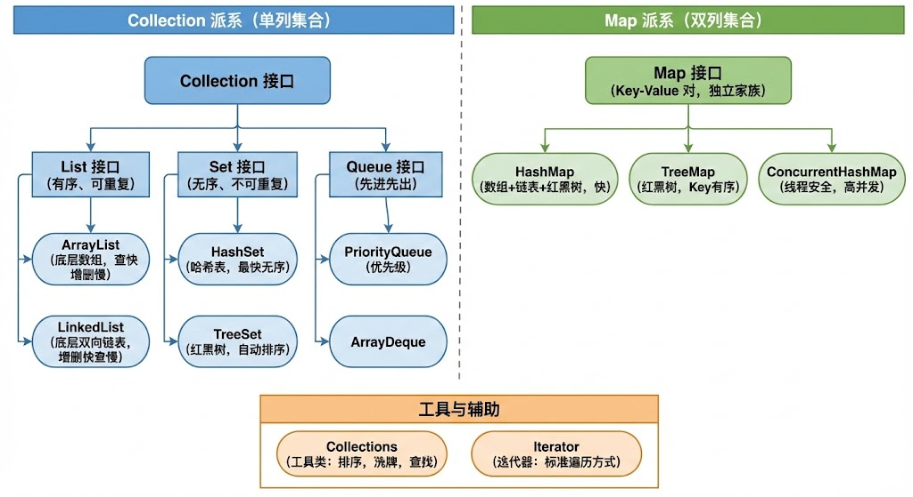

**Java 集合框架主要由两大接口派系组成——负责存储“单体对象”的** `**Collection**` **和负责存储“键值对”的** `**Map**`**。**

为了回答得有条理，我们可以把整个框架拆解为 **“三大接口”** 和 **“一个工具类”** 来讲：

1. Collection 派系（单列集合）

这是存储单个元素的顶层接口，它下面有三个最重要的子接口：

- **List（有序、可重复）：**
    - **特点：** 像排队一样，怎么存进去就怎么取出来，元素可以通过下标访问。
    - **核心实现：**
        - `**ArrayList**`**：** 底层是**数组**。查询快（下标直达），增删慢（要移动数据）。这是最常用的。
        - `**LinkedList**`**：** 底层是**双向链表**。增删快（改指针就行），查询慢（得一个个挨着找）。
- **Set（无序、不可重复）：**
    - **特点：** 也就是数学上的“集合”，里面的元素独一无二。
    - **核心实现：**
        - `**HashSet**`**：** 基于哈希表实现，速度最快，但完全无序。
        - `**TreeSet**`**：** 基于红黑树实现，虽然慢点，但是能让元素**自动排序**。
- **Queue（队列）：**
    - **特点：** 先进先出（FIFO）。
    - **核心实现：**`PriorityQueue`（优先级队列）和 `ArrayDeque`。
1. **Map 派系（双列集合）**
- **特点：** 存储 Key-Value 对。Key 是唯一的，Value 可以重复。**注意：Map 不继承 Collection 接口，它是独立的一个家族。**
- **核心实现：**
    - `**HashMap**`**：** 底层是“数组 + 链表 + 红黑树”（JDK 8）。查询和插入速度极快，非线程安全。
    - `**TreeMap**`**：** 基于红黑树，Key 是有序的。
    - `**ConcurrentHashMap**`**：** 线程安全的 HashMap，高并发场景必备。
1. **工具类**
    1. `**Collections**`**：** 注意后面有个 `s`。它不是集合，而是操作集合的**工具类**，提供了排序（sort）、洗牌（shuffle）、二分查找等静态方法。
    2. `**Iterator**`**：** 迭代器，用于遍历集合的标准方式。

---

### 面试标准回答

Java 集合框架主要封装了一套用于存储和操作数据的标准架构。从顶层设计来看，它主要分为**两大根接口**：

**第一是** `**Collection**` **接口**，用于存储单个元素，它衍生出了三个主要分支：

- **List**：代表有序、可重复的列表。最常用的是基于数组的 `ArrayList`（查询快）和基于链表的 `LinkedList`（增删快）。
- **Set**：代表无序、不可重复的集合。最常用的是 `HashSet`，底层其实就是个 HashMap；如果需要排序则使用 `TreeSet`。
- **Queue**：代表队列，遵循 FIFO 原则，常用于并发编程中的缓冲。

**第二是** `**Map**` **接口**（注意它不继承 Collection），用于存储 Key-Value 映射关系：

- 最核心的是 `**HashMap**`，它在 JDK 8 中采用了‘数组+链表+红黑树’的结构，性能极高。
- 如果涉及多线程并发，我们会使用 `**ConcurrentHashMap**`。
- 如果需要 Key 有序，我们会使用 `**TreeMap**`。

### 购买了课程的同学，本八股动画视频持续更新！

### 后续视频更新也会在群里分享，一定要先进群！
