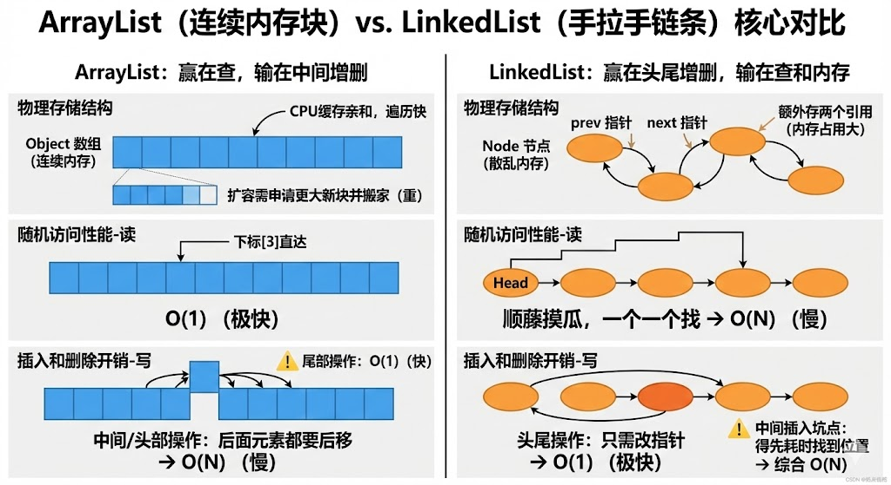

**ArrayList 是“连续的内存块”，赢在查，输在中间增删；LinkedList 是“手拉手的链条”，赢在头尾增删，输在查和内存占用。**

具体对比从以下 **3 个维度** 拆解：

1. **物理存储结构**
- **ArrayList：** 底层是 **Object 数组**。
    - 必须占用一块**连续**的内存空间。
    - **优点：** 极其亲和 CPU 缓存，遍历速度快。
    - **缺点：** 扩容时需要申请新的大块内存并搬家，比较重。
- **LinkedList：** 底层是 **双向链表**（Node 节点）。
    - 内存是**散乱**分布在堆中的，靠 `prev` 和 `next` 指针连在一起。
    - **缺点：** 每个节点都要多存两个引用（64位系统下额外占 16 字节），内存占用比 ArrayList 大得多。
1. **随机访问性能（读）**
- **ArrayList：****O(1)**。
    - 它是数组，知道首地址和下标，直接算一下偏移量就能拿到数据。这是它的看家本领。
- **LinkedList：****O(N)**。
    - 它没有下标的概念。你要找第 100 个元素，只能从头（或尾）开始，一个一个节点顺藤摸瓜找过去，速度极慢。
1. **插入和删除开销（写）**
- **ArrayList：**
    - **尾部操作：** O(1)。很快。
    - **中间/头部操作：****O(N)**。极慢。因为你要把插入点后面的所有元素都往后挪一位。
- **LinkedList：**
    - **操作本身：****O(1)**。只需要断开指针，再连上新的就行，不用移动数据。
    - **但在实际场景中（有个坑）：** 如果你要在“第 i 个位置”插入，你得先耗费 O(N) 的时间**找到**这个位置。所以综合来看，只有在操作**头尾**时，LinkedList 才有绝对优势。

---

### 面试标准回答

ArrayList 和 LinkedList 是 List 接口的两种不同实现，它们的适用场景完全相反：

**第一，在底层结构上**：

- **ArrayList** 基于动态数组，数据在内存中是**连续存储**的。这使得它非常利用 CPU 缓存，遍历效率极高。
- **LinkedList** 基于双向链表，数据是**分散存储**的。每个节点除了数据外，还要额外维护 `prev` 和 `next` 指针，因此**内存占用**明显高于 ArrayList。

**第二，在随机访问上**：

- **ArrayList** 支持高效的随机访问，时间复杂度是 **O(1)**。
- **LinkedList** 必须从头或尾遍历查找，时间复杂度是 **O(N)**。

**第三，在增删操作上**：

- **ArrayList** 在**尾部**增删很快，但在中间或头部增删时，需要**移动**后续所有元素，开销较大。
- **LinkedList** 的优势在于**修改指针**的代价极低（O(1)）。但是，如果我们要向‘指定索引’插入数据，还是需要先遍历找到那个节点，这部分开销依然是 O(N)。
