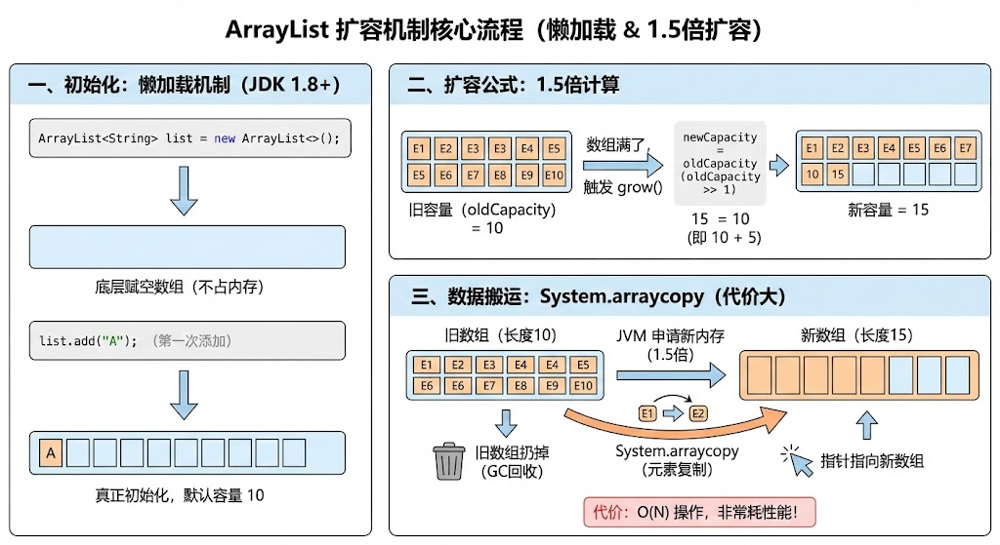

ArrayList 的扩容机制**是一种“懒加载”机制，默认初始容量为 10（但第一次 add 时才创建），每次扩容增加到原来的 1.5 倍，底层通过数组拷贝来实现。**

### 初始化

- **以前（JDK 1.7）：** 你 `new ArrayList()` 的时候，底层直接给你创建一个长度为 10 的数组。
- **现在（JDK 1.8+）：** 变成了 **“懒加载”**。
    - 当你 `new ArrayList()` 时，底层只是赋了一个**空数组**。
    - 只有当你第一次调用 `add()` 方法添加元素时，它才会被真正初始化为默认容量 **10**。
    - **目的：** 省内存。如果你 new 了不用，就不占空间。

### 扩容公式：1.5 倍是怎么算的？

- 当数组满了，再往里加元素时，会触发 `grow()` 方法。
- **核心代码：**`int newCapacity = oldCapacity + (oldCapacity >> 1);`
    - `oldCapacity` 是旧容量。
    - `>> 1` 是右移一位，相当于除以 2。
    - 所以结果就是：**旧容量 + 0.5 * 旧容量 = 1.5 * 旧容量**。
    - 举例：如果当前是 10，扩容后就是 15；如果当前是 15，扩容后就是 15 + 7 = 22（取整）。

### 数据搬运：System.arraycopy

- 算出新容量后，ArrayList 没法直接给旧数组“接一段”内存（数组物理地址是连续的，没法接）。
- **动作：**
    - JVM 申请一块新的内存空间（长度为 1.5 倍）。
    - 调用 `System.arraycopy`把旧数组里的所有元素，一个个**复制**到新数组里。
    - 把旧数组扔掉（等待 GC 回收），指针指向新数组。
- **代价：** 这是一个 **O(N)** 的操作，非常耗性能。

---

### 面试标准回答（建议背诵）

ArrayList 的扩容策略主要包含以下几个关键点：

第一，初始化的懒加载：

在 JDK 1.8 中，使用无参构造器创建 ArrayList 时，默认赋值的是一个空数组。只有在第一次 add 添加元素时，才会初始化为默认容量 10。

第二，1.5 倍的扩容逻辑：

当数组填满需要扩容时，新的容量是旧容量的 1.5 倍。

源码中使用的是位运算 oldCapacity + (oldCapacity >> 1)，这种方式比普通的除法运算效率更高。

第三，底层的数据拷贝：

扩容本质上是创建一个更大的新数组，然后使用 System.arraycopy 将旧数据复制过去。

<u>（关键补充）：</u>

由于数组复制是一个耗时的 O(N) 操作，所以在实际开发中，如果我们预先知道数据量的大小（比如从数据库查出 1000 条数据），我一定会直接使用 new ArrayList&lt;>(1000) 来指定初始容量，从而避免中间多次扩容带来的性能损耗。
