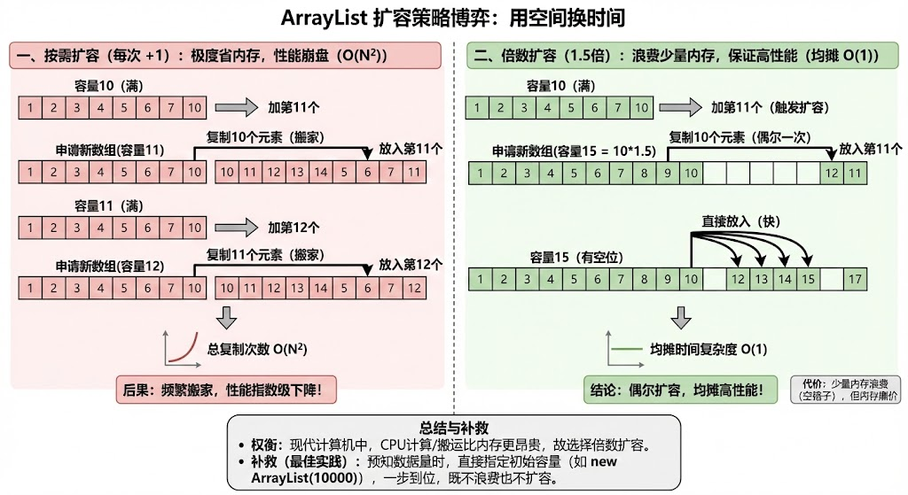

**这是一个典型的“用空间换时间”的设计。按需扩容（每次+1）虽然极度节省内存，但会导致性能崩盘；倍数扩容（1.5倍）虽然会浪费少量内存，但能保证插入操作的高性能（均摊 O(1)）。**

具体的原因可以从**时间复杂度**和**空间复杂度**的博弈来拆解：

### 为什么不能按需扩容（每次 +1）？

假设 ArrayList 现在的容量是 10，你要添加第 11 个元素。

如果采用“按需扩容”策略，也就是把容量变成 11：

1. 申请一个长度为 11 的新数组。
2. 把原来 10 个元素复制过去（`System.arraycopy`）。
3. 放入第 11 个元素。
4. **下一次：** 当你放第 12 个元素时，又要申请长度 12 的数组，再把 11 个元素复制过去。

**后果：**

- 每添加一个元素，都要把之前所有的老底搬一次家。
- 如果你要添加 N 个元素，总的复制次数就是 `1 + 2 + 3 + ... + N`。
- 这是一个等差数列求和，时间复杂度是 $$O(N^2)$$。
- **结论：** 随着数据量变大，性能会呈指数级下降，这是绝对不可接受的。

### 为什么要倍数扩容？

现在的策略是扩容 1.5 倍（或者 C++ Vector 的 2 倍）。

这意味着扩容操作是“偶尔”发生的，而不是“每次”发生的。

- 虽然某一次扩容操作（比如从 1000 扩到 1500）会比较耗时（因为要复制 1000 个数据）。
- 但是，接下来的 500 次 `add` 操作，都是直接往空位里放，不需要扩容，速度极快。
- **均摊复杂度：** 把那一次昂贵的扩容成本，分摊到这 500 次操作头上，每一次操作的平均成本依然是 $$O(1) $$。

### 会导致内存浪费吗？

- **现状：** 是的，会浪费。比如扩容到 1500，但你只存了 1001 个，那剩下的 499 个格子就是空的，确实浪费了内存。
- **权衡：** 在现代计算机体系中，**内存是相对廉价的资源，而 CPU 计算和数据搬运是最昂贵的资源**。
- **补救：**
    - 或者在创建时就**指定初始容量**（`new ArrayList(10000)`），一步到位，既不浪费也不扩容。

---

### 面试标准回答

ArrayList 之所以不采用‘按需扩容’（每次只加 1），是因为这在性能上是不可接受的。

核心原因在于时间复杂度：

数组的扩容涉及到内存申请和数据拷贝。如果每次 add 都扩容，添加 N 个元素就需要搬运 1+2+...+N 次数据，会导致时间复杂度退化为 $$O(N^2) $$。

而采用倍数扩容（1.5 倍）是一种‘空间换时间’的策略：

虽然它会预留一部分空闲内存，导致一定的空间浪费，但它能保证扩容是‘低频’发生的。

将单次扩容的高耗时分摊到后续的多次插入操作中，使得单次插入的均摊时间复杂度保持在 $$O(1)$$。

当然，为了减少这种内存浪费和扩容开销，我们在实际开发中，如果能预估数据量，最佳实践依然是在构造时直接指定 initialCapacity。
