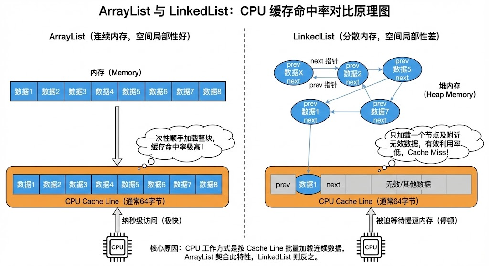

这是一个非常显现**底层功底**的问题。很多教科书只会告诉你链表增删快，但实际上在现代高配机器上，ArrayList 即使做插入操作，有时也比 LinkedList 快，原因就在于 **CPU 缓存**。

**ArrayList 的内存是连续的，完美契合了 CPU 的“空间局部性”原理，缓存命中率极高；而 LinkedList 的内存是分散的，遍历时会导致大量的 Cache Miss，CPU 只能被迫等待慢速内存。**

### 空间局部性与 Cache Line

- **CPU 的工作方式：** CPU 并不是需要 1 个字节就去内存里拿 1 个字节。内存太慢了。
    - **Cache Line：** CPU 每次去内存拿数据，都会一次性拿一块连续的数据（通常是 **64 字节**），这叫一个 **Cache Line**。
- **ArrayList：**
        - 因为它的数据是**物理连续**的。
        - 当你访问 `arr[0]` 时，CPU 顺手把 `arr[1]`、`arr[2]`... `arr[7]` 全都加载到了 L1 缓存里。
        - 接下来你要访问 `arr[1]` 时，发现它已经在缓存里了，直接拿来用，速度是纳秒级的。
- **LinkedList：**
        - 节点是 `new` 出来的，散落在堆内存的各个角落，物理上**不连续**。
        - 访问 `node1` 时，Cache Line 里顺手加载了 `node1` 附近的内存，但 `node2` 可能在十万八千里外。
        - 结果就是 CPU 必须重新去慢速内存里找 `node2`，这会导致 CPU 停顿。

### 数据密度

- **ArrayList：** 存的全是干货（数据本身）。
- **LinkedList：** 每个节点除了存数据，还要存 `prev` 和 `next` 指针（在 64 位系统上占 16 字节）。
- **后果：** 同样的 64 字节 Cache Line，ArrayList 能装 8 个 long 类型的数据，LinkedList 算上指针开销可能只能装 2 个数据。这相当于缓存的**有效利用率**变低了。

---

### 面试标准回答

虽然从时间复杂度上看，LinkedList 在增删操作上有优势，但在现代 CPU 架构下，**ArrayList 的实际性能往往更好**，这主要是由于 **CPU 缓存机制** 决定的。

**核心原因在于‘空间局部性’：**

CPU 读取内存时是以 Cache Line（通常 64 字节） 为单位的。

- **ArrayList** 的内存是**连续**的。读取第一个元素时，后续的元素往往已经被一同加载到了 L1/L2 缓存中，访问速度极快。
- **LinkedList** 的节点分散在堆内存各处。遍历时需要通过指针跳跃，极易导致 **Cache Miss**，迫使 CPU 频繁等待主内存，性能损耗巨大。
