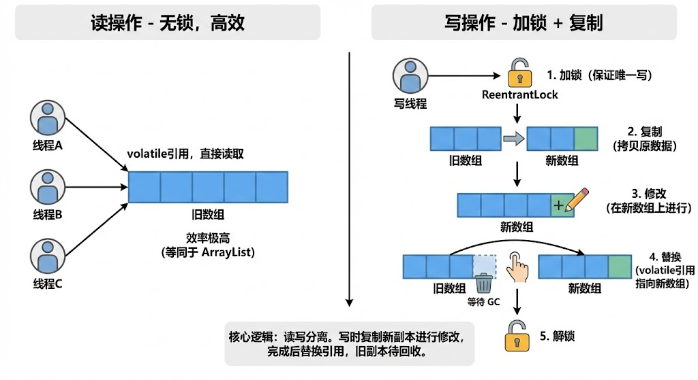
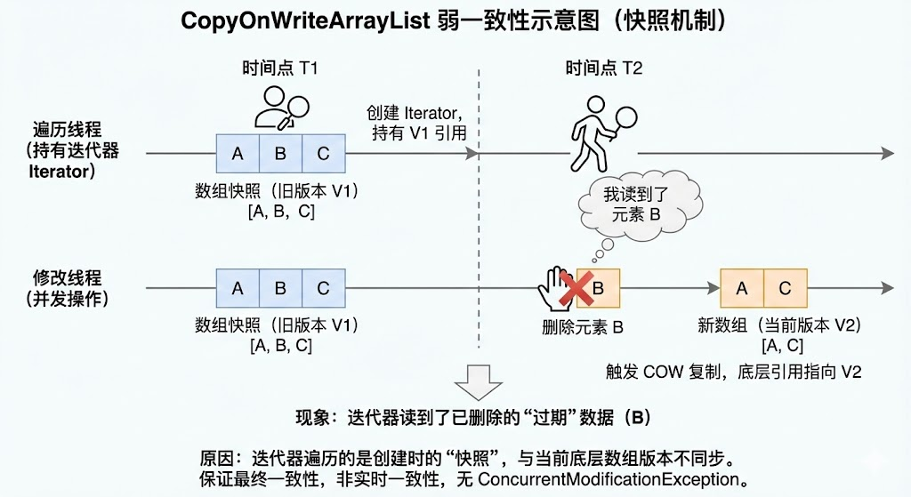

`CopyOnWriteArrayList`是 Java 并发包（JUC）里一种**非常有特色**的容器。

**它采用“读写分离”的思想，读操作完全无锁，写操作通过“复制一份新数组”来实现。它是典型的“以空间换时间”的数据结构，专门用于“读多写少”的并发场景。**

### 实现原理：写时复制（Copy-On-Write）

它的核心逻辑就像它的名字一样：

- **读操作（无锁）：**
    - 底层有一个被 `volatile` 修饰的数组引用。
    - 当你 `get()` 的时候，直接读取这个数组。完全不用加锁，效率极高（等同于 ArrayList）。
- **写操作（加锁 + 复制）：**
    - 当你 `add()` 或 `set()` 时，它**不会**直接修改原来的数组（因为可能有别的线程正在读，改了就会出乱子）。
    - **步骤：**
        - **加锁：** 先加一把重入锁（`ReentrantLock`），保证同一时刻只有一个线程能写。
        - **复制：** 把原数组的数据，**完整拷贝**一份到一个新的数组中（长度+1）。
        - **修改：** 在这个**新数组**上进行修改。
        - **替换：** 将底层的 `volatile` 引用，指向这个新数组。
        - **解锁。**
    - **结果：** 旧数组就被丢弃了（等待 GC），后续的读请求看到的都是新数组。

### 为什么它是“弱一致性”的？

这是面试经常问的坑点。`CopyOnWriteArrayList` 只能保证**数据的最终一致性**，不能保证**实时一致性**。

- **场景：** 假设你正在遍历列表（获取了迭代器 Iterator），这时候另一个线程突然删除了一个元素。
- **现象：** 你的迭代器**依然能**读到那个被删除的元素。
- **原因（快照机制）：**
    - 当你创建 Iterator 的那一瞬间，它就持有了**当时那个版本**的数组引用。
    - 哪怕底层数组的引用已经被别的线程偷梁换柱换成了新的，迭代器手里拿的依然是**旧数组**。
    - **好处：** 彻底告别了 `ConcurrentModificationException`，遍历时永远不需要加锁。
    - **代价：** 你读到的数据可能是“过期”的。

### 适用场景与缺点

- **适用场景：**
    - **读多写少：** 读写比例严重失调的场景，比如**白名单/黑名单判断**、**监听器列表（Listeners）**、**商品类目缓存**。
- **致命缺点：**
    - **内存占用大：** 每次写都要复制整个数组。如果数据量大（几万条），写操作会频繁触发 GC，搞崩系统。
    - **写性能差：** 毕竟是 O(N) 的数据拷贝操作，写多了系统会慢如蜗牛。

---

### 面试标准回答

`CopyOnWriteArrayList` 是 JUC 包提供的一个线程安全的 List，它的核心设计思想是**读写分离**和**最终一致性**。

关于实现原理：

它的读取操作是完全无锁的，性能极高。

而对于写入操作（add/set），它不会直接修改原数组，而是先加锁，然后将原数组复制一份，在副本上进行修改，最后把 volatile 修饰的数组引用指向这个新数组。

关于‘弱一致性’：

这主要体现在迭代器（Iterator）上。COWList 的迭代器在创建时，持有的是旧数组的引用（快照）。即使在遍历过程中有其他线程修改了数据（替换了新数组），迭代器依然遍历的是旧数据。这种机制虽然避免了 ConcurrentModificationException，但也导致了无法实时读到最新数据。
