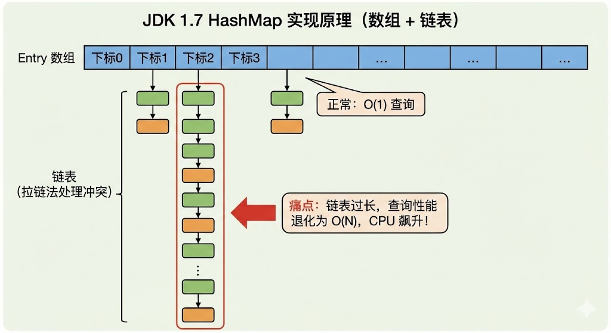
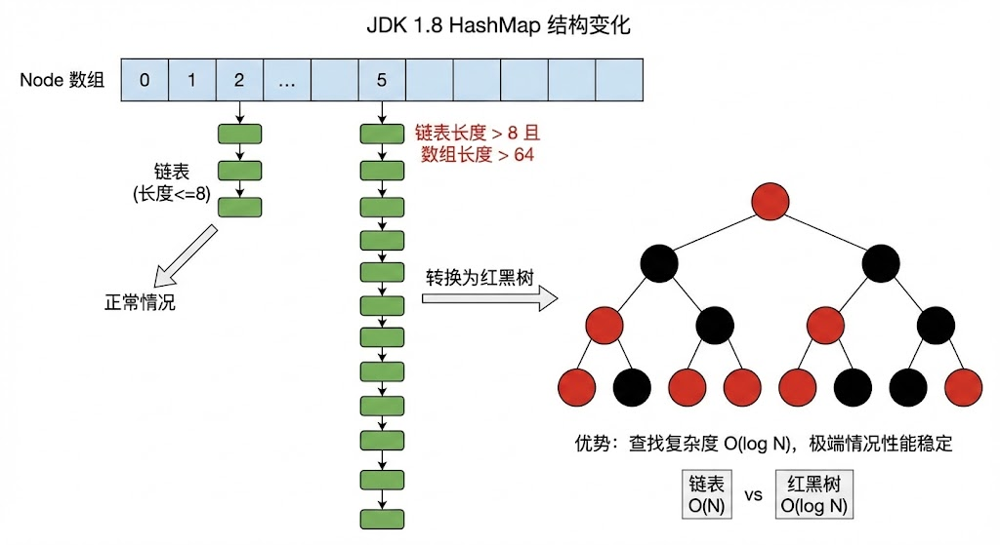
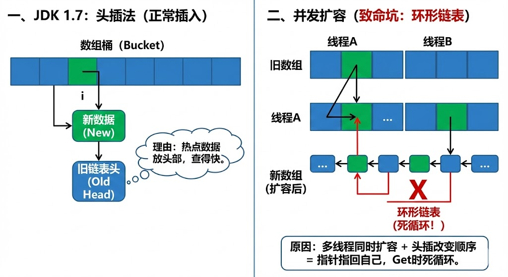
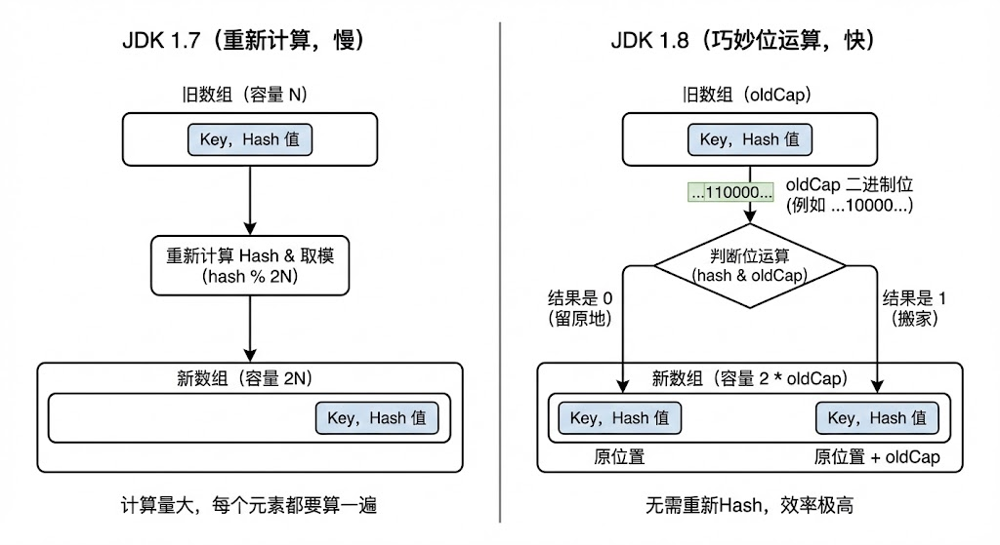

**JDK 1.8 在“数组+链表”的基础上增加了“红黑树”，并将“头插法”改为“尾插法”，彻底解决了哈希冲突导致的查询性能退化和并发扩容死循环问题。**

### 一、 底层数据结构的进化

1. **JDK 1.7：纯粹的“数组 + 链表”**

- **实现：** 底层维护一个 `Entry` 数组。
- **处理冲突：** 采用**拉链法**。当 hash 冲突时，直接在数组下标处挂一个链表。
- **痛点：** 这种结构有个致命弱点。如果大量 hash 值相同的 key，或者单纯运气不好，所有数据都挂在了一条链表上。 查找性能直接从 O(1) 退化成 **O(N)**。如果链表长 1 万，你查个数据就得遍历 1 万次，CPU 直接飙升。
1. **JDK 1.8：引入“红黑树”做兜底**

- **实现：** 底层维护一个 `Node` 数组（名字改了，Entry -> Node）。
- **升级逻辑：** 当链表长度超过阈值（默认 **8**），且数组长度大于 **64** 时，链表会自动转换为**红黑树**。
- **优势：** 红黑树的查找复杂度是 $$O(\log N)$$。
- **对比：** 就算链表挂了 1 万个数据，用红黑树查找也只需要查 14 次左右 。这保证了极端情况下的性能稳定性。

### 二、 插入方式的变革

1. **JDK 1.7：头插法**

- **做法：** 新来的数据，直接插在链表的**头部**（数组下标指向新节点，新节点指向旧链表）。
- **理由：** 设计者觉得，“后来者”被访问的概率更大（热点数据），放头部查得快。
- **致命坑：** 在并发扩容时，因为是头插，迁移数据会**改变链表原本的顺序**（倒序）。一旦多个线程同时扩容，很容易导致链表指针指回自己，形成**环形链表**。下次 get 的时候就是死循环。
1. **JDK 1.8：尾插法**
    1. **做法：** 新来的数据，遍历链表，插在**尾部**。
    2. **理由：** 既然引入了红黑树，反正都要遍历判断长度是否超过 8，顺便插在尾部也不增加开销。
    3. **收益：** 扩容时保持链表元素的**顺序不变**。顺序没变，就不会出现环形引用，彻底解决了并发扩容的死循环问题（但依然线程不安全，会覆盖数据）。

### 三、 扩容机制的优化

- **JDK 1.7：** 扩容时，需要对每个元素重新计算 Hash 值，然后再取模算出新位置。计算量大。
- **JDK 1.8：** 极其巧妙。它不需要重新 Hash。
    - 因为扩容是变成原来的 2 倍。数据要么在**原位置**，要么在**原位置 + 旧容量**的位置。
    - **判断方法：** 看 hash 值的二进制在新增的那一位是 0 还是 1（`hash & oldCap`）。
    - 如果是 0，留原地；如果是 1，搬到“原位置 + oldCap”。效率极高。

---

### 面试标准回答

HashMap 在 JDK 1.7 和 1.8 中有非常显著的区别，主要体现在以下三个方面：

第一，底层数据结构不同：

JDK 1.7 采用的是数组 + 链表。一旦发生严重的 Hash 冲突，查询复杂度会退化为 O(N)。

JDK 1.8 引入了红黑树，形成了数组 + 链表 + 红黑树的结构。当链表长度大于 8 且数组长度大于 64 时，链表会转为红黑树，将查询复杂度优化为 $O(\log N)$，解决了 Hash DoS 攻击的问题。

第二，插入方式不同：

JDK 1.7 使用头插法。这在并发扩容时，会导致链表元素顺序倒置，容易形成环形链表，造成死循环。

JDK 1.8 改为了尾插法。扩容时保持元素原有顺序，彻底解决了链表成环的问题。

第三，扩容逻辑优化：

JDK 1.7 需要对所有元素进行 Rehash 重新计算下标。

JDK 1.8 利用二进制位运算的特性，只需要判断 hash 值新增的参与运算的那一位是 0 还是 1，即可快速定位数据是留在原地还是移动到‘原下标 + 旧容量’的位置，省去了复杂的 Rehash 计算。
