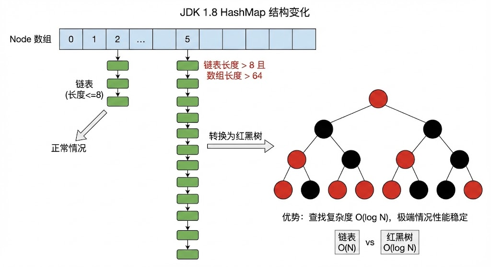
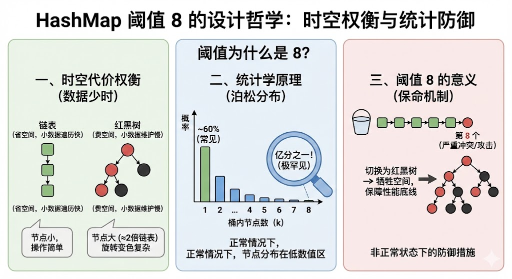
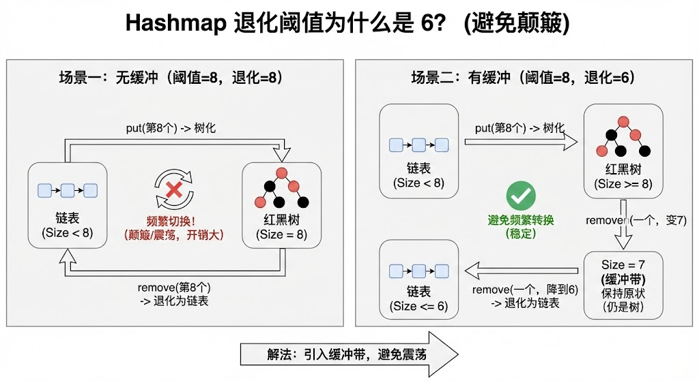

**引入红黑树是为了在极端哈希冲突下兜底性能；阈值选 8 是基于泊松分布算出来的“小概率事件”；退化阈值选 6 是为了防止链表和树之间频繁震荡。**

具体原因拆解如下：

### 为什么要引入红黑树？

    - **JDK 1.7 的痛点：** 以前只有链表。如果出现了多个 hash 值一样的 key，或者哈希算法极其糟糕，这 大量数据就会挂在同一个数组下标下，形成一条超长链表。
    - **后果：** 你的 HashMap 会瞬间变成一个“单向链表”。查询时，必须一个个遍历，复杂度是 **O(N)**。CPU 会瞬间飙升到 100%。
    - **红黑树的解法：** 树的查找复杂度是 $$O(\log N)$$。哪怕挂了 10 万个数据，红黑树也就查不到 20 次。这是为了保证在**最坏情况**下，HashMap 的性能也不会太差。

### 阈值为什么是 8？

既然树这么快，为什么不一开始就用树？

- **空间代价：** 树节点的大小几乎是链表节点的 **2 倍**。如果数据少，用树是浪费内存。
- **时间代价：** 数据少的时候，遍历链表其实比操作红黑树（即使是旋转和变色）还要快。
- **统计学原理：** 根据JDK源码中的注释，在哈希函数设计良好的情况下，节点分布符合**泊松分布**。
    - 一个桶里有 1 个节点的概率是 ~60%。
    - 有 8 个节点的概率是 **0.00000006**（不到亿分之一）。
    - **结论：** 正常情况下根本不可能达到 8。如果达到了 8，说明发生了严重的哈希冲突（大概率是遭到了攻击或哈希算法有问题），这时候为了保命，必须牺牲空间转为红黑树。

### 退化阈值为什么是 6？

- **场景：** 假设阈值也是 8。
- **问题：** 如果你频繁地对同一个桶进行 `put`（第 8 个）和 `remove`（第 8 个）操作。
- **后果：** 数据结构会在“链表”和“红黑树”之间疯狂切换（树化需要旋转，退化需要重组，开销极大）。这叫“颠簸”**或**“震荡”。
- **解法：** 中间留一个**缓冲带**。
    - 8 变树。
    - 降到 6 才变链表。
    - 7 的时候保持原状。这样就避免了频繁转换。

---

### 面试标准回答

HashMap 引入红黑树以及阈值的设计，是基于**性能稳定性**和**统计学概率**的综合考量。

第一，为什么要引入红黑树？

主要是为了解决哈希冲突导致性能急剧退化的问题。

在 JDK 1.7 中，大量冲突会导致链表过长，查询复杂度退化为 O(N)，容易引发 Hash DoS 攻击。JDK 1.8 引入红黑树后，将最坏情况下的查询复杂度优化到了 O(\log N)，保证了极端情况下的性能底线。

第二，为什么转树阈值是 8？

这是一个空间和时间的权衡。

树节点占用的内存是普通链表节点的 2 倍，且维护树结构有开销。源码注释中提到，在随机哈希下，节点分布符合泊松分布。一个桶内节点数达到 8 的概率极低（不到千万分之一）。

所以，阈值选 8 意味着：除非发生异常的哈希冲突，否则通常不会触发树化，平时尽量用链表节省空间。

第三，为什么退化阈值是 6？

主要是为了防止‘颠簸’。

如果退化阈值也设为 8，那么在节点数 8 附近频繁插入和删除，会导致结构在链表和树之间反复转换，严重浪费 CPU 资源。中间留出 2 个节点的缓冲，可以有效避免这种震荡。
