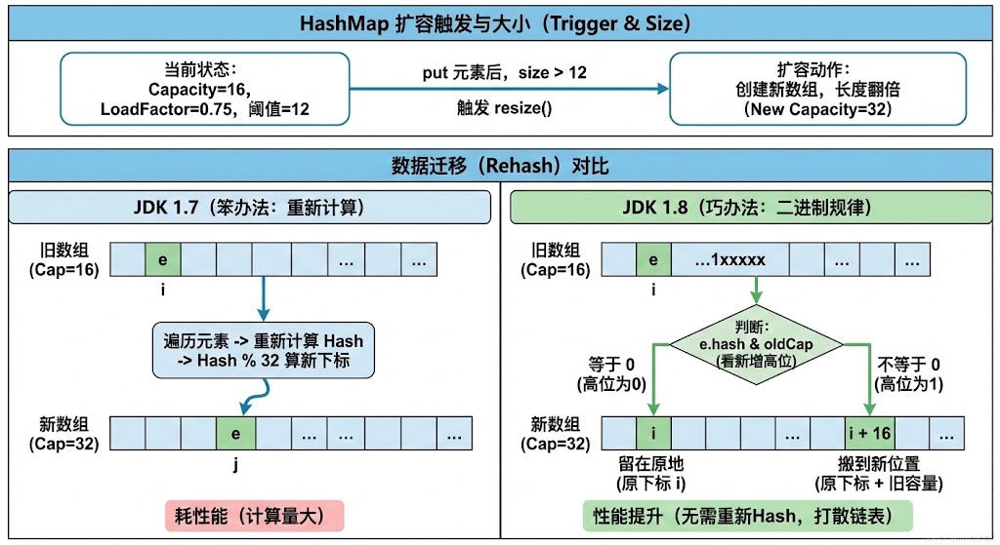
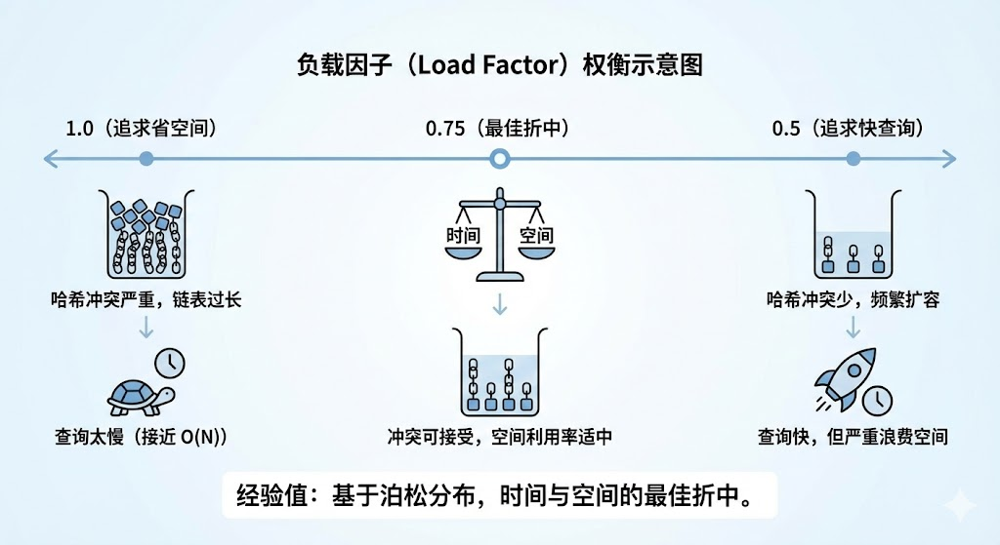

HashMap 的扩容机制，用一句话总结就是：**双倍扩容，巧妙rehash。**

而负载因子 0.75，则是**空间利用率**和**查询****时间效率**之间的一个平衡点。

具体细节拆解如下：

### 一、 扩容机制

1. **触发时机：**
    1. HashMap 内部有一个阈值 `threshold`，计算公式是 `capacity * loadFactor`（默认 16 * 0.75 = 12）。
    2. 当 `put` 元素后，如果当前 map 的 `size`**大于** 这个阈值，就会触发 `resize()` 方法。
2. **扩容大小：**
    1. **翻倍。** 创建一个新的 `Node` 数组，长度是原数组的 **2 倍**。
3. **数据迁移（Rehash）**
    1. **JDK 1.7（笨办法）：** 遍历旧数组的所有元素，重新计算 hash 值，然后 `hash % newCap` 算新下标。这非常耗性能。
    2. **JDK 1.8：** 利用了二进制的规律，**不需要重新计算 Hash**。
        - 因为只扩容了 2 倍，下标的变化只取决于 hash 值在二进制上**多出来的那一位**（高位）是 0 还是 1。
        - **判断方法：** 看 `e.hash & oldCap` 的结果。
            - **等于 0：** 留在原地（原下标）。
            - **不等于 0：** 搬到 `原下标 + 旧容量` 的位置。
        - **优势：** 既省去了复杂的 Hash 运算，又把长链表打散了，性能极大提升。

### 二、 为什么负载因子是 0.75？

这是一个典型的 **Trade-off（权衡）** 问题，在“防冲突”**和**“省空间”之间做妥协。

1. **如果是 1.0（追求省空间）：**
- **后果：** 只有等数组完全填满才扩容。虽然内存利用率极高，但哈希冲突会极其严重，链表会变得很长。
- **代价：** 查询效率从 O(1) 退化甚至接近 O(N)，查询太慢。
1. **如果是 0.5（追求快查询）：**
- **后果：** 填了一半就扩容。虽然冲突很少，查询很快。
- **代价：** 还有一半内存没用呢就翻倍了，频繁扩容，**严重浪费内存空间**。
1. **为什么是 0.75：**
- 这是一个经验值。根据泊松分布的统计规律，在负载因子为 0.75 时，哈希冲突的概率维持在一个**可接受的低水平**，同时内存利用率也不算太差。它是时间与空间的最佳折中。

---

### 面试标准回答

HashMap 的扩容和负载因子设计，体现了极致的性能优化和时空平衡。

关于扩容机制：

当 HashMap 中的元素个数超过 <u>容量 * 负载因子</u> 时，会触发扩容。

扩容的核心是创建一个两倍大小的新数组。

在 JDK 1.8 中，为了优化性能，数据迁移不再需要重新计算 Hash 值。它通过位运算 hash & oldCap 来判断元素是留在原下标，还是移动到‘原下标 + 旧容量’的位置。这种方式效率极高，且能有效缓解哈希冲突。

关于负载因子为什么是 0.75：

这是一个基于泊松分布得出的空间与时间的平衡点。

- 如果负载因子过大（如 1.0），虽然节省了空间，但会造成严重的 Hash 冲突，导致链表变长，降低查询性能。
- 如果负载因子过小（如 0.5），虽然查询快，但会导致频繁扩容和大量的内存浪费。
- **0.75** 能够保证在空间利用率尚可的情况下，将哈希冲突控制在较低水平，是性价比最高的选择。
