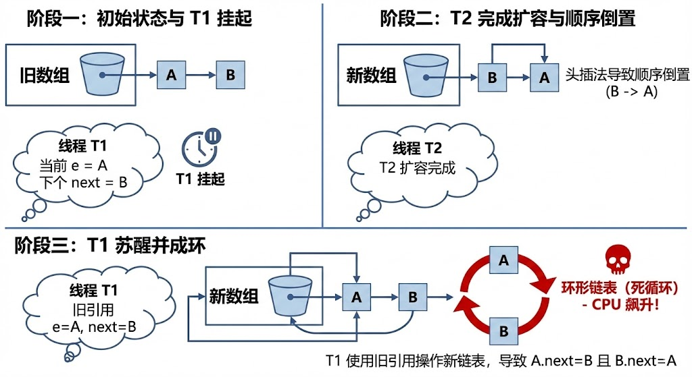
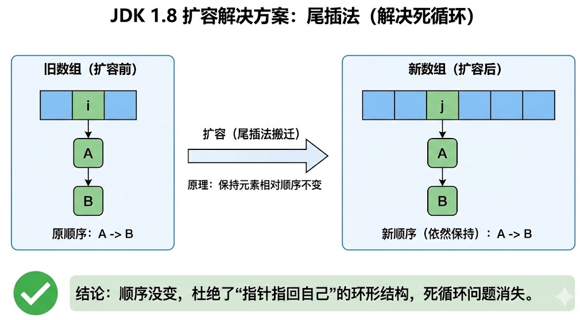

**JDK 1.7 在多线程扩容时使用“头插法”，导致链表顺序在迁移后颠倒，容易形成“环形链表”；而 JDK 1.8 改用了“尾插法”，保留了原序，从而根除了死循环问题。**

### 一、 JDK 1.7 为什么会死循环？

在 JDK 1.7 中，HashMap 扩容时的核心代码是 `transfer()` 方法。它在把旧数组的数据搬到新数组时，采用的是 **头插法**。

- 意思是：新元素总是插在链表的头部。
- 后果：**数据搬家后，****链表****的顺序会倒置**。比如原来是 `A -> B`，搬到新数组里就变成了 `B -> A`。

**死循环发生的场景：**

1. **并发扩容：** 假设有两个线程 T1 和 T2 同时触发了扩容。
2. **挂起：** T1 刚准备处理节点 A（记录了 `e = A`, `next = B`），突然被 CPU 挂起了。
3. **抢跑：** T2 线程运气好，一口气执行完了扩容。因为是头插法，新数组里链表顺序变成了 `B -> A`。
4. **梦醒：** T1 线程醒了，继续执行。它手里拿着的引用还是旧的（以为是 `A -> B`），但内存里已经被 T2 改成了 `B -> A`。
5. **成环：** T1 继续搬运，试图把 B 接在 A 后面，结果一顿操作猛如虎，最终把指针变成了 `A.next = B` 且 `B.next = A`。
6. **结果：** 链表变成了**环形**。当下一次 `get()` 操作遍历到这个桶时，就会在环里无限转圈，导致 **CPU 飙升 100%**。

### 二、 JDK 1.8 是怎么解决的？

JDK 1.8 在扩容时做了重大调整，改用了 **尾插法**。

- **原理：** 在扩容时，它会保持链表元素在旧数组里的**相对顺序不变**。
- **结果：** 原来是 `A -> B`，搬到新数组里（要么还在同一个桶，要么在 `原下标+扩容长度` 的桶），它依然保持 `A -> B` 的顺序，绝对不会倒过来。
- **结论：** 既然顺序没变，就不会出现“指针指回自己”的情况，死循环问题自然就消失了。

---

### 面试标准回答

HashMap 的死循环问题主要发生在 **JDK 1.7** 版本中。

根本原因在于：

JDK 1.7 在并发扩容时，采用了‘头插法’来迁移链表数据。这会导致链表元素在迁移后顺序倒置（比如由 A->B 变为 B->A）。

当多个线程同时扩容时，如果线程执行时机发生特定的交错，就会导致新数组中的链表形成首尾相接的环形结构。一旦形成环，后续的 get 操作就会陷入死循环，导致 CPU 飙升至 100%。

在 JDK 1.8 中：

官方进行了优化，将扩容逻辑改为了‘尾插法’。

这种方式在扩容后会保持链表元素的相对顺序不变，从根本上杜绝了链表成环的可能性，因此解决了死循环问题。
