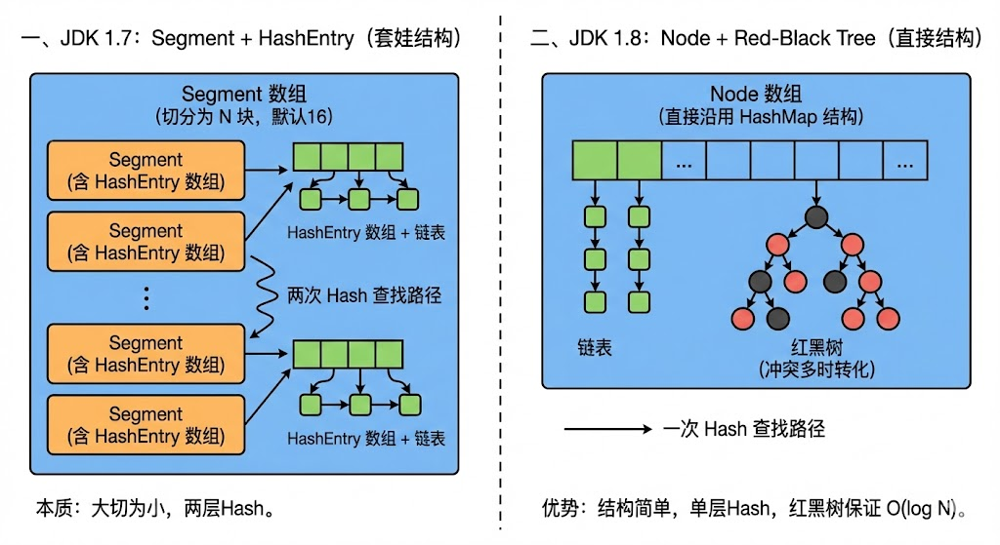
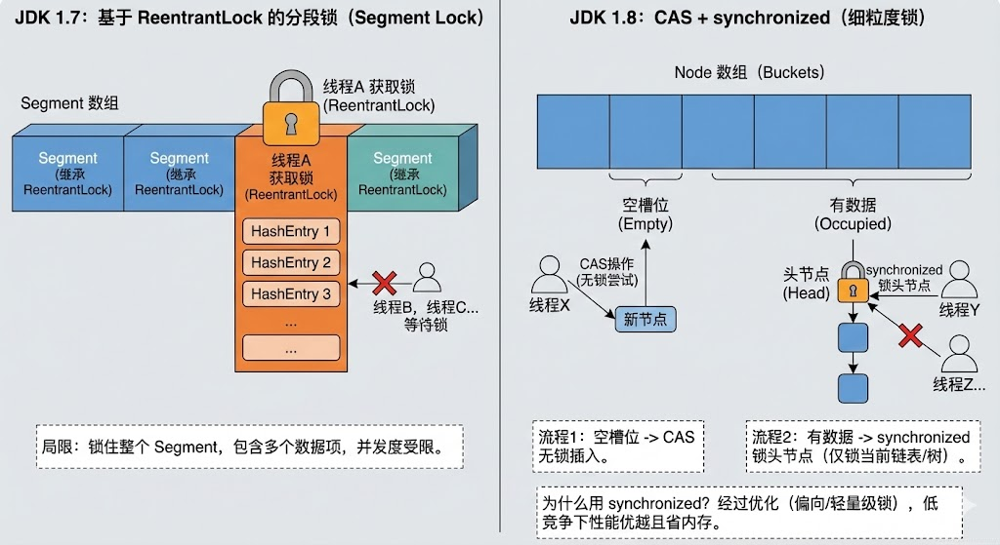

**JDK 1.7 是“分段锁”，一把锁管一堆数据；JDK 1.8 是“节点锁”，一把锁只管一个数据槽（Bucket），并且引入了红黑树和 CAS 算法，并发粒度达到了极致。**

### 一、 数据结构的重构

1. **JDK 1.7：Segment + HashEntry**
    1. **结构：** 它的结构像是一个“套娃”。最外层是一个 `Segment` 数组，每个 `Segment` 里面又包了一个小的 `HashEntry` 数组（类似于一个 HashMap）。
    2. **本质：** 就是把一个大哈希表切成了 N 块（默认为 16 块），每一块叫一个 Segment。
2. **JDK 1.8：Node + Red-Black** **Tree**
- **结构：** 抛弃了 Segment 的概念，直接沿用了 JDK 1.8 HashMap 的结构，即**数组 +** **链表** **+ 红黑树**。
- **优势：** 结构更简单，查找数据时不需要经过两层 Hash（先找 Segment 再找 Entry），少了一次指针跳转。同时，红黑树保证了在大量冲突时的查询效率为 $$O(\log N)$$。

### 二、 锁实现的颠覆

1. **JDK 1.7：基于 ReentrantLock 的分段锁**
- **机制：**`Segment` 这个类直接继承了 `**ReentrantLock**`。
- **流程：** 当要修改数据时，必须先获取该数据所在的 `Segment` 的锁。
- **局限：** 只要你获取了锁，这整个 Segment 下的所有数据（比如几千个 HashEntry）都被你锁住了，其他线程想改这部分数据里的任何一个，都得排队。
1. **JDK 1.8：CAS + synchronized**
- **机制：** 彻底放弃了 Segment，直接针对数组的每个槽位（Bucket）进行加锁。
- **流程（精髓）：**
    - **如果槽位是空的：** 不需要加锁！直接利用 **CAS** 操作尝试放入新节点。失败了就重试，完全无锁化。
    - **如果槽位有数据：** 使用 `**synchronized**` 关键字，只锁住当前链表（或树）的**头节点**。
- **为什么用 synchronized？** 在 JDK 1.6 之后，synchronized 经过了大量优化（偏向锁、轻量级锁），在低竞争场景下性能已经优于 ReentrantLock，而且它省内存（不用存 AQS 队列）。

### 三、 并发度的飞跃

- **JDK 1.7：** 并发度是固定的，默认是 **16**。也就是说，理论上最多只能有 16 个线程同时写。你想扩容并发度？很难，因为 Segment 数组一旦初始化就不能扩容。
- **JDK 1.8：** 并发度取决于**数组的长度**。数组有多长，理论上就能支持多少个线程并发写（只要 hash 不冲突）。随着数组扩容，并发度会线性增长。

---

### 面试标准回答

ConcurrentHashMap 在 JDK 1.7 和 1.8 中的实现发生了翻天覆地的变化，主要体现在以下三点：

第一，数据结构不同：

JDK 1.7 采用的是 Segment 数组 + HashEntry 数组 的结构。

JDK 1.8 取消了 Segment，直接采用类似于 HashMap 的 Node 数组 + 链表 + 红黑树 结构，查询性能更优。

第二，锁的实现机制不同（核心）：

JDK 1.7 使用的是 分段锁。Segment 继承了 ReentrantLock，每次操作锁定整个 Segment。

JDK 1.8 采用了 CAS + synchronized 的方式。如果数组槽位为空，通过 CAS 无锁插入；如果槽位不为空，只对链表头节点加 synchronized 锁。

第三，并发粒度不同：

JDK 1.7 的并发度受限于 Segment 的个数（默认 16），且初始化后无法扩容。

JDK 1.8 的锁粒度细化到了每个 Hash Bucket。这意味着数组有多大，并发度就有多大，随着扩容并发能力会越来越强。
