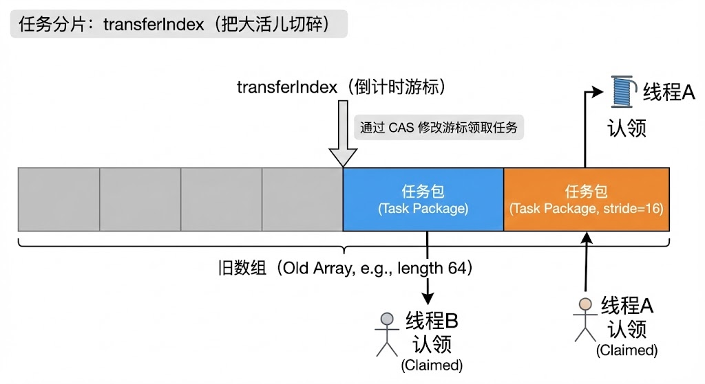
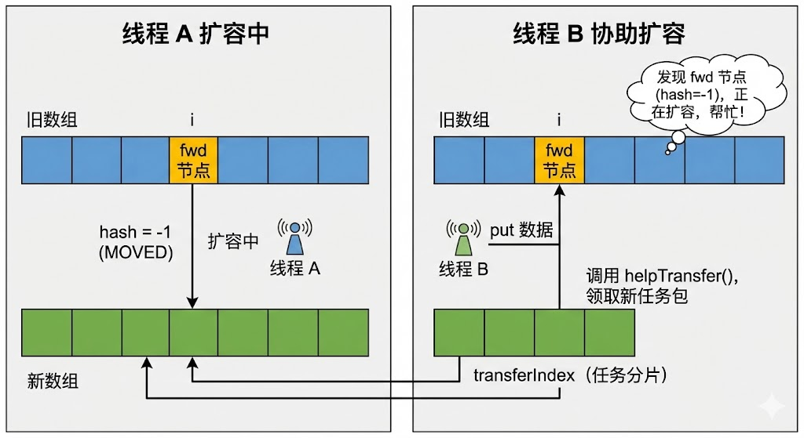
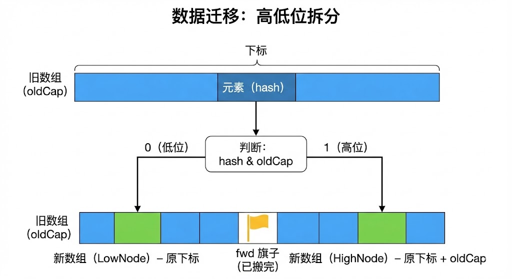

用最通俗的一句话总结：**它不是“一个人在战斗”，而是“一方有难，八方支援”。当一个线程触发扩容时，它不会阻塞其他线程，而是会让后续所有试图操作 Map 的线程，都放下手里的活，加入进来一起搬数据（多线程协助扩容）。**

具体的实现细节，可以拆解为 **“任务分片”**、**“协作机制”** 和 **“数据迁移”** 三个核心步骤：

### 任务分片：transferIndex（把大活儿切碎）

扩容本质上就是把旧数组里的数据搬到新数组。如果数组很大（比如 65536），一个线程搬太慢了。

ConcurrentHashMap 引入了一个核心变量 transferIndex。

- **作用：** 它是一个倒计时的游标。
- **步长（Stride）：** 它把整个数组切成了一块一块的“任务包”，默认每个包长度是 **16**（由 CPU 核数决定）。
- **逻辑：** 线程 A 来了，认领最后 16 个槽位（比如下标 48-63）；线程 B 来了，认领前 16 个槽位（比如 32-47）。通过 **CAS** 修改 `transferIndex` 来领取任务，互不冲突。

### 协作机制：ForwardingNode

这是最精彩的部分。线程之间怎么知道要不要帮忙？靠的是一个特殊的节点：`**ForwardingNode**`（简称 fwd 节点）。

- **状态感知：**
    - 当一个线程（比如线程 A）正在扩容，如果它把旧数组中下标为 `i` 的槽位搬空了，它不会留空，而是会在那里放一个 `**fwd**` **节点**。
    - 这个节点的 hash 值是 `MOVED` (-1)。
- **协助（Help Transfer）：**
    - 此时，线程 B 想要 `put` 数据。
    - 它一算 hash 值，找到下标 `i`，发现里面有个节点，且 hash 值是 -1。
    - 线程 B 瞬间明白：“哦，正在扩容，而且这个位置已经被搬走了。”
    - **关键动作：** 线程 B **不阻塞**，也不傻等。它会直接调用 `helpTransfer()` 方法，根据 `transferIndex` 去领一份还没人干的“任务包”，加入搬运大队。

### 数据迁移：高低位拆分

领到任务后，具体的搬运逻辑和 HashMap 1.8 是一样的：

- 并不需要重新计算复杂的 Hash。
- 只需要看 `hash & oldCap` 的值。
- **0：** 放在新数组的**原下标**（LowNode）。
- **1：** 放在新数组的**原下标 + oldCap**（HighNode）。
- 搬完一段，就给这段的所有槽位插上 `fwd` 旗子，告诉后来人“这里搞定了”。

---

### 面试标准回答

ConcurrentHashMap 在 JDK 1.8 中采用了一种**多线程协作式扩容**的方式，大大提升了扩容效率，避免了单线程扩容导致的系统停顿。其核心机制如下：

第一，并发扩容：

扩容时，它不会让一个线程独自承担所有工作。通过 transferIndex 变量，将整个数组切分为多个**步长（Stride，默认 16）**的小段。每个线程可以通过 CAS 竞争领取一段任务进行迁移，实现了真正的并行处理。

第二，协助机制：

当一个线程正在执行 put 或 remove 操作时，如果发现目标桶位的头节点是 ForwardingNode（Hash 值为 -1 的特殊节点），说明当前 Map 正在扩容且该桶位已迁移完成。

此时，该线程不会阻塞，而是会调用 helpTransfer() 方法，主动加入到扩容队伍中，去领取其他未完成的数据段进行迁移，这就是所谓的‘协助扩容’。

第三，数据迁移与可见性：

迁移完一个桶位后，会在旧数组该位置放置 ForwardingNode 指向新数组。读操作如果遇到 ForwardingNode，会直接转发到新数组查找，保证了扩容期间的读写不阻塞。
