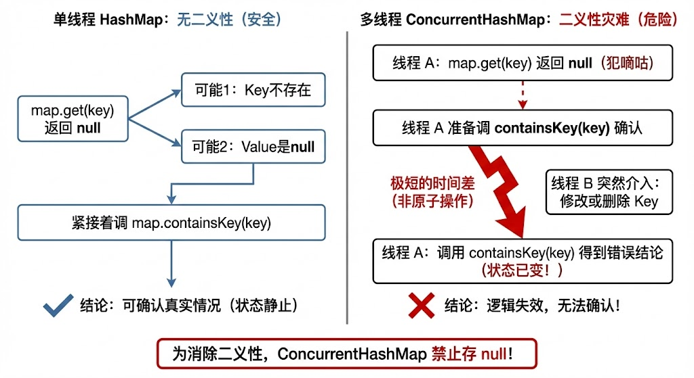

**为了消除“二义性”。在多线程环境下，我们无法区分** `**get(key)**` **返回的** `**null**` **到底是因为“键不存在”，还是因为“键对应的值本身就是 null”。**

### 核心原因：多线程下的“二义性”灾难

在单线程的 HashMap 中：

如果我们执行 map.get(key) 返回了 null，确实存在两种情况：

1. key 根本不存在。
2. key 存在，但在 map 里的 value 就是 null。

但这没事，因为是单线程，我们紧接着调一下 `map.containsKey(key)` 就能确认是哪种情况。在这个过程中，map 的数据是不会变的。

在多线程的 ConcurrentHashMap 中：

这就非常恐怖了。假设你允许存 null：

1. 线程 A 调用 `map.get(key)`，发现返回了 `null`。
2. 线程 A 此时心里犯嘀咕：是没这个 key，还是值是 null 呢？于是它准备去调 `map.containsKey(key)` 来确认。
3. **就在这个极短的时间差里**，线程 B 突然冲进来，把这个 key 给删了，或者把它的值改了。
4. 线程 A 再去调 `containsKey`，得到的结果已经不能代表刚才 `get` 那一瞬间的状态了。

这种“先 check 再 act”的复合操作在多线程下不是原子性的，会导致逻辑判断彻底失效。为了避免这种说不清道不明的误会，ConcurrentHashMap 干脆禁止存 null。
