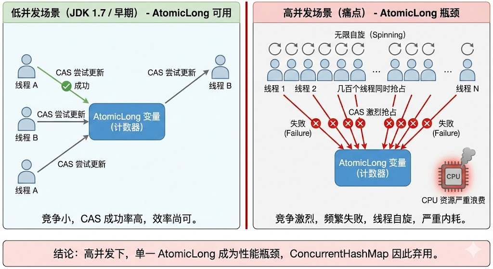
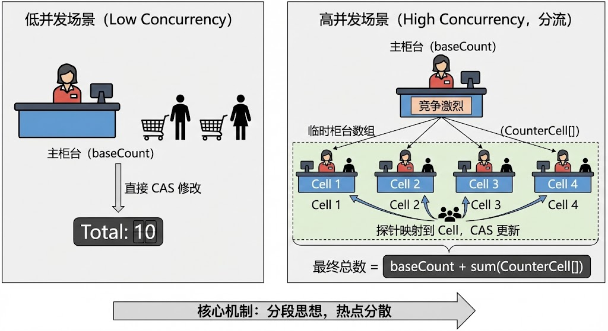
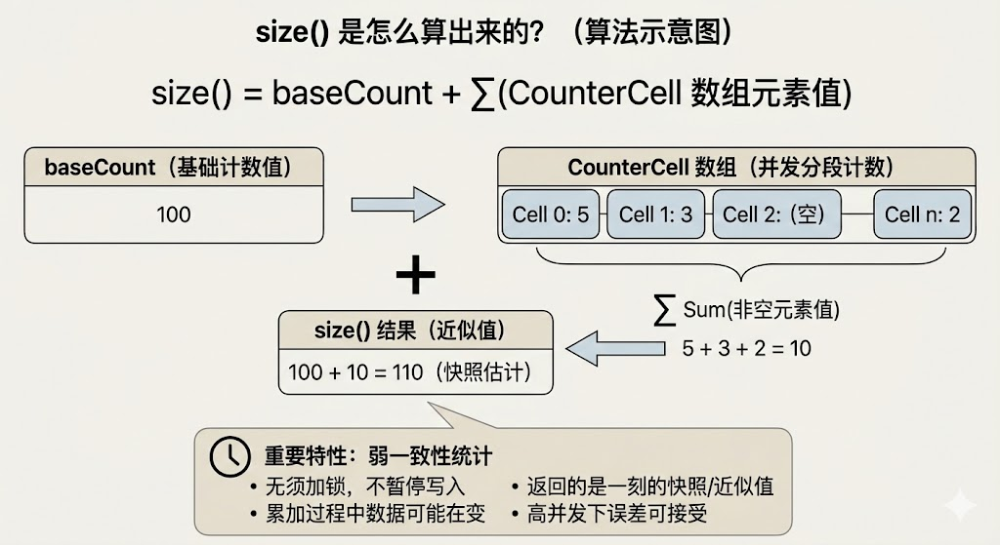

`**ConcurrentHashMap**` **的** `**size()**` **并不是每次去遍历链表算出来的，也不是只靠一个 AtomicInteger 变量顶着所有并发压力的。它采用了“化整为零”的策略（类似 LongAdder 机制）：将计数压力分散到一个** `**baseCount**` **变量和一组** `**CounterCell**` **数组中，最后求和得到总数。**

### 痛点：为什么不用 AtomicLong？

在 JDK 1.7 或者低并发场景下，我们可以用一个 `AtomicLong` (CAS) 来计数。

- **问题：** 当并发极高时（比如几百个线程同时 put），大家都在抢着更新这**同一个变量**。
- **后果：** CAS 会频繁失败，线程陷入无限自旋，严重浪费 CPU 资源。

### 核心机制：LongAdder 的“分段思想”

为了解决热点竞争，ConcurrentHashMap 内部引入了 `CounterCell` 数组（这和 `java.util.concurrent.atomic.LongAdder` 的原理是一模一样的）。

它把计数分成了两部分：

1. `**baseCount**`**：**
    1. 当并发不高时，线程直接通过 CAS 修改这个变量。如果成功了，就完事了。
2. `**CounterCell[]**`**：**
    1. 一旦 `baseCount` 的 CAS 失败了（说明有竞争），线程就不再去死磕 `baseCount` 了。
    2. 它会根据自己的 **探针哈希值**，映射到 `CounterCell` 数组中的某一个槽位（Cell）。
    3. 然后对这个**单独的 Cell** 进行 CAS 更新。
    4. **比喻：** 就像超市结账，本来只有一个柜台（baseCount），人多了就开始排长队。这时候经理开了 16 个临时柜台（CounterCell），大家分流去不同的柜台结账，效率瞬间起飞。

### size() 是怎么算出来的？

当你要调用 `size()` 方法时，它不需要加锁，也不需要停止写入。

- **算法：**`size = baseCount + Sum(CounterCell[0]...CounterCell[n])`。
- **过程：** 它只是简单地把 `baseCount` 的值，加上 `CounterCell` 数组里所有非空元素的 value 值。
- **准确性：** 这是一个**弱一致性**的统计。在累加的过程中，可能数据还在变，所以 `size()` 返回的是一个**近似值**（或者说调用该方法那一刻的快照估计）。但在高并发场景下，这个误差是可以接受的，毕竟你刚算出 100，下一毫秒可能就变成 101 了，追求绝对实时没有意义。

---

### 面试标准回答

ConcurrentHashMap 在 JDK 1.8 中，为了解决高并发写入下的计数性能问题，抛弃了单纯依赖 `AtomicLong` 的方式，而是采用了类似 `**LongAdder**` 的机制。

**其核心思想是‘热点分散’：**

第一，写入时的分流：

Map 内部维护了一个 baseCount 变量和一个 CounterCell 数组。

- 当并发度较低时，线程优先通过 **CAS** 更新 `baseCount`。
- 当并发度很高导致 CAS 失败时，线程不再自旋等待，而是根据 hash 值映射到 `CounterCell` 数组中的某一个槽位，对该槽位进行 CAS 更新。这相当于把‘对一个变量的竞争’分散到了‘多个变量’上，极大减少了 CAS 失败的概率。

第二，读取时的累加：

当调用 size() 方法时，它并不需要加锁。它只是简单地将 baseCount 的值与 CounterCell 数组中所有计数值进行累加，返回总和。
