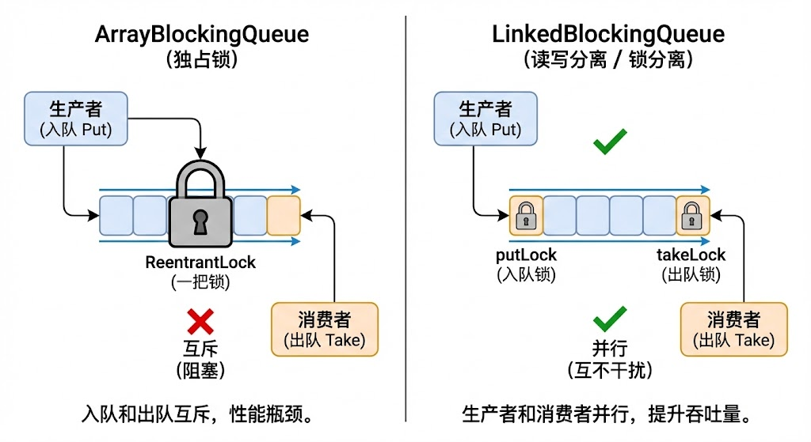
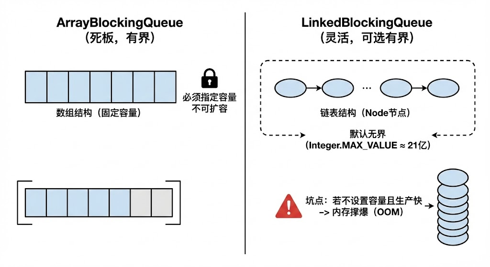
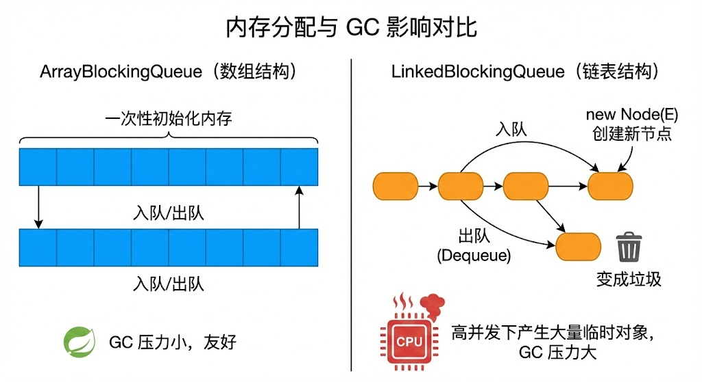

**ArrayBlockingQueue 是“一把锁管所有”，读写互斥；LinkedBlockingQueue 是“两把锁分工”，读写分离，并发性能更强，但它会产生额外的内存垃圾（GC 压力）。**

### 锁的机制：独占锁 vs 读写分离

- **ArrayBlockingQueue：**
    - 它的实现非常简单粗暴。内部只维护了**一把** `**ReentrantLock**`。
    - 这意味着：**“入队”和“出队”是****互斥****的。**
    - 当生产者往里放数据的时候，消费者必须在外面等着，连读都不行。在高并发场景下，这把锁就是性能瓶颈。
- **LinkedBlockingQueue：**
    - 它采用了锁分离（Lock Splitting）技术。内部维护了 `**takeLock**`**（出队锁）** 和 `**putLock**`**（入队锁）** 两把锁。
    - 这意味着：**生产者往尾部加数据，消费者从头部取数据，两人互不干扰，可以同时进行。**
    - 只有当两个生产者同时抢着入队，或者两个消费者同时抢着出队时，才需要竞争。这极大地提升了队列的吞吐量。

### 底层结构与边界

- **ArrayBlockingQueue：**
    - 底层是**数组**。必须在创建时**指定容量**（有界）。
    - 它是一个“死板”的队列，定好了多大就是多大，不能扩容。
- **LinkedBlockingQueue：**
    - 底层是**链表节点（Node）**。
    - 它是**可选有界**的。如果你不指定容量，它默认就是 `Integer.MAX_VALUE`（约为 21 亿）。
    - **坑点：** 如果生产者速度远快于消费者，且你忘了设置容量，内存会瞬间被撑爆（OOM）。

### 内存分配与 GC 影响

- **ArrayBlockingQueue：**
    - 它是数组，初始化时内存就分配好了。运行过程中不会频繁创建对象，**对 GC 非常友好**。
- **LinkedBlockingQueue：**
    - 它是链表。每放入一个元素，内部就要 `new Node(E item)` 创建一个节点对象；取出一个元素，这个节点就变成垃圾等待回收。
    - 在超高并发下，这会产生**大量的临时对象**，给垃圾回收器（GC）带来不小的压力。

---

### 面试标准回答

ArrayBlockingQueue 和 LinkedBlockingQueue 的主要区别体现在**并发控制机制**和**内存管理**上：

**第一，核心区别在于锁的粒度（锁分离）**：

- **ArrayBlockingQueue** 使用的是**单锁机制**（一把 ReentrantLock）。这意味着入队和出队操作是互斥的，同一时间只能有一个线程操作队列，并发性能受限。
- **LinkedBlockingQueue** 实现了**锁分离**，它内部维护了 `putLock` 和 `takeLock` 两把锁。这使得入队和出队可以并行执行，互不阻塞，因此在高并发场景下，它的吞吐量通常高于 ArrayBlockingQueue。

**第二，底层结构与 GC 影响**：

- **ArrayBlockingQueue** 基于数组，内存是预分配的，运行期间不会创建额外对象，**GC 压力小**。
- **LinkedBlockingQueue** 基于链表，每次入队都需要创建一个新的 `Node` 对象，出队后该对象成为垃圾，这会在高频读写时给 **GC 带来较大压力**。
