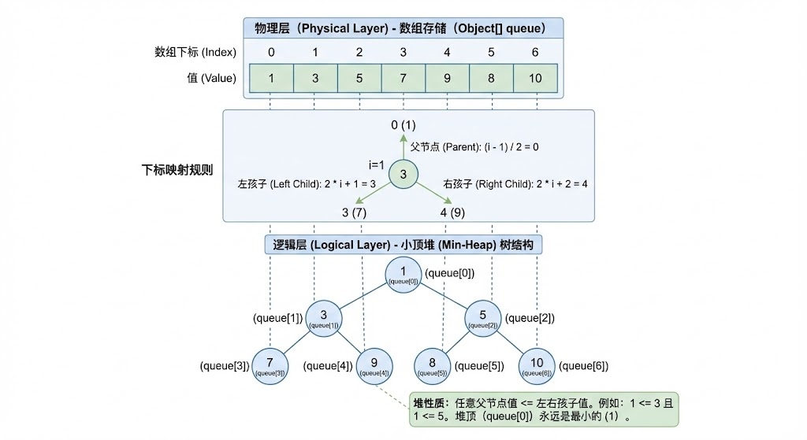
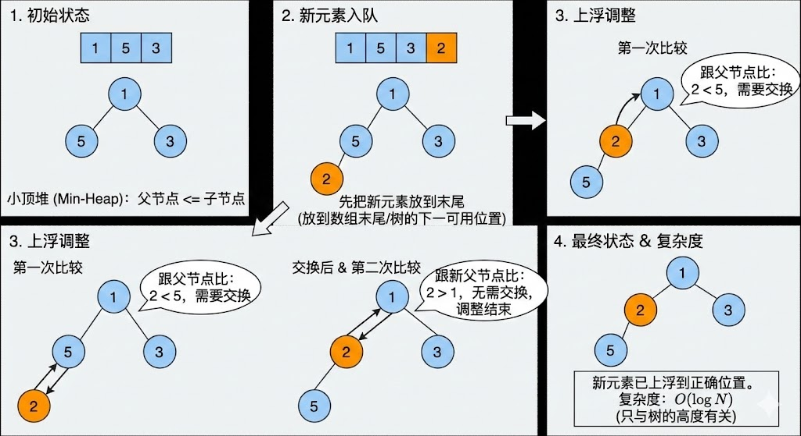

**它的物理底层是一个“动态数组”，但逻辑上是一棵“完全二叉树”（二叉堆）。它是通过“上浮”和“下沉”两个操作，来保证堆顶永远是最大（或最小）元素的。**

### 物理存储

    - **物理层：** 它内部维护了一个 `Object[] queue` 数组。
    - **逻辑层：** 虽然是平铺的数组，但我们通过**下标映射**把它想象成一棵树。
        - 假设当前节点下标是 `i`。
        - 它的**左孩子**下标是 `2 * i + 1`。
        - 它的**右孩子**下标是 `2 * i + 2`。
        - 它的**父节点**下标是 `(i - 1) / 2`。
    - **堆性质：** Java 的 `PriorityQueue` 默认是 **小顶堆（Min-Heap）**。也就是任意父节点的值，都必须 **小于等于** 它的左右孩子节点的值。堆顶（`queue[0]`）永远是最小的。

### 入队操作

- **动作：** 当新元素加入时，先把这里放到数组的**末尾**。
- **维持属性：**
    - 新兵蛋子（新元素）可能会比它的班长（父节点）还小。这就破坏了规矩。
    - 于是新元素要“上浮”**：跟父节点比，比父节点小就**交换。
    - 交换完再跟爷爷节点比，直到比不过长辈，或者这就成了新的堆顶为止。
- **复杂度：**$$O(\log N)$$。

### 出队操作

- **动作：** 只有**堆顶**（数组第 0 个）能被删掉。
- **维持属性：**
    - 老皇帝（堆顶）走了，直接把**数组最后一个元素**（太子）拉过来，强行按在堆顶的位置。
    - 这时候太子德不配位（值可能很大），压不住下面的臣子。
    - 于是太子要“下沉”**：跟左右两个孩子比，找出**更小**的那个孩子，跟它**交换。
    - 一路换下去，直到比孩子都小，或者沉到底为止。
- **复杂度：**$$O(\log N) $$。

---

### 面试标准回答

`PriorityQueue` 的底层数据结构是基于**动态数组**实现的**二叉堆（Binary Heap）**。

关于它的结构：

虽然物理上是连续的数组，但逻辑上它是一棵完全二叉树。它利用数组下标的关系（如孩子节点是 2n+1 和 2n+2）来模拟树的结构。在 Java 中，默认是小顶堆，即堆顶元素永远是最小的。

**它是如何维持堆属性的？主要靠两个核心操作：**

1. 入队时，执行‘上浮’：
2. 将新元素添加到数组末尾，然后不断与父节点比较。如果比父节点小，就交换位置，直到满足堆的性质。
3. 出队时，执行‘下沉’：
4. 移除堆顶元素后，将数组最后一个元素移到堆顶。由于这个元素可能很大，破坏了堆序性，所以需要让它不断与左右孩子中较小的那个交换，直到沉到合适的位置。

**性能方面**：由于是完全二叉树，这两个操作的时间复杂度都是 $$O(\log N)$$。
