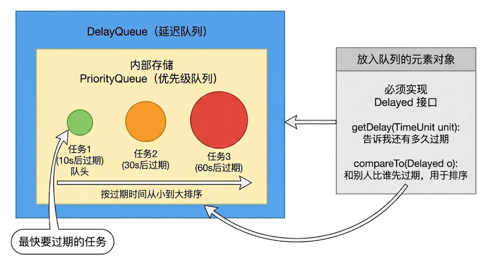
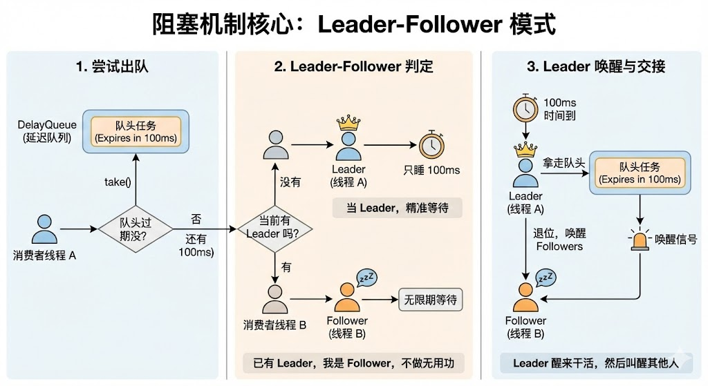

`DelayQueue` 是 Java 并发包中一个专门用于处理“延时任务”的无界阻塞队列。**DelayQueue 本质上是一个“按时间排序”的优先级队列，只有当元素的延时时间到了，消费者才能从队列里把它拿出来。它利用“Leader-Follower”模式极大地减少了线程不必要的唤醒，是实现轻量级定时任务的神器。**

### 核心结构：PriorityQueue + Delayed 接口

- **内部存储：**`DelayQueue` 内部并没有自己实现一套排序算法，而是直接包装了一个 `**PriorityQueue**`。
    - 这意味着，队列里的元素始终是按照“过期时间”从小到大排序的。队头永远是那个**最快要过期**的任务。
- **门槛：** 你想往这个队列里放东西，这个对象必须实现 `**Delayed**` 接口。
    - 你需要重写 `getDelay(TimeUnit unit)`：告诉队列，我还有多久才过期。
    - 你需要重写 `compareTo(Delayed o)`：告诉队列，我和别的任务比，谁先过期（用于排序）。

### 阻塞机制的核心：Leader-Follower 模式

这是 `DelayQueue` 源码中最精彩的部分。它解决了一个问题：*如果队头的任务还有 10 秒才过期，这 10 秒内，消费者线程该怎么办？*

- **笨办法：** 线程睡 1 秒，醒来看看；再睡 1 秒，再看看。这太浪费 CPU 了。
- **DelayQueue 的办法：**
    - **进队（put）：** 加锁，把元素放进 `PriorityQueue` 排序。如果发现我是最早过期的（成了新队头），就唤醒在该条件上等待的线程。
    - **出队（take）：**
        1. 先看队头，如果队头为空，阻塞等待。
        2. 如果队头不为空，看它过期没。
        3. **如果过期了：** 直接拿走（poll）。
        4. **如果没过期（关键）：**
            - 判断当前有没有 **Leader** 线程。
            - **如果有 Leader：** 说明已经有一个线程在专门等这个队头了，我就不做无用功了，直接**无限期等待**。
            - **如果没有 Leader：** 那我就当 **Leader**。计算一下队头还有多久过期（比如 100ms），我就**只睡 100ms**。
            - 时间到了，Leader 醒来，拿走队头，然后**退位**，唤醒其他的 Follower 线程起来干活。

### 在定时任务中的应用

相比于 `Timer`（单线程，脆皮）或者 `ScheduledThreadPool`（重型），`DelayQueue` 更加轻量灵活，适合“海量、不固定时间”的延时任务。

- **场景一：订单超时取消。** 用户下单 30 分钟未支付，自动取消。
    - 用户下单，把订单号封装成 `Delayed` 对象（设为 30 分钟后过期），扔进 `DelayQueue`。
    - 开一个后台线程一直 `take()`，拿出来的就是刚好超时的订单，执行取消逻辑。
- **场景二：缓存过期淘汰。**
    - 每个缓存对象都带个过期时间，扔进队列。后台线程拿出来的就是该清理的缓存。

---

### 面试标准回答

`DelayQueue` 是一个支持延时获取元素的无界阻塞队列。

**关于它的实现原理，主要包含三个核心点：**

第一，数据结构：

它的底层依赖于 PriorityQueue。所有元素都必须实现 Delayed 接口，队列会根据 compareTo 方法按照过期时间进行排序，保证队头永远是剩余延迟时间最短的元素。

第二，出队逻辑（Leader-Follower 模式）：

在执行 take() 获取元素时，如果队头元素未过期，线程不会简单地阻塞或轮询。

它采用了一种 Leader-Follower 的设计模式：

- 同一时刻，只有一个线程（Leader）会调用 `awaitNanos(剩余时间)` 进行有限期的等待。
- 其他线程（Followers）则调用 `await()` 进行无限期等待。
- 当 Leader 线程醒来获取完数据后，会唤醒其他 Follower 线程来竞争成为新的 Leader。
- 这种设计极大地减少了不必要的线程唤醒，提升了性能。

关于应用场景，它非常适合处理‘具有时效性’的任务，比如订单 30 分钟未支付自动关闭、缓存过期清除等场景。相比于轮询数据库，使用 DelayQueue 能极大降低系统资源消耗。”
