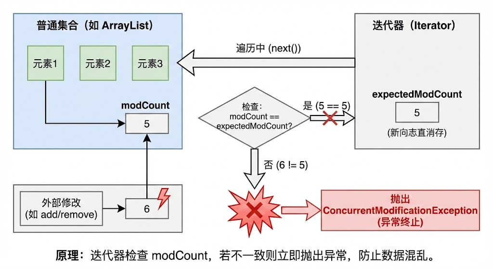
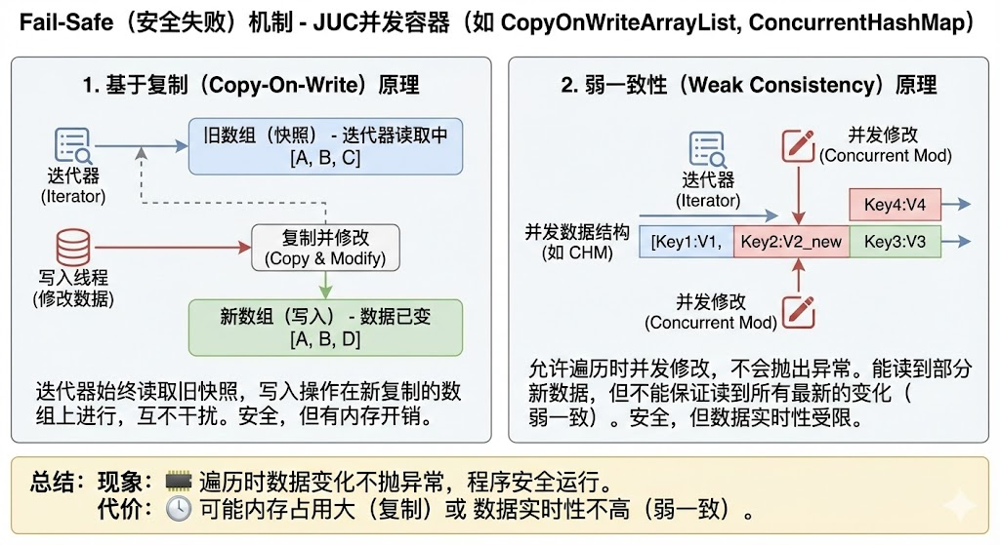

### 一、 核心概念解析

#### Fail-Fast（快速失败）

这是 Java `java.util` 包下普通集合（如 `ArrayList`, `HashMap`, `HashSet`）的默认机制。

- **现象：** 当你正在使用迭代器遍历一个集合时，如果此时有别的线程（或者你自己的代码在迭代器外部）修改了集合的结构（比如 add 或 remove 元素），迭代器会立刻感知到，并抛出 `ConcurrentModificationException`。
- **原理：** 集合内部维护了一个计数器 `modCount`。
    - 迭代器创建时，会将当前的 `modCount` 保存为 `expectedModCount`。
    - 在每次调用 `next()` 或 `remove()` 时，迭代器都会先检查：`modCount` 是否等于 `expectedModCount`？
    - 如果不相等，说明集合被动过了，为了防止数据混乱，立即抛出异常终止程序。
- **注意：** 这是一种**防御式编程**，它不能保证 100% 捕获并发修改，只是尽最大努力提醒你出错了。

#### Fail-Safe（安全失败）

这是 JUC 包下并发容器（如 `CopyOnWriteArrayList`, `ConcurrentHashMap`）采用的机制。

- **现象：** 当你在遍历集合时，即使集合的数据发生了变化，迭代器也不会抛出异常，程序继续正常运行。
- **原理：**
    - **基于复制：** 像 `CopyOnWriteArrayList`，当你修改数据时，它会把底层的数组复制一份，在新的数组上修改。而之前的迭代器依然指向旧的数组。所以，你读的是“快照”，写的是“新盘”。
    - **弱一致性：** 像 `ConcurrentHashMap`，它的迭代器允许并发修改。它能保证遍历不报错，但不保证你能读到最新的数据（迭代器创建之后产生的数据变化，可能看不见）。
- **代价：** 虽然安全，但可能存在内存占用大或数据实时性不高的问题。

---

### 二、 面试标准回答

第一点，关于 Fail-Fast：

它是普通集合的默认行为。

- **原理是：** 迭代器在遍历时，会随时检查集合的一个 `modCount` 变量。如果发现这个变量和迭代器刚创建时保存的值不一样，说明集合被修改了，它会立即抛出 `ConcurrentModificationException`。
- **它的目的是：** 防止脏读，尽早报错，避免后续出现不可预知的错误。这是一种“严格”的机制。

第二点，关于 Fail-Safe：

它是 JUC 包下并发容器采用的机制。

- **原理是：** 它们通常是基于“副本”或者“弱一致性”来工作的。比如 `CopyOnWriteArrayList` 在遍历时，实际上是在读底层数组的一个快照。
- **结果是：** 即使原集合在遍历时被修改了，迭代器也不会报错，程序能继续运行。
- **缺点是：** 迭代器读取的数据可能不是最新的，且部分实现会消耗更多内存。
