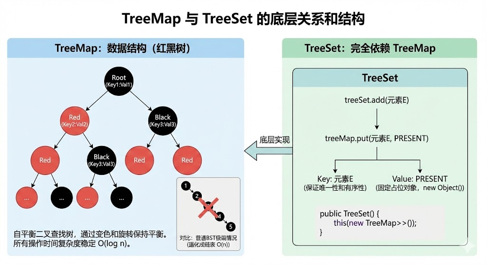

### 一、 核心原理深度解析



#### TreeMap

    - 数据结构：红黑树
    - TreeMap 并不是普通的二叉查找树，而是红黑树（自平衡的二叉查找树）。
        - **为什么不用普通** **BST****？** 普通二叉树在极端情况下（例如插入 1, 2, 3, 4, 5）会退化成链表，查询效率从 $$O(\log n)$$降级为 O(n)。
        - **为什么用红黑树？** 红黑树通过变色和旋转保持树的近似平衡。它保证最长路径不超过最短路径的两倍。这使得 TreeMap 在增、删、改、查所有操作上的时间复杂度都能稳定在 $$O(\log n)$$。

#### TreeSet

TreeSet 本身几乎没有复杂的逻辑代码，它完全依赖于 TreeMap。

- 底层实现：
- 打开 TreeSet 的源码，你会看到它的构造函数里直接 new 了一个 TreeMap：

```
public TreeSet() {
    this(new TreeMap<E,Object>());
}
```

- **存储逻辑：**
    - 当你调用 `treeSet.add(element)` 时，它实际上是调用了 `treeMap.put(element, PRESENT)`。
    - **Key：** 你存入 TreeSet 的元素，作为 TreeMap 的 Key（从而保证了元素的唯一性和有序性）。
    - **Value：** 一个固定的、共享的静态常量对象 `PRESENT`（`new Object()`）。因为 Set 只需要 Key，不需要 Value，这个对象只是用来占位的。

| **特性** | **TreeMap** | **TreeSet** |
| --- | --- | --- |
| **底层结构** | 红黑树 (Red-Black Tree) | 封装了 TreeMap (红黑树) |
| **存储内容** | Key-Value 键值对 | 只有 Element (作为 Map 的 Key) |
| **有序性** | 根据 Key 排序 | 根据 Element 排序 |
| **Null 值** | Key 不能为 null (因为要比较)，Value 可以 | 元素不能为 null (因为元素就是 Key) |
| **时间复杂度** | $O(\log n)$ | $O(\log n)$ |
| **线程安全** | 否 | 否 |

---

### 二、 面试标准回答

首先说 TreeMap：

它的底层是一个红黑树。

- 与 HashMap 这种哈希表不同，TreeMap 可以保证 Key 的有序性。
- 这种有序性是通过实现 `Comparable` 接口或者在构造时传入 `Comparator` 比较器来实现的。
- 得益于红黑树的自平衡特性，TreeMap 在插入、删除和查找时的性能都稳定在 O(\log n)，不会像普通二叉树那样退化。

接着说 TreeSet：它本质上就是TreeMap 的一层包装。

- 在 TreeSet 内部维护了一个 TreeMap 实例。
- 当我们往 TreeSet 里 `add` 元素时，实际上是把这个元素作为 Key，存到了底层的 TreeMap 中；而 Value 则是一个固定的静态 Object 对象（源码里叫 `PRESENT`）。
- 所以，TreeSet 的有序性和唯一性，完全是复用了 TreeMap Key 的特性。
