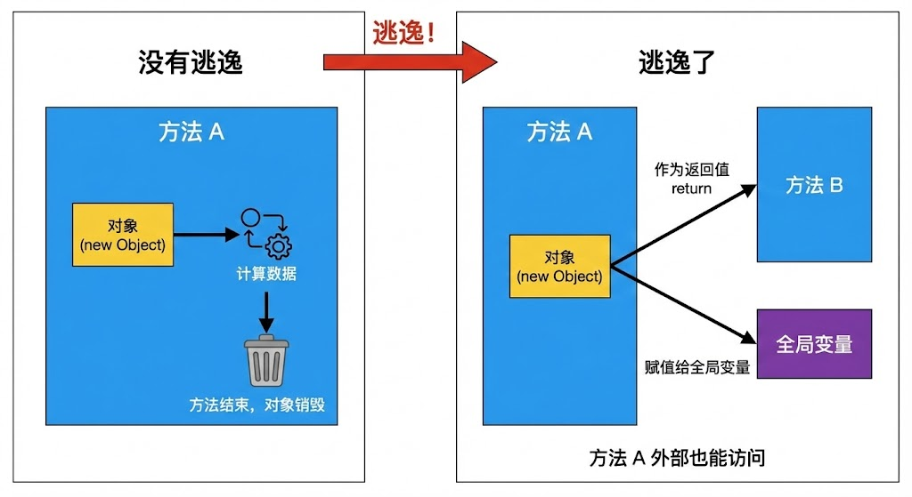
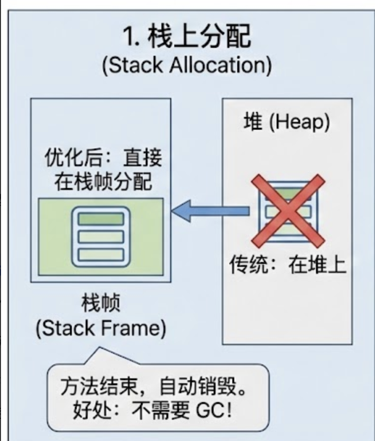
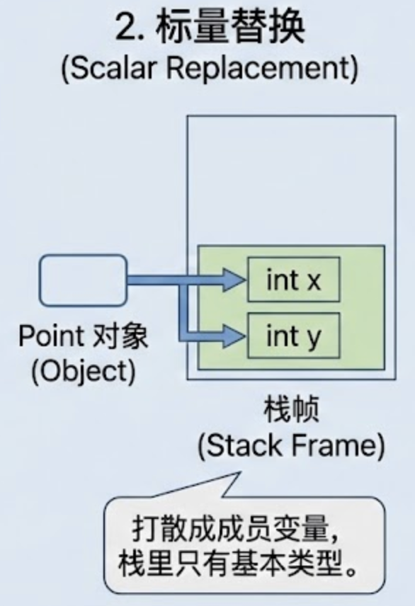
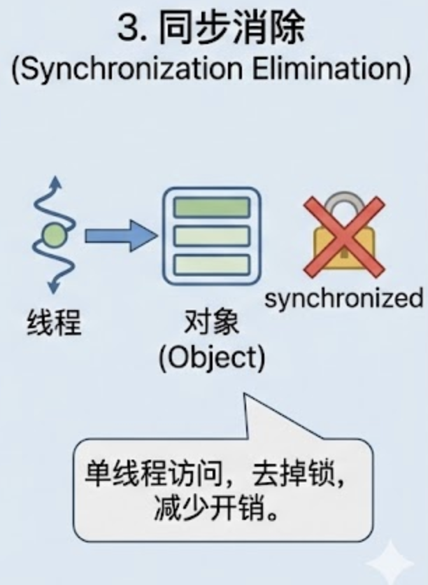

**内存逃逸分析是 JIT 编译器在运行时的一种分析手段，用来判断一个对象的引用范围。如果对象没有“逃出”当前方法，JVM 就会把它优化在栈上分配，从而减少 GC 的压力。**

### 一、 核心原理深度解析

#### 什么是“逃逸”？

在 Java 代码中，我们创建一个对象，这个对象可能会被传到方法外面去，也可能只在方法内部自生自灭。

- **逃逸了：** 你在方法 A 里 new 了一个对象，然后把它作为返回值 return 了，或者把它赋值给了一个全局变量。这时候，方法 B 也能访问它，这就叫“逃逸”。
- **没逃逸：** 你在方法 A 里 new 了一个对象，用它算了一些数据，方法结束时这个对象就没用了，谁也拿不到它。这就叫“没有逃逸”。

#### 如果没逃逸，JVM 会做什么优化？

这是面试的重头戏。JIT 编译器发现对象没有逃逸后，会进行“激进”的优化：

- **栈上分配：**

    - 传统认知是：对象在堆上，引用在栈上。
    - 优化后：既然这个对象不出方法，那干脆直接把它分配在**栈帧**里。方法结束，栈帧弹出，对象自动销毁。
    - **好处：****不需要 GC！** 这能极大减轻垃圾回收的压力。
- **标量替换：**

    - 它不直接在栈上创建一个完整的对象，而是把这个对象**打散**，拆解成若干个成员变量（int, long 等基本数据类型）。
    - **举例：** 一个 `Point` 对象有 `x` 和 `y`。优化后，栈里没有 `Point` 对象，只有 `int x` 和 `int y`。
- **同步消除：**

    - 如果发现一个对象只能被一个线程访问（没逃逸），那在这个对象上的 `synchronized` 锁会被直接去掉，减少锁开销。

---

### 二、 面试标准回答

**内存逃逸分析是 JVM 在 JIT 即时编译阶段进行的一项非常重要的优化技术。**

**它的核心目的只有一点：减少 Java 堆内存的分配压力，从而减少 GC 的频率。**

**我们可以从三个层面来理解它：**

**第一，什么是逃逸？**

简单来说，就是分析一个对象的作用域。

当我们在一个方法内部创建一个对象后，如果这个对象被作为返回值返回，或者被赋值给全局静态变量，导致其他方法或线程也能访问它，这就叫对象逃逸。反之，如果这个对象只在当前方法内部使用，方法结束后它就无用了，这就叫未逃逸。

**第二，基于“未逃逸”的优化手段：**

如果 JIT 分析出对象没有逃逸，它会进行三个关键优化：

1. **栈上分配：** 打破了“对象只能分配在堆上”的铁律。JVM 会尝试把对象直接分配在栈帧中。这样方法结束时对象就自动销毁了，根本不需要垃圾回收器（GC）介入，极大提升了系统性能。
2. **标量替换：** 这是 HotSpot 虚拟机目前的具体实现方式。它不会真的在栈上创建对象，而是把对象拆解成若干个基础类型的成员变量（标量），直接在寄存器或栈上读写。
3. **同步消除：** 如果对象没逃逸，说明它肯定不会被多线程共享，JVM 就会自动去掉代码中针对这个对象的 `synchronized` 锁。

总结一下，逃逸分析它通过让局部对象在栈上“自生自灭”，避免了大量的堆内存占用和 GC 开销。这也是为什么我们在写代码时，推荐尽量使用局部变量的原因。
