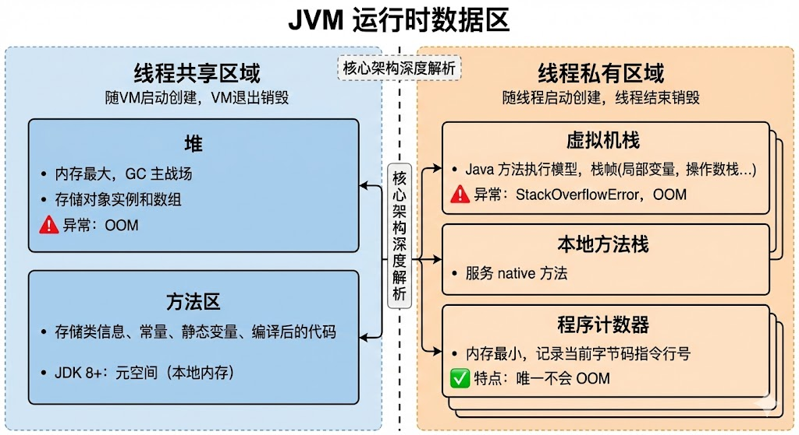

**JVM 内存主要分为 5 大块。其中“堆”和“方法区”是所有线程共享的，而“虚拟机栈”、“本地方法栈”和“程序计数器”是线程私有的。**

### 一、 核心架构深度解析

JVM 的运行时数据区遵循 Java 虚拟机规范，总体架构如下：

#### 线程共享区域

这两块区域随虚拟机的启动而创建，随虚拟机的退出而销毁。

- **堆：**
    - **地位：** 内存中最大的一块，也是 **GC（垃圾回收）** 的主战场。
    - **作用：** 几乎所有的**对象实例**和**数组**都在这里分配内存。
    - **异常：** 如果堆满了且无法扩展，抛出 `OutOfMemoryError`。
- **方法区：**
    - **地位：** 存储“类”相关的信息。
    - **作用：** 存已被加载的**类信息、常量、静态变量**、即时编译器编译后的代码等。
    - **演变：** 在 JDK 7 及以前叫“永久代”；**JDK 8 开始改名叫“元空间”**，并且挪到了**本地内存**中，不再占用 JVM 内存。

#### 线程私有区域

这三块区域的生命周期与线程相同，随线程启动而创建，随线程结束而销毁。

- **虚拟机栈：**
    - **地位：** Java 方法执行的线程内存模型。
    - **作用：** 每个方法执行时都会创建一个**栈帧**，用于存储**局部变量表**、操作数栈、动态链接、方法出口等信息。
    - **异常：** 如果递归太深，抛出 `StackOverflowError`；如果无法申请到足够内存，抛出 `OOM`。
- **本地方法栈：**
    - **作用：** 和虚拟机栈类似，只不过它是为 `native` 方法服务的。
- **程序计数器：**
    - **地位：** 内存最小的一块。
    - **作用：** 记录当前线程执行到了哪一行字节码指令。
    - **特点：** 它是 JVM 中**唯一一个不会发生内存溢出** 的区域。

---

### 二、 面试标准回答

**JVM 的运行时数据区通常被我们划分为 5 大块，我把它们分为“线程共享”和“线程私有”两类。**

**第一类是线程共享的区域，主要包含两块：**

1. **堆：** 这是 JVM 管理的最大一块内存。我们创建的**对象实例**和**数组**都存放在这里。同时，这里也是垃圾回收器管理的主要区域，所以有时也被称为“GC 堆”。
2. **方法区：** 它主要存储已经被虚拟机加载的**类信息、常量、静态变量**等数据。
- *这里有个关键细节：* 在 JDK 8 以前它叫永久代，JDK 8 以后它的实现变成了**元空间**，使用的是本地内存。

**第二类是线程私有的区域，也包含三块：**

1. **虚拟机栈：** 这是描述 Java 方法执行的内存模型。每个方法在执行时都会创建一个**栈帧**，里面存了局部变量表、操作数栈等信息。我们平时遇到的 `StackOverflowError` 异常就发生在这里（通常是因为递归过深）。
2. **本地方法栈：** 跟虚拟机栈很像，只不过它是为 `native` 方法服务的。
3. **程序计数器：** 它是当前线程所执行的字节码的行号指示器。它的特点是内存很小，而且是 JVM 中**唯一一个不会发生内存溢出**的区域。
