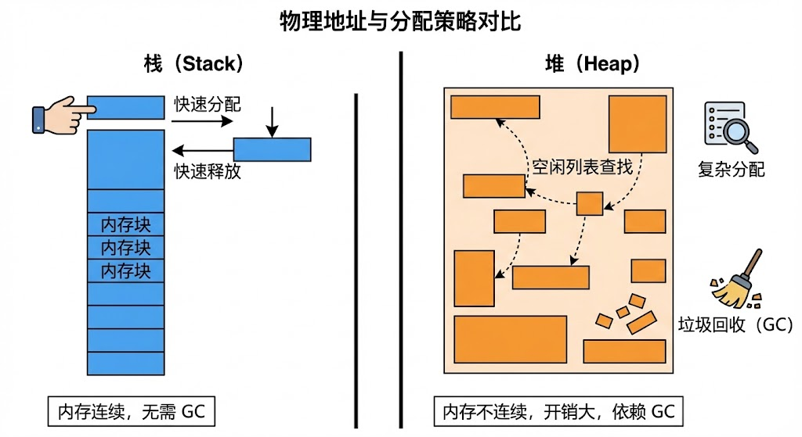
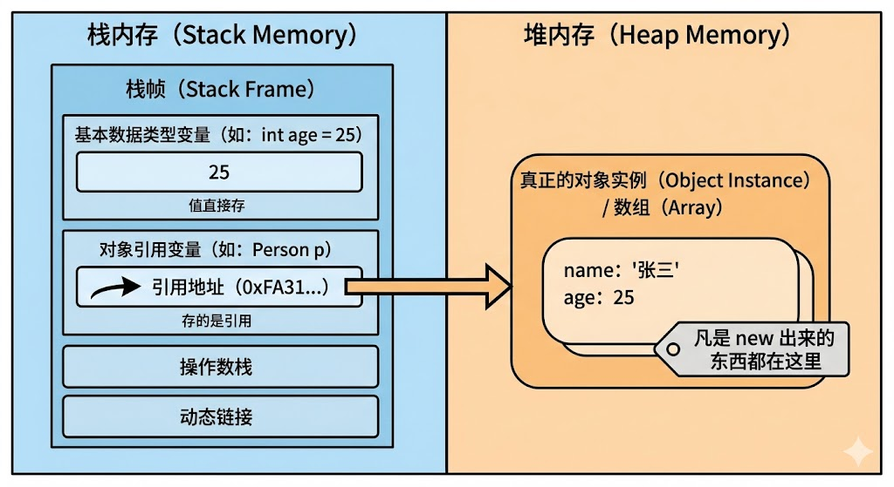

**栈是运行时的单位，解决了程序“怎么执行”的问题；堆是存储的单位，解决了数据“怎么存放”的问题。**

### 一、 核心区别深度解析

我们可以从以下 4 个维度来彻底拆解它们的区别：

#### 物理地址与分配策略

- **栈：** 内存通常是**连续**的。它的分配和释放非常快，不需要垃圾回收。
- **堆：** 内存通常是**不连续**的。它的分配涉及到复杂的空闲列表查找，释放则依赖垃圾回收器的标记-清除或复制算法，开销比较大。

#### 存储内容

- **栈：** 存的是**局部变量**、**操作数栈**、**动态链接**。
    - 如果是基本数据类型，直接把**值**存在栈里。
    - 如果是对象，栈里存的只是一个**引用**。
- **堆：** 存的是**真正的对象实例**和**数组**。
    - 只要是 `new` 出来的东西，都在堆里。

#### 线程可见性

- **栈：** 是**线程私有**的。每个线程都有自己的栈，互不干扰，所以栈上的数据天然是**线程安全**的，不需要加锁。
- **堆：** 是**线程共享**的。所有线程都能访问堆里的对象，所以多线程操作同一个对象时，需要考虑同步和加锁问题。

#### 异常类型

- **栈：** 空间不足抛出 `StackOverflowError`（通常是递归太深）。
- **堆：** 空间不足抛出 `OutOfMemoryError (OOM)`（通常是对象太多且无法回收）。

---

### 二、 面试标准回答

**堆和栈是 JVM 内存模型中最重要的两个区域，它们的职责截然不同。简单来说：栈是运行时的单位，而堆是存储的单位。**

**具体来说，我有以下 4 点理解：**

**第一，存储的内容不同：**

- **栈**主要存储**局部变量**和**对象引用**。比如 `User u = new User();`，这个 `u` 这个引用是放在栈里的。
- **堆**主要存储**真正的对象实例**。刚才那个 `new User()` 生成的实体对象，是放在堆里的。

**第二，资源管理的机制不同：**

- **栈**的生命周期是跟随方法的，方法调用结束，栈帧弹出，内存自动释放，**不需要 GC 介入**，速度非常快。
- **堆**的生命周期由 **GC**管理。对象的创建和回收涉及到复杂的算法（如标记清除、分代回收），所以开销比栈大得多。

**第三，线程可见性不同：**

- **栈**是**线程私有**的，每个线程有自己的栈，互不干扰，所以栈里没有线程安全问题。
- **堆**是**线程共享**的，所有线程都能访问堆内存，所以在多线程并发下需要考虑同步问题。

**第四，抛出的异常不同：**

- 如果栈不够用了（比如递归太深），会抛出 `**StackOverflowError**`。
- 如果堆不够用了（对象太多塞满了），会抛出 `**OutOfMemoryError**`。
