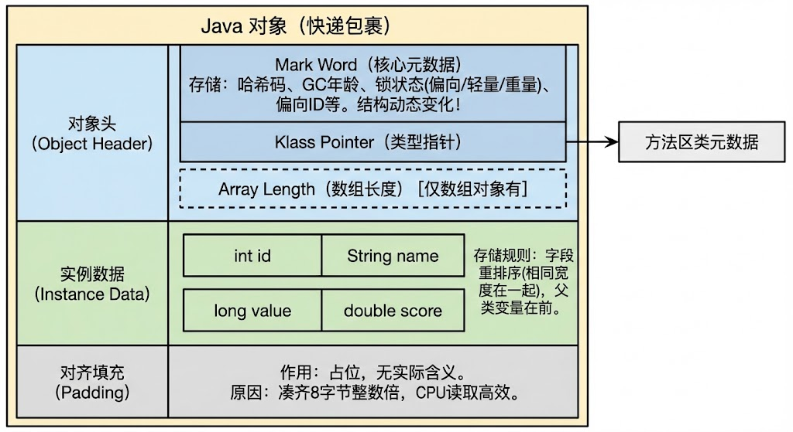

**在 HotSpot 虚拟机中，一个对象在内存中的布局分为三块区域：对象头、实例数据和对齐填充。**

### 一、 核心结构深度解析

#### 对象头

这是面试中最关键的部分，包含了对象所有的“元数据”。它又细分为两部分：

- **Mark Word：**
    - 这是对象头最核心的部分，存储了对象**运行时**的数据。
    - **内容包含：** 哈希码、GC 分代年龄、锁状态标志（偏向锁/轻量级锁/重量级锁）、线程持有的锁、偏向线程 ID 等。
    - **动态性：** Mark Word 的结构是不固定的，它会随着锁状态的改变而改变（比如升级为重量级锁时，里面存的就是指向 Monitor 的指针）。
- **Klass Pointer：**
    - JVM 怎么知道这个对象是 `Student` 还是 `Person`？就靠这个指针。
    - 它指向方法区中该类的**类元数据**。
- **Array Length：**
    - **只有数组对象才有这部分。** 普通对象是没有的。JVM 需要这 4 个字节来记录数组到底有多长。

#### 实例数据

- 这才是我们在类里定义的 `int id`、`String name` 等实际数据。
- **存储规则：** JVM 为了节省空间，会进行**字段重排序**。通常相同宽度的字段会被分配在一起（比如 `long` 和 `double` 放一起，`int` 放一起），且父类定义的变量会出现在子类之前。

#### 对齐填充

- **作用：** 仅仅是起占位作用，没有实际含义。
- **原因：** HotSpot 虚拟机的内存管理系统要求对象的起始地址必须是 **8 字节的整数倍**。如果不满足 8 字节，就补上一些空字节来凑齐。这主要是为了 CPU 读取内存的高效性。

### 二、 面试标准回答

**在 HotSpot 虚拟机中，对象在内存中的布局主要由三部分组成：对象头、实例数据和对齐填充。**

**第一部分是对象头，这是最复杂的区域，通常包含两类信息：**

- 一是 **Mark Word**。它存储了对象运行时的状态数据，比如 HashCode、**GC 分代年龄**、以及**锁的状态信息**。
- 二是 **Klass Pointer**。对象通过它指向方法区中的类元数据，从而确定自己属于哪个类。
- 另外，如果这个对象是数组，对象头里还会多出一个字段来记录**数组长度**。

第二部分是实例数据：

这里存储的是我们在代码中定义的各种成员变量的内容，包括从父类继承下来的。JVM 会为了内存对齐而对字段的存储顺序进行重排序优化。

第三部分是对齐填充：

这不是必须的。因为 HotSpot 规定对象的总大小必须是 8 字节的整数倍。如果前两部分加起来不是 8 的倍数，就需要通过 Padding 来补齐。
