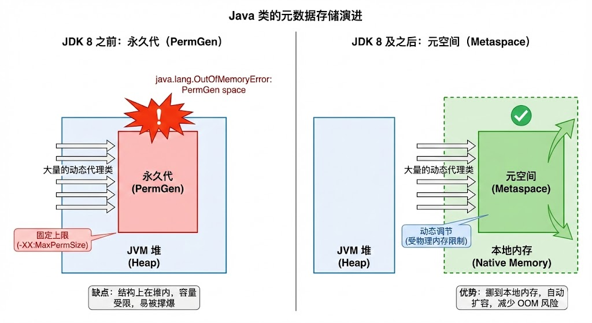

**永久代最大的问题是大小固定且难以调优，极易导致 OOM。改成元空间后，利用本地内存来存储类元数据，彻底解决了原来容量受限的问题。**

### 一、 核心演进深度解析

#### 永久代的缺点

- **结构：** 在 JDK 8 之前，永久代虽然逻辑上独立，但物理上是堆的一部分。
- **限制：** 它通过 `-XX:MaxPermSize` 设定了一个固定的上限。
- **问题：** 现代框架在运行时会生成大量的动态代理类。如果应用很大，或者部署了多个应用，很容易就把这个固定的上限撑爆，抛出 `java.lang.OutOfMemoryError: PermGen space`。

#### 元空间可动态调节

- **改变：** JDK 8 把类的元数据挪到了本地内存中，也就是堆外内存。
- **优势：****不再受 JVM 堆大小的限制**，而是受限于操作系统可用的物理内存。只要机器内存够，它就能自动扩容，极大地减少了 OOM 的风险。

### 二、 面试标准回答

**这个变化主要发生在 JDK 8。核心原因是解决内存管理的痛点。**

- 在旧版本中，永久代的大小是固定的，通过 `-XX:MaxPermSize` 设置。
- 但在现在的 Java 开发中，我们大量使用 Spring、Hibernate 等框架，它们底层会利用 CGLib 生成大量的**动态代理类**。这很容易导致永久代被填满，进而导致程序崩溃。
- 虽然可以调大参数，但这个“度”很难把握。
- 改成元空间**后，类的元数据不再存放在 JVM 堆里，而是存放在**本地内存中。这意味着它不再受限于 JVM 设置的内存上限，只受限于操作系统的物理内存，实现了“自动扩容”，极大降低了 OOM 的概率。
