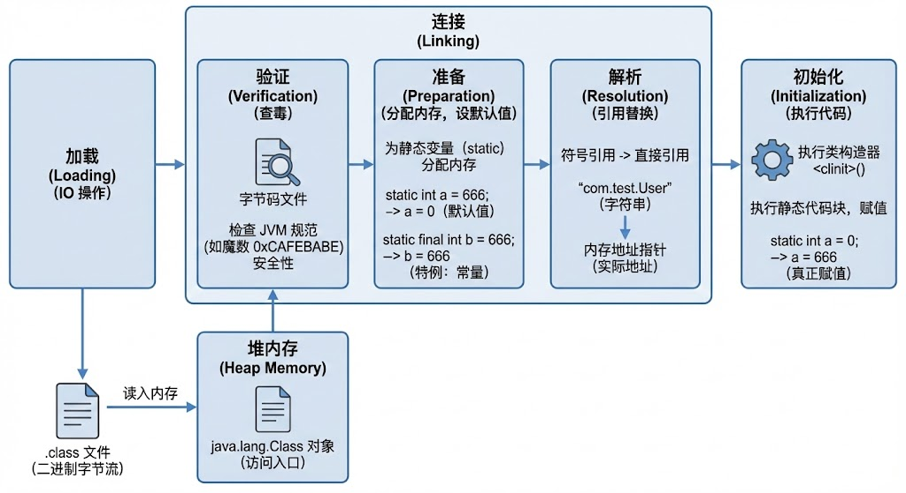

**类加载就是 JVM 把磁盘上的** `**.class**` **文件读进内存，并为之创建** `**java.lang.Class**` **对象的过程，它包含加载、连接（验证、准备、解析）和初始化这几个阶段。**

---

### 一、 核心流程深度解析

类加载的整个生命周期包括 7 个阶段，但面试中我们主要关注前 5 个：**加载、验证、准备、解析、初始化**。其中验证、准备、解析统称为**连接**。

#### 加载

这是 IO 操作阶段。

- **动作：** JVM 通过类的全限定名（包名+类名）找到 `.class` 文件，把二进制字节流读进内存。
- **产出：** 在堆内存中生成一个代表这个类的 `java.lang.Class` 对象，作为方法区这个类各种数据的访问入口。

#### 连接

这个阶段又细分为三步：

- **验证：****查毒。** 确保字节码文件是符合 JVM 规范的，没有安全隐患（比如魔数 `0xCAFEBABE` 对不对，有没有非法跳转）。
- **准备：**
    - 这一步会为类的**静态变量（static）分配内存，并设置默认初始值**。
    - **注意：** 如果 `static int a = 666;`，在这一步 `a` 的值是 **0**，而不是 666。因为 666 是赋值动作，要等到后面才做。
    - *特例：* 如果是 `static final` 常量，这一步直接就是 666。
- **解析：** 把符号引用（比如 `com.test.User` 这种字符串）替换为直接引用（内存里的实际地址指针）。

#### 初始化

这是类加载的最后一步，也是真正开始执行 Java 代码的一步。

- **动作：** 执行类构造器 `<clinit>()` 方法。
- **实质：** 这时候才会执行**静态代码块**，并把刚才那个 `static int a` 真正赋值为 **666**。

---

### 二、 面试标准回答

**JVM 的类加载过程，简单来说就是把** `**.class**` **字节码文件加载到内存中，并生成 Class 对象的过程。**

**严谨来说，它分为三个大阶段，五个小步骤：**

第一阶段是“加载”：

这一步主要是做 IO 操作。JVM 通过类加载器根据类的全限定名，读取二进制字节流，并在堆内存中生成一个 java.lang.Class 对象，作为后续访问的入口。

**第二阶段是“连接”，它包含三个关键步骤：**

1. **验证：** 主要是为了安全，检查字节码是否符合 JVM 规范，防止恶意代码破坏虚拟机。
2. **准备：** 这一步会为类的**静态变量**分配内存，并设置**默认零值**。
    1. 比如 `public static int a = 10;`，在这一步 `a` 的值会被设为 0，而不是 10。
3. **解析：** 将常量池中的符号引用（字符串）替换为直接引用（内存地址）。

第三阶段是“初始化”：

这是类加载的最后一步。到了这一步，JVM 才会真正执行类中定义的 Java 代码。

- 本质上就是执行类构造器 `<clinit>` 方法的过程。
- 它会执行所有的**静态代码块**，并对**静态变量**进行真正的赋值。比如刚才那个 `a`，在这一步才会被赋值为 10。
