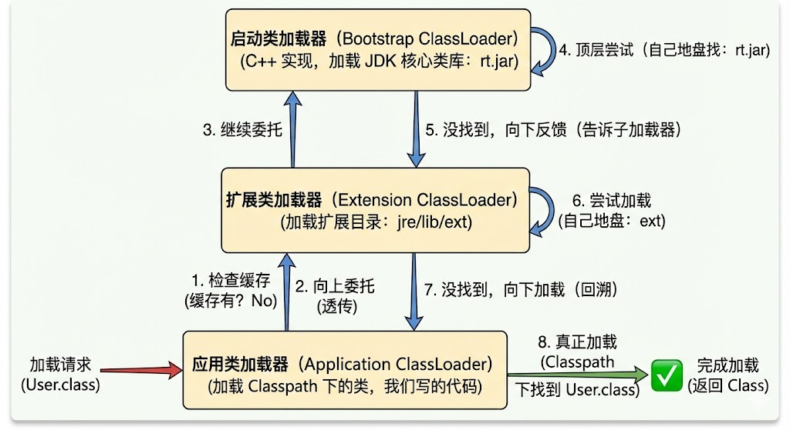

**双亲委派模型就是“向上委托，向下加载”。当一个类加载器收到加载任务时，它不会自己去加载，而是先把活儿甩给父加载器，直到最顶层的启动类加载器。只有当父加载器搞不定时，子加载器才会尝试自己去加载。**

---

### 一、 核心流程深度解析

要理解这个过程，首先要记住 Java 的三个核心类加载器：

1. **Bootstrap ClassLoader（启动类加载器）：** 最顶层，由 C++ 实现，负责加载 JDK 核心类库（如 `rt.jar`，也就是 `String`、`Object` 所在的包）。
2. **Extension ClassLoader（扩展类加载器）：** 负责加载 JDK 的扩展目录（`jre/lib/ext`）。
3. **Application ClassLoader（应用类加载器）：** 负责加载我们自己写的代码（Classpath 下的类）。

#### 具体的委派过程：

1. **检查缓存：** 当 `AppClassLoader` 收到加载 `User.class` 的请求时，先看自己缓存里有没有。如果没有，**它不干活**，直接抛给父加载器（Ext）。
2. **向上委托（透传）：**`ExtClassLoader` 也不干活，继续抛给它的父加载器（Bootstrap）。
3. **顶层尝试：**`BootstrapClassLoader` 已经是老祖宗了，它会去自己的地盘（`rt.jar`）找。
    1. 如果找到了：直接返回 Class。
    2. 如果没找到：它会告诉子加载器：“我这边没有，你去找别人吧”。
4. **向下加载（回溯）：**
    1. `ExtClassLoader` 收到反馈，去自己的地盘（`ext`）找。如果没找到，继续往下抛。
    2. 最后回到 `AppClassLoader`，它才真正去 Classpath 下加载 `User.class`。

---

### 二、 为什么要这么做？

双亲委派的目的非常明确，就两点：**安全** 和 **避免重复**。

#### 沙箱安全机制

- **防止核心 API 被篡改。**
- **举个经典例子：** 假设黑客写了一个恶意的 `java.lang.String` 类，里面植入了病毒代码，并放在了项目的 Classpath 下。
- 如果没有双亲委派，`AppClassLoader` 直接加载这个伪造的 String，整个系统就完了。
- 有了双亲委派，加载请求会一直传到 `BootstrapClassLoader`。它发现 `rt.jar` 里已经有 `java.lang.String` 了，就会直接加载 JDK 自带的那个，**黑客写的那个永远不会被加载**。

#### 避免类的重复加载

- Java 中判断两个类是否相同，看的是 **“类全名 + 类加载器”**。
- 如果没有委派，`String` 类可能会被 Bootstrap 加载一次，又被 AppClassLoader 加载一次。内存里就会出现两个不同的 `String` 类，导致类型转换异常，且浪费内存。
- 委派机制保证了核心类永远只由 `BootstrapClassLoader` 加载一次。

### 三、 面试标准回答

**双亲委派模型是 JVM 类加载的核心机制，简单来说就是“向上委托，向下加载”。**

关于它的加载过程，可以描述为：

当一个类加载器收到类加载请求时，它不会立即自己去加载，而是把这个请求层层向上委托给父类加载器，直到最顶层的 Bootstrap ClassLoader（启动类加载器）。

- 只有当父加载器在自己的搜索范围内找不到该类时，子加载器才会尝试自己去执行加载逻辑。

**这么设计的目的主要有两个：**

第一是安全性：

它可以防止 Java 的核心 API 被篡改。

举个例子，如果我们自己定义了一个 java.lang.String 类。如果没有双亲委派，这个类可能会覆盖 JDK 原生的 String 类，导致系统崩溃或安全漏洞。

但有了双亲委派，Bootstrap ClassLoader 会优先加载 JDK 自带的 rt.jar 中的 String 类，从而保证了核心类的唯一性和安全性。

第二是避免重复加载：

通过委派机制，确保了一个类在内存中只会被加载一次。无论哪个加载器请求加载 String，最终都是由 Bootstrap 加载的，保证了内存中 String 类的唯一性。
