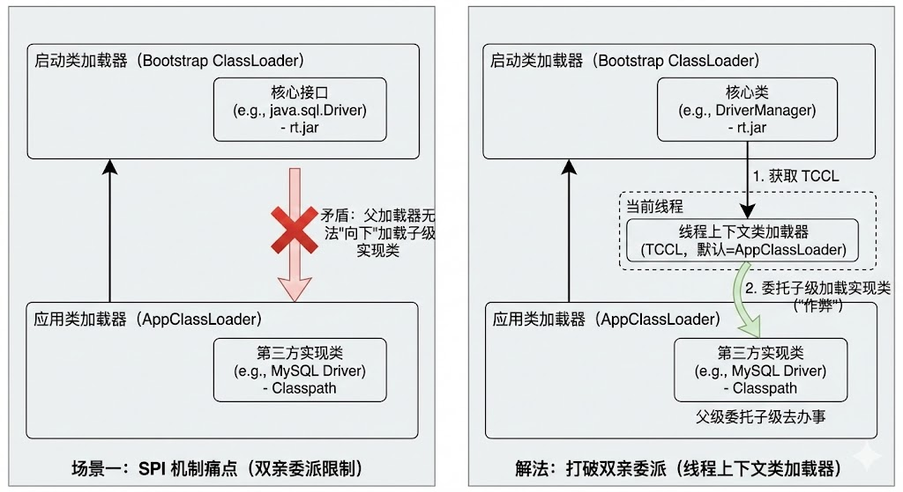
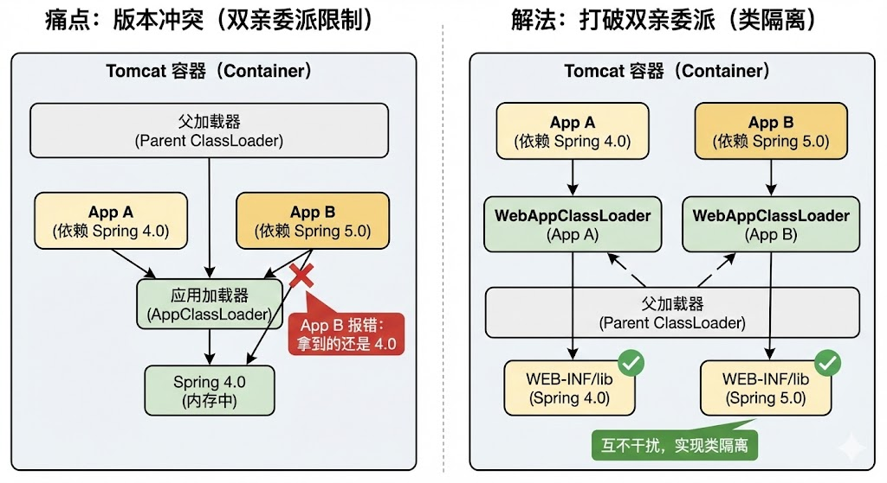

简单概括：**双亲委派解决了基础类的统一安全问题，但在两种场景下必须打破：一是基础类要调用用户代码，二是需要多版本共存隔离。**

### 一、 核心场景深度解析

双亲委派模型虽然安全，但它有一个天然的短板：**可见性是单向的。** 顶层加载器看不到底层加载器加载的类。

#### 场景一：SPI 机制

- **痛点：** Java 核心包（`rt.jar`）里定义了接口（比如 `java.sql.Driver`），这些接口是由 **Bootstrap ClassLoader** 加载的。但具体的实现类（比如 MySQL 的驱动 jar 包）是第三方厂商提供的，放在 Classpath 下，只能由 **AppClassLoader** 加载。
- **矛盾：** 根据双亲委派，Bootstrap 加载器是无法“向下”去加载 AppClassLoader 里的实现类的。那 `DriverManager` 怎么去加载 MySQL 的驱动呢？
- **解法：****打破双亲委派。** JDK 引入了 **线程上下文类加载器（ThreadContextClassLoader）**。
    - `DriverManager` 在初始化时，会“作弊”，获取当前线程的 ContextClassLoader（默认就是 AppClassLoader），然后用这个子加载器去加载 SPI 接口的实现类。这就是典型的“父级委托子级”去办事。

#### 场景二：Web 容器隔离

- **痛点：** 一个 Tomcat 容器里可能部署了多个 Web 应用（App A 和 App B）。
    - App A 依赖了 Spring 4.0。
    - App B 依赖了 Spring 5.0。
- **矛盾：** 如果严格遵守双亲委派，类加载器加载到 Spring 4.0 后，内存里就有了。当 App B 请求加载 Spring 5.0 时，加载器会说“我内存里已经有了”，结果 App B 拿到的还是 4.0，直接报错。
- **解法：****打破双亲委派。** Tomcat 自定义了 `WebAppClassLoader`。
    - 它的加载逻辑是：**优先在自己的 WebApp 目录下找**，找不到再往上委托。
    - 这样 App A 和 App B 各自加载各自的 Spring 版本，互不干扰，实现了**类隔离**。

### 二、 面试标准回答

**双亲委派模型虽然保证了 Java 核心类的安全性，但在某些特定业务场景下，它的“单向可见性”和“全局唯一性”会成为限制，这时候就需要打破它。**

**主要有两种经典场景：**

**第一种是 JNDI/JDBC 等 SPI 机制（解决基础层调用用户层的问题）：**

- 像 JDBC 的接口定义在 JDK 的核心库中，由启动类加载器（Bootstrap）加载。
- 但具体的数据库驱动（如 MySQL Driver）是第三方厂商提供的，存在于 Classpath 下，由应用类加载器（AppClassLoader）加载。
- 根据双亲委派，父加载器是看不到子加载器的类的。
- **如何打破：** Java 引入了**线程上下文类加载器**。核心类通过获取当前线程的上下文加载器，“逆向”去加载用户路径下的代码，从而打通了接口与实现。

**第二种是 Tomcat 等 Web 容器的部署：**

- 一个 Web 容器通常需要部署多个应用程序，这些应用可能依赖同一个第三方库的不同版本（比如一个用 Spring 4，一个用 Spring 5）。
- 如果严格遵循双亲委派，内存中同一个类只能有一份，会导致版本冲突。
- **如何打破：** Tomcat 自定义了 WebAppClassLoader。它的加载逻辑是“优先加载本地”**（即优先在当前应用的** `**/WEB-INF/lib**` **下找），只有本地找不到时，才向上委托。这样就实现了不同应用之间的**类隔离。

总结一下：

打破双亲委派并不是说这个模型不好，而是为了满足**“父类调用子类”或者“依赖版本隔离”**的实际需求，对原生机制的一种补充。
