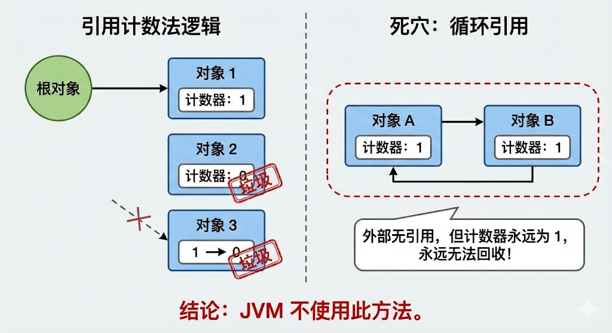
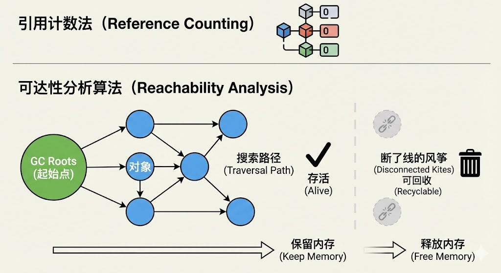

**JVM 判断对象是否可回收，主要依赖“可达性分析算法”。即从 GC Roots 出发，看能不能遍历到这个对象。如果有路径可达，就是活的；如果不可达，就是垃圾。**

---

### 一、 核心算法深度解析

JVM 判断垃圾主要有两种思路，但工业级 JVM（如 HotSpot）只用第二种。

#### 引用计数法

- **逻辑：** 给对象加一个计数器。被引用一次就 +1，引用断开就 -1。计数器为 0 就是垃圾。
- **死穴：****循环引用**。
    - 对象 A 引用 B，对象 B 引用 A。
    - 除此之外，没有任何人引用它们。
    - 逻辑上它们是垃圾，但计数器永远是 1，永远无法回收。所以 JVM **不用**这个。

#### 可达性分析算法

- **逻辑：** 将内存中的对象看作是一张图。
- **起点：** 选取一系列根节点，称为 **GC Roots**。
- **搜索：** 从 GC Roots 开始向下遍历。
- **判定：** 能被连上的对象就是“存活”的；**断了线的风筝**就是“可回收”的。

#### 谁是 GC Roots？

这是面试必问的细节。哪些对象可以作为“根”？主要有四类：

1. **虚拟机栈（栈帧中的局部变量表）中引用的对象：**
    1. 比如方法里 `User u = new User();`，只要方法没结束，这个 `u` 就是根，它指向的对象就不能回收。
2. **方法区中静态属性（static）引用的对象：**
    1. `public static User user = ...;`，类加载着，它就在。
3. **方法区中常量（final）引用的对象：**
    1. 比如字符串常量池里的引用。
4. **本地方法栈中 JNI（Native 方法）引用的对象。**

---

### 二、 面试标准回答

**JVM 判断对象是否存活，主要依赖的是“可达性分析算法”。**

虽然历史上存在过“引用计数法”，但现代 JVM 并不使用它。

引用计数法虽然简单（有个计数器，引用一次加一，断开减一），但它无法解决“循环引用”的问题。比如 A 和 B 互相引用，但外界谁也不理它们，计数器不为 0，导致内存泄漏。

所以，JVM 采用的是“可达性分析算法”。

它的核心思想是图论。

- JVM 会选取一系列对象作为起点，我们称之为 **GC Roots**。
- 从这些起点开始向下搜索，搜索过的路径称为引用链。
- 如果一个对象到 GC Roots 没有任何引用链相连（即不可达），那么这个对象就可以判定为“可回收”。

**在 Java 中，可以作为 GC Roots 的对象主要包含这几类：**

1. **虚拟机栈中引用的对象：** 也就是我们在方法中定义的**局部变量**。
2. **方法区中类静态属性引用的对象：** 也就是 `static` 修饰的变量。
3. **方法区中常量引用的对象：** 比如 `static final` 修饰的变量。
4. **本地方法栈中 Native 方法引用的对象。**
