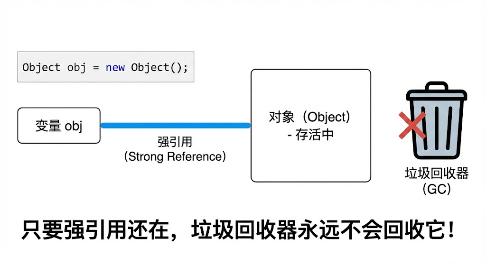
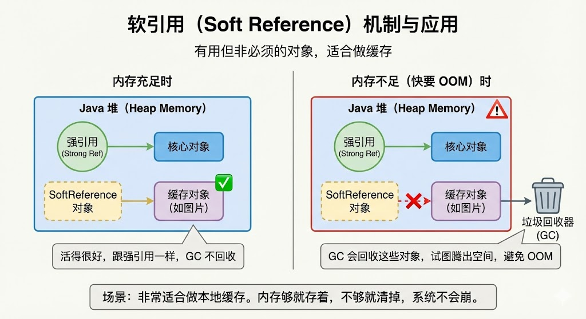
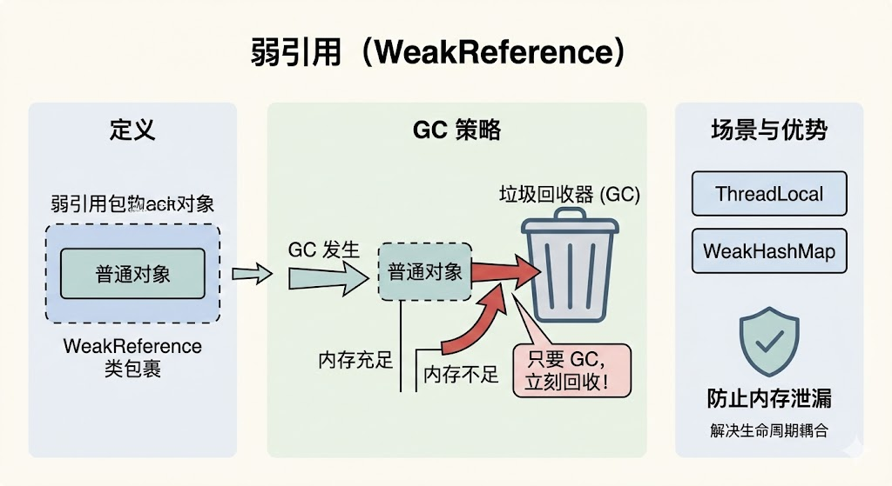
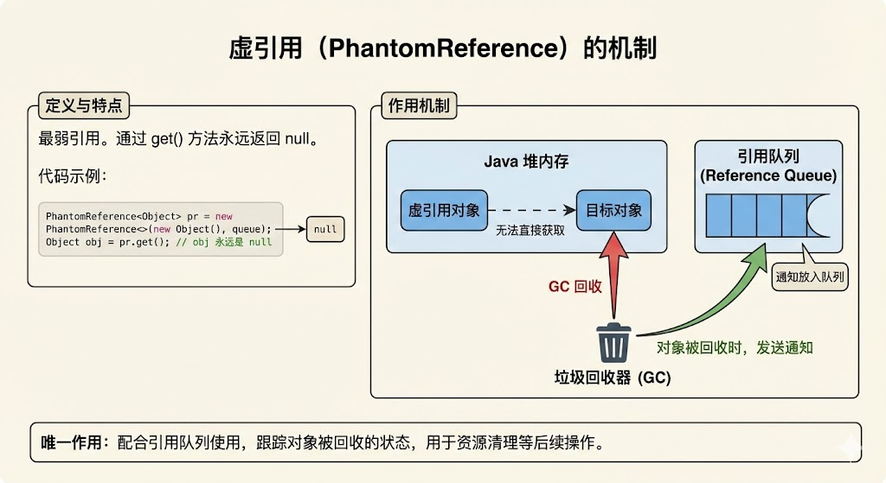

简单概括：**这四种引用的核心区别在于 GC（垃圾回收器）对待它们的态度不同。强引用是“誓死不回收”，软引用是“不够用才回收”，弱引用是“见了就回收”，虚引用是“回收了给个信”。**

---

### 一、 核心概念深度解析

#### 强引用

- **定义：** 我们平时写代码最常用的引用。例如 `Object obj = new Object();`。
- **GC** **策略：** 只要强引用还在，垃圾回收器**永远不会**回收它。

#### 软引用

- **定义：** 用 `SoftReference` 类包裹的对象。
- **GC** **策略：** 它是**有用但非必须**的对象。
    - 内存充足时：它活得很好，跟强引用一样。
    - 内存不足（快要 OOM）时：GC 会把这些对象回收掉，试图腾出空间。
- **场景：** 非常适合做**本地缓存**（如图片缓存）。内存够就存着，不够就清掉，不会导致系统崩。

#### 弱引用

- **定义：** 用 `WeakReference` 类包裹的对象。
- **GC 策略：** 它比软引用生命周期更短。**不管当前内存够不够**，只要垃圾回收器开始干活（GC 发生），弱引用关联的对象就会被回收。
- **场景：**`**ThreadLocal**`、`**WeakHashMap**`。解决核心对象的生命周期耦合问题，防止内存泄漏。

#### 虚引用

- **定义：** 最弱的一种引用，用 `PhantomReference` 类包裹。
- **特点：** 你甚至无法通过 `get()` 方法拿到原来的对象（永远返回 null）。
- **作用：** 它唯一的作用就是配合 **引用队列** 使用。当对象被 GC 回收时，系统会发一个通知放入队列。

---

### 二、 面试标准回答

**这四种引用的主要区别在于：当垃圾回收发生时，JVM 对它们的回收策略不同。这是 Java 为了让我们能更灵活地控制对象的生命周期而设计的。**

**具体来说，它们的强度依次递减：**

第一是强引用：

这是最常见的普通对象引用，比如 Object o = new Object()。

只要强引用指向一个对象，GC 绝对不会回收它。哪怕内存不足，JVM 宁愿抛出 OOM 异常，也不会动它。

第二是软引用：

它描述的是“有用但非必须”的对象。

GC 策略是 只有当堆内存不足、即将发生 OOM 时，GC 才会回收软引用对象。如果内存充足，它就会一直存在。因为这个特性，它非常适合用来做对内存敏感的缓存。

第三是弱引用：

它的强度比软引用更低。

GC 策略是只要发生 GC，无论当前内存是否充足，弱引用关联的对象都会被回收。最典型的应用是 ThreadLocal 中的 Key，以及 WeakHashMap。利用这个特性，可以使键值对在不再被外部强引用时自动被回收，防止内存泄漏。

第四是虚引用：

它是最弱的。我们甚至无法通过虚引用获取到对象实例。它唯一的作用是跟踪对象的回收状态。当对象被回收时，它会被放入引用队列中。这通常用于管理堆外内存的释放与清理。
