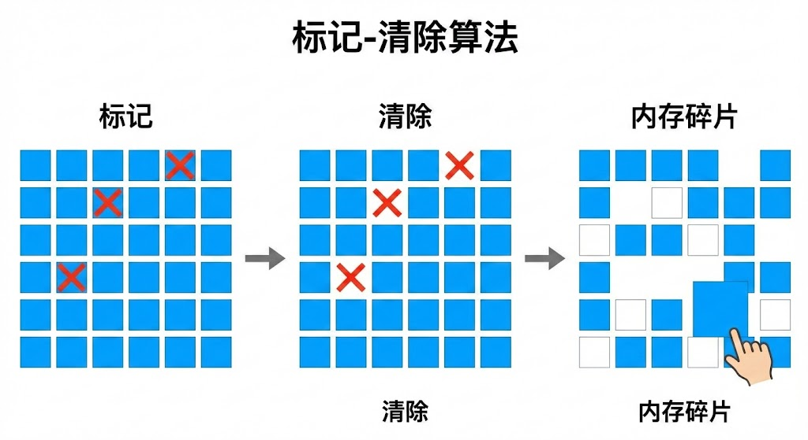
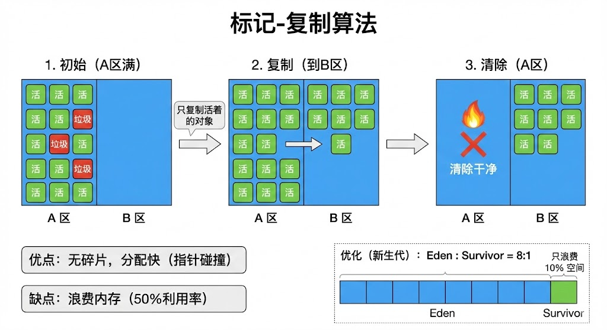
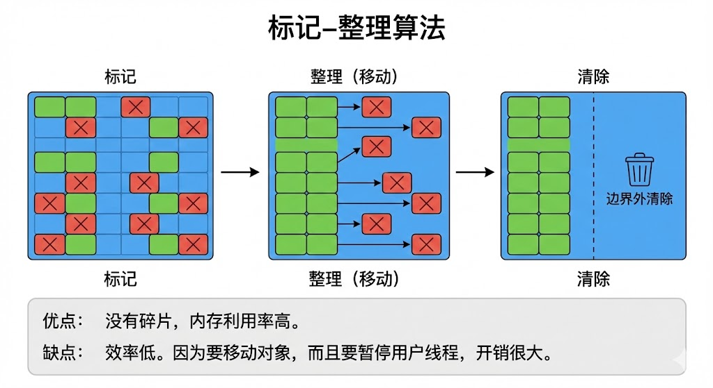
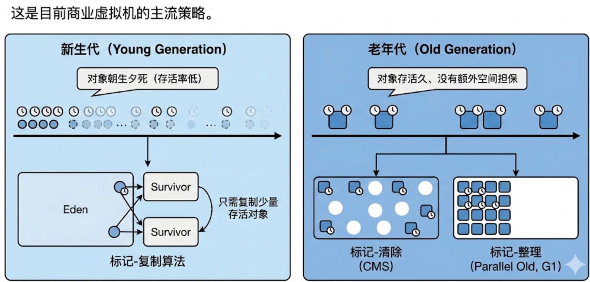

**常见的 GC 算法主要有“标记-清除”、“标记-复制”和“标记-整理”。但工业级 JVM 并不孤立使用它们，而是采用“分代收集”理论：新生代用复制算法，老年代用清除或整理算法。**

---

### 一、 核心原理深度解析

#### 标记-清除算法

- **做法：** 先把垃圾“标记”出来，然后直接“清除”掉。
- **优点：** 简单，不用移动对象。
- **致命缺点：****内存碎片**。
    - 就好比一张纸被剪得千疮百孔，虽然空闲总面积很大，但想画一张大图却找不到一块连续的地方，只能再次触发 GC。

#### 标记-复制算法

- **做法：** 把房间分成两半（A 区和 B 区）。只用 A 区，满了就把活着的搬到 B 区，然后把 A 区一把火烧干净。
- **优点：** 没有碎片，分配内存极其快（指针碰撞）。
- **缺点：****浪费内存**。相当于花了两份钱只买了一半的使用面积（50% 利用率）。
- **优化：** 在新生代中，对象死得快，所以不需要 1:1 分配。HotSpot 采用了 **Eden : Survivor = 8:1** 的比例，只浪费 10% 的空间。

#### 标记-整理算法

- **做法：** 标记完垃圾后，不直接清，而是把存活的对象**往一端移动**，挤在一起，然后把边界以外的全部清掉。
- **优点：** 没有碎片，内存利用率高。
- **缺点：****效率低**。因为要移动对象，而且要暂停用户线程，开销很大。

#### 分代收集理论

- 这是目前商业虚拟机的主流策略。
- **新生代：** 对象朝生夕死（存活率低），使用**标记-复制**算法（只需复制少量存活对象）。
- **老年代：** 对象存活久、没有额外空间担保，使用**标记-清除**（CMS）或**标记-整理**（Parallel Old, G1）。

---

### 二、 面试标准回答

**JVM 的垃圾收集算法主要有三种基础思想，以及一种综合性的分代策略。它们本质上都是在“时间”和“空间”之间做权衡。**

第一种是“标记-清除”算法：

它的逻辑最简单，标记出垃圾后直接清除。

- **缺点是：** 会产生大量的**内存碎片**。可能导致明明有内存，但塞不下大对象，从而频繁触发 GC。

第二种是“标记-复制”算法：

为了解决碎片问题，它把内存分为两半，将存活对象复制到另一半，然后清空当前这一半。

- **优点是：** 运行高效，且没有碎片。
- **缺点是：** 内存利用率低，浪费了一半空间。
- **应用场景：** 因为**新生代**的对象 98% 都是“朝生夕死”的，复制成本很低，所以新生代普遍采用这种算法。

第三种是“标记-整理”算法：

它是为了解决老年代存活率高的问题。在标记后，让所有存活对象向一端移动，然后直接清理掉边界以外的内存。

- **优点是：** 没有碎片，内存利用率高。
- **缺点是：** 移动对象需要暂停应用，效率相对较低。

最后是“分代收集”算法：

这是目前 JVM 的主流策略。

- 在**新生代**，由于存活率低，选用**复制算法**（配合 Eden 和 Survivor 区）。
- 在**老年代**，由于存活率高且没有额外空间担保，选用**标记-清除**或者**标记-整理**。
