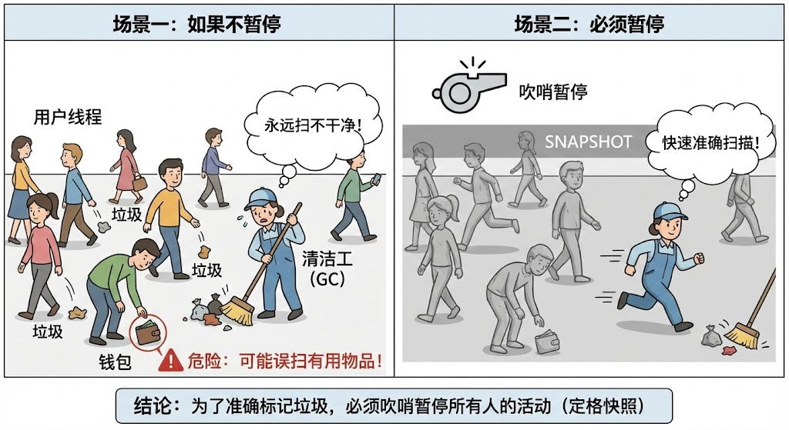
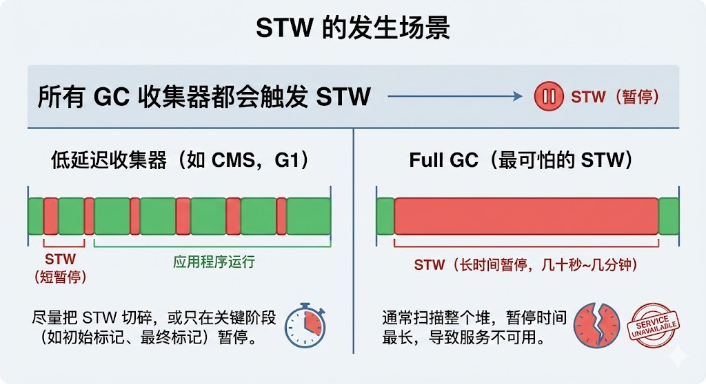

**STW (Stop The World) 是指在垃圾回收（GC）过程中，JVM 强制暂停所有用户线程，整个应用程序像“卡死”了一样，只让 GC 线程干活。这是为了保证在分析对象引用关系时，内存状态是一致的。**

---

### 一、 核心原理深度解析

为什么 JVM 必须要Stop The World？

#### 保证一致性

我们可以把内存回收想象成“在人流密集的广场上打扫垃圾”。

- **如果不暂停：** 清洁工（GC）正在扫地，一边扫，行人（用户线程）一边扔垃圾，或者把本来要扔的垃圾又捡回去了。
- **后果：** 清洁工永远扫不干净，甚至可能把正在使用的钱包（存活对象）当成垃圾扫走了。这在程序里就是致命的空指针异常。
- **必须暂停：** 为了准确地标记出什么是垃圾，什么是有用的，必须吹哨暂停所有人的活动，定格成一张照片（快照），然后快速扫描。

#### STW 的发生场景

- **所有 GC 收集器都会触发 STW。**
- 即使是号称“低延迟”的 CMS 或 G1，也无法完全避免 STW，只是尽量把 STW 的时间切碎，或者只在关键阶段（如初始标记、最终标记）暂停。
- **Full GC** 是最可怕的 STW，因为它通常会扫描整个堆，暂停时间最长，可能导致服务几十秒甚至几分钟不可用。

#### 调优的核心目标

JVM 调优的终极目标之一，就是**减少 STW 的停顿时间**。

- **吞吐量优先：** 宁愿停顿时间长一点，也要少停几次，保证计算效率（适合后台计算任务）。
- **响应时间优先：** 宁愿多停几次，每次停顿时间要极短，保证用户感觉不到卡顿（适合 Web 应用）。

---

### 二、 面试标准回答

**Stop The World 是 JVM 在垃圾回收（GC）过程中产生的一种特殊状态。**

简单来说，STW 就是全局暂停。

当 GC 发生时，JVM 会强制暂停所有的用户线程，整个应用程序看起来就像“卡死”了一样，只有 GC 线程在执行垃圾回收的工作。

为什么必须要有 STW 呢？主要是为了保证“引用关系的准确性”。

我们可以把 GC 的标记过程想象成统计人数。如果大家一直在走动（线程在运行，引用关系在变化），你是永远数不准的，甚至可能把活着的对象误判为垃圾给清理掉，导致程序崩溃。

所以，在进行可达性分析（尤其是根节点枚举和最终标记）时，必须冻结当前的内存状态，这就需要 STW。

STW 的影响和演进：

STW 是导致 Java 应用出现延迟、卡顿、超时的主要原因。

JVM 垃圾收集器的演进史，也体现出对于STW的优化思路：

- 从最早的 **Serial/Parallel**（完全 STW，停顿长）。
- 到 **CMS**（并发收集，只有初始/最终标记 STW，停顿短）。
- 再到现在的 **G1**（可预测停顿时间）。
- 以及最新的 ZGC（几乎并发，停顿控制在亚秒级）。
- 它们的目标都不是消除 STW（目前还做不到），而是尽可能地缩短 STW 的时间，提升用户体验。
