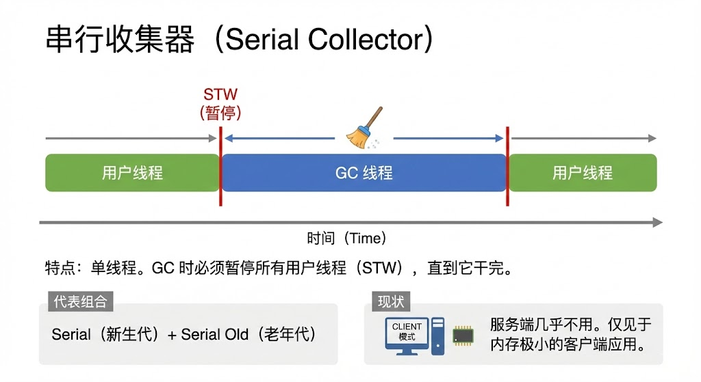
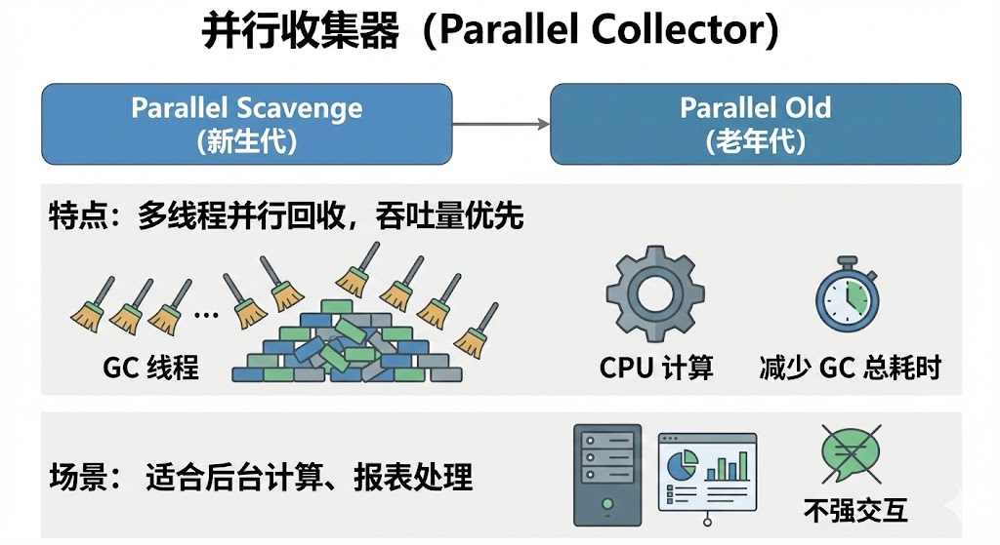
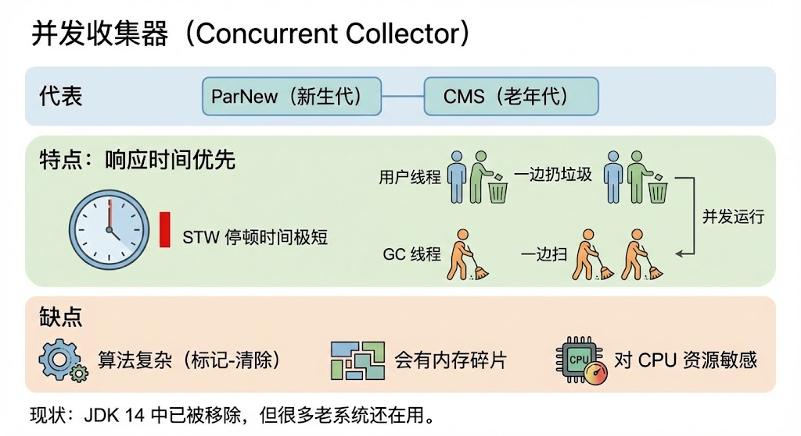
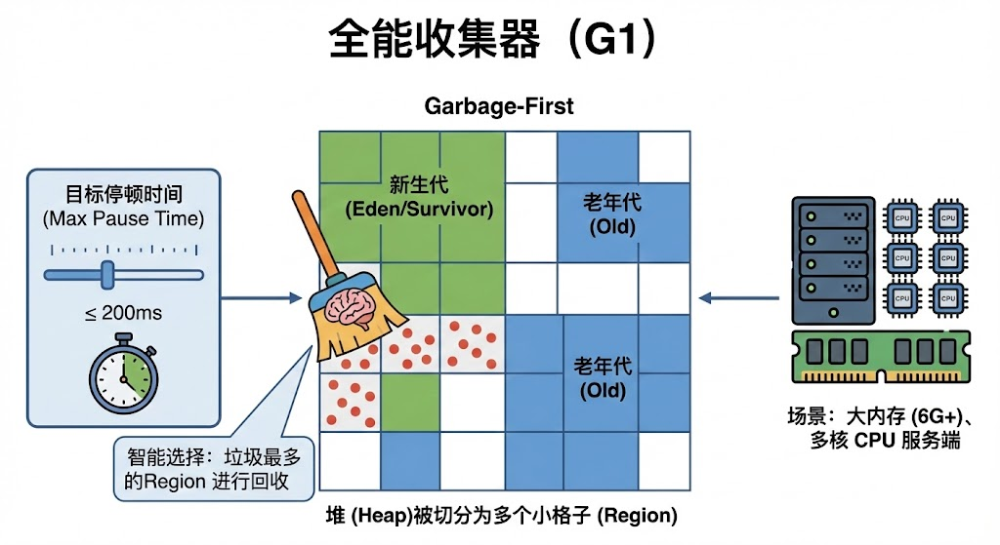

**Java 的垃圾收集器主要经历了三个阶段：Serial（单线程）、Parallel（多线程吞吐量优先）和 CMS/G1（并发低延迟）。目前面试中最常问的是 CMS 和 G1。**

---

### 一、 核心分类与演进

我们可以根据**使用场景**和**底层机制**，把它们分为四类：

#### 串行收集器

- **代表：**`Serial` (新生代) + `Serial Old` (老年代)。
- **特点：** 单线程。GC 时必须暂停所有用户线程（STW），直到它干完。
- **现状：** 现在服务端几乎不用了，只有在内存极小的客户端应用（Client 模式）里还能见到。

#### 并行收集器

- **代表：**`Parallel Scavenge` (新生代) + `Parallel Old` (老年代)。
- **特点：** 多线程并行回收。它的目标是**吞吐量优先**，即减少 GC 总耗时，让 CPU 更多地去算数据，而不是响应用户。
- **场景：** 适合后台计算、报表处理等不需要太强交互的场景。

#### 并发收集器

- **代表：**`ParNew` (新生代) + `CMS` (老年代)。
- **特点：****响应时间优先**。它最大的创新是让 GC 线程和用户线程**并发运行**（一边扔垃圾一边扫），极大缩短了 STW 的停顿时间。
- **缺点：** 算法复杂（标记-清除），会有**内存碎片**，且对 CPU 资源敏感。**JDK 14 中已被移除**，但很多老系统还在用。

#### 全能收集器

- **代表：**`G1` (Garbage-First)。<u>【这里读G first， 不是读 G一】</u>
- **特点：****可预测停顿**。它打破了物理上的分代隔离，把堆切成了很多个小格子（Region）。它可以根据用户设定的目标（比如“停顿不超过 200ms”），智能选择垃圾最多的 Region 进行回收。
- **场景：** 大内存（6G+）、多核 CPU 的服务端应用。

---

### 二、 面试标准回答

**我们主要关注以下三类主流组合：**

第一类是 Parallel 系列（Parallel Scavenge + Parallel Old）：

这是 JDK 8 的默认收集器。

- **核心特点是：** 关注**吞吐量**。它使用多线程并行回收，适合后台运算、科学计算等不需要太多交互的场景。它的策略是“宁愿一次停顿时间长点，也要让 CPU 总的利用率最高”。

第二类是 CMS 系列（ParNew + CMS）：

这是这类收集器是很多老系统的首选，也是并发收集的开山之作。

- **核心特点是：** 关注**低延迟**。它引入了“并发标记”和“并发清除”，让 GC 线程和用户线程同时工作，极大缩短了 STW 时间，适合 Web 服务器等对响应速度要求高的应用。

第三类是 G1 收集器：

这是 JDK 9 之后的默认收集器，也是目前的主流。

- **核心特点是：可预测停顿**。它引入了 Region（分区）的概念，不再物理隔离新生代和老年代。它可以让用户指定期望的停顿时间（比如 200ms），然后智能选择回收收益最高的区域，非常适合大内存的服务端应用。
