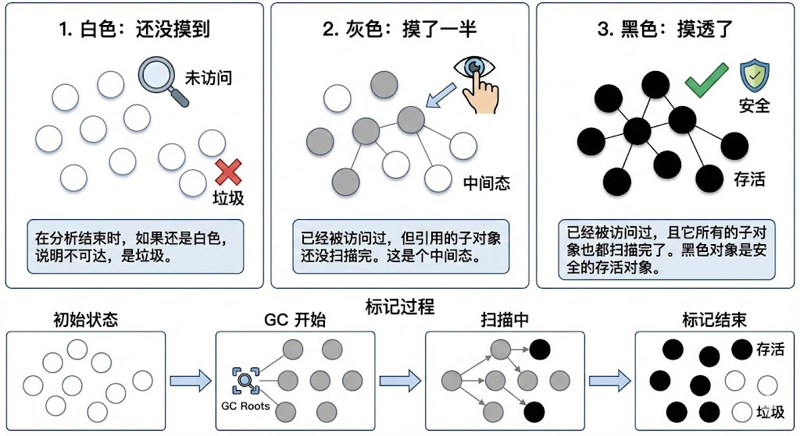
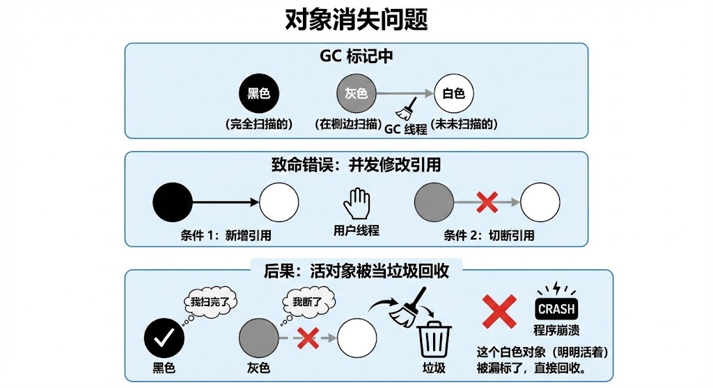
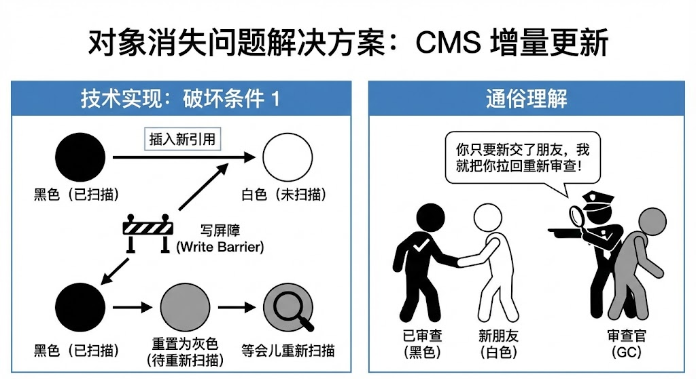

**三色标记法是 JVM 在并发标记阶段为了保证准确性引入的逻辑抽象。它通过白、灰、黑三种颜色来记录对象的扫描状态，核心是为了解决“用户线程修改引用”和“GC 线程扫描”并发进行时的数据一致性问题。**

---

### 一、 核心原理深度解析

#### 三种颜色的定义

GC 线程把堆中的对象视为有三种状态：

- **白色：****还没摸到。** 表示对象尚未被垃圾收集器访问过。在分析结束时，如果还是白色，说明不可达，是垃圾。
- **灰色：****摸了一半。** 表示对象已经被访问过，但这个对象引用的**子对象**还没扫描完。这是个中间态。
- **黑色：****摸透了。** 表示对象已经被访问过，且它所有的子对象也都扫描完了。黑色对象是安全的存活对象。

#### 标记过程

    1. 初始状态，所有对象都是**白色**。
    2. GC 开始，把 **GC Roots** 直接引用的对象变成**灰色**。
    3. 从灰色集合中取出对象，把它引用的子对象变成灰色，把自己变成**黑色**。
    4. 重复步骤 3，直到灰色集合为空。
    5. 剩下的白色对象就是垃圾。

#### 对象消失问题

如果 GC 线程正在标记，用户线程同时也修改了引用，可能会出现致命错误：**把活对象当成垃圾收掉了。**

这种情况必须同时满足两个条件：

1. **新增一条边：** 一个**黑色**对象突然指向了一个**白色**对象（赋值）。
2. **切断一条边：** 原本**灰色**对象指向这个**白色**对象的引用被切断了。

**后果：** 黑色对象以为自己扫完了，不会再去管那个白色；灰色对象那边断了，也没法顺藤摸瓜找到那个白色。结果这个白色对象（明明活着）被漏标了，直接回收，程序崩溃。

#### 写屏障

为了打破上面两个条件，JVM 引入了写屏障，主流有两种流派：

- **增量更新—— CMS 采用：**

- **破坏条件 1。**
- 只要黑色对象插入了新的指向白色的引用，就把这个黑色对象**重置为灰色**。等会儿重新扫描它。
- *通俗理解：* “你只要新交了朋友，我就把你拉回重新审查。”
- **原始快照 —— G1 采用：**

- **破坏条件 2。**
- 当灰色对象要删除指向白色的引用时，把这个白色对象**记录下来**。哪怕你删了，我依然默认它活着，按下快照里的引用关系扫描。
- *通俗理解：* “不管你现在怎么改，我只认开始那一刻的关系，断掉的我也当它连着。”

---

### 二、 面试标准回答

**三色标记算法是并发 GC（如 CMS、G1）的核心逻辑，主要为了解决在“并发标记”阶段，如何准确追踪对象引用的问题。**

**它的核心思想是把对象分为三种状态：**

- **白色：** 还没被扫描到的对象（最终是垃圾）。
- **灰色：** 被扫描到了，但它的子引用还没扫描完（正在处理中）。
- **黑色：** 自己和子引用都扫描完了（确认存活）。

这个算法最大的挑战在于“并发性”：

当 GC 线程在扫描时，用户线程也在运行，可能会修改引用关系。这会导致“对象消失”的严重 Bug：即一个黑色对象引用了一个白色对象，同时灰色对象切断了对该白色对象的引用，导致这个活着的白色对象被误判为垃圾。

**为了解决这个问题，JVM 引入了“写屏障”技术，有两种主流实现：**

第一种是 CMS 使用的“增量更新”：

它的逻辑是：一旦黑色对象引用了白色对象，就把黑色变成灰色，下次重新扫描。宁可多扫描，绝不漏掉。

第二种是 G1 使用的“原始快照（SATB）”：

它的逻辑是：在引用被切断之前，把引用关系记录下来。无论引用怎么变，GC 都按照刚开始时的快照进行扫描。虽然可能会产生一点浮动垃圾，但效率更高。
