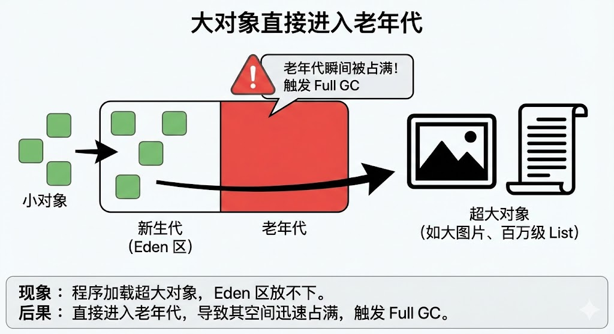
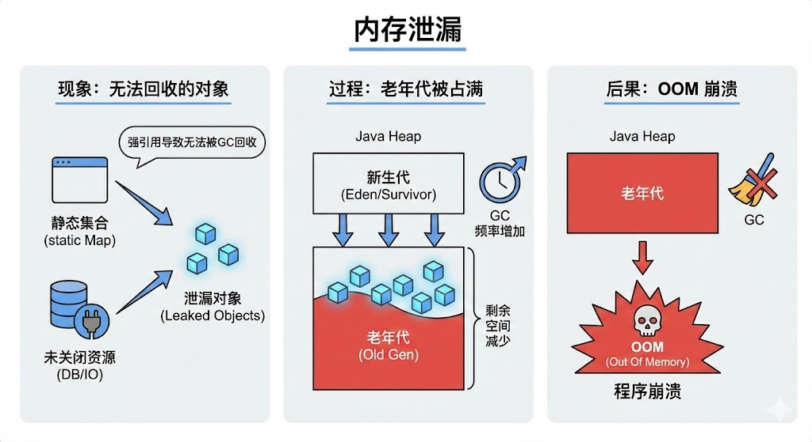
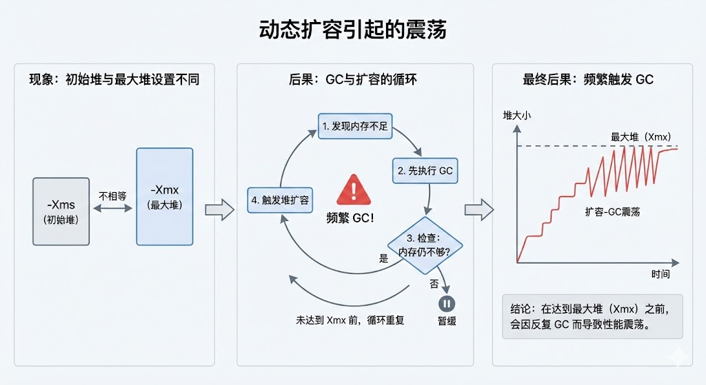

**GC 频繁的本质只有两点：要么是对象产生得太快（代码写得烂），要么是存活时间太长（内存泄漏或配置不当）。导致的结果就是堆内存（尤其是老年代）一直处于“高水位”预警状态。**

---

### 一、 核心原因深度拆解

#### 大对象直接进入老年代

- **现象：** 程序运行期间突然加载了一张超大的图片，或者从数据库查询了一个百万级的 List。
- **后果：** 这种大对象在 Eden 区放不下，会直接进入老年代。老年代空间瞬间被占满，触发 Full GC。

#### 内存泄漏

- **现象：** 一些本该被回收的对象，因为被静态集合（如 `static Map`）引用着，或者资源连接（DB/IO）没关闭。
- **后果：** 每次 GC 都回收不掉它们，老年代的有效空间越来越少，GC 也就越来越频繁，最后 OOM。

#### 动态扩容引起的震荡

- **现象：**`-Xms`（初始堆）和 `-Xmx`（最大堆）设置不一样。
- **后果：** JVM 发现内存不够时先 GC，GC 完发现还不够才扩容。在扩容达到最大值之前，会频繁触发 GC。

---

### 二、 面试标准回答

**通常可以从代码层面和配置层面这两个维度来分析。**

**第一类是代码层面的问题：**

1. **大对象直接进入老年代：**

如果在代码中创建了超大的数组、List，或者加载了大文件，导致 Eden 区放不下，这些对象会直接晋升到老年代。一旦老年代被塞满，就会频繁触发 Full GC。

1. **内存泄漏：**

这是最隐蔽的原因。比如 static 的 Map 只存不删，或者 ThreadLocal 没有 remove，导致大量对象无法被回收。老年代的可用空间越来越小，GC 就会越来越频繁，直到 OOM。

1. **不必要的对象创建：**

比如在高频循环里创建复杂的对象，或者由 System.gc() 显式调用。

**第二类是 JVM 配置层面的问题：**

1. **堆内存设置过小：**

物理内存给的太少了，无法满足应用运行时的基本需求，导致对象稍微一多就得回收。

1. **新生代设置过小：**

如果 -Xmn 设置得太小，或者 Survivor 区太小，会导致“对象过早晋升”。也就是说，很多本该在新生代就死掉的对象，因为没地方放，被迫提前进入了老年代。老年代压力剧增，从而导致频繁的 Full GC。

1. 元空间不足：

如果系统使用了大量的动态代理（如 Spring, CGLib），会生成很多动态类。如果元空间设置得太小，也会触发 Full GC 来清理类元数据。
