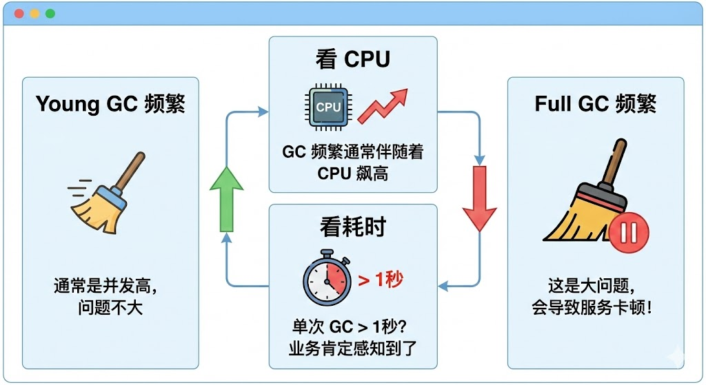

**排查 GC 问题的核心流程是：先看监控区分是 Full GC 还是 Young GC，然后用命令行工具（jstat）确认内存分布，接着保留现场（Dump 堆内存），最后离线分析（用 MAT）找到元凶。**

---

### 一、 核心排查思路深度解析

排查线上问题，切忌上来就重启或者上来就 Dump（因为 Dump 会卡死服务）。

#### 第一步：确认“病情”

- **区分类型：** 是 **Young GC 频繁**（通常是并发高，问题不大），还是 **Full GC 频繁**（这是大问题，会导致服务卡顿）？
- **看 CPU：** GC 频繁通常伴随着 CPU 飙高。
- **看耗时：** 单次 GC 耗时多少？如果超过 1秒，业务肯定感知到了。

#### 第二步：临床诊断

在不重启、不 Dump 的情况下，先看看内存里到底发生了什么。

- **神器** `**jstat**`**：**`jstat -gcutil <pid> 1000`。
- **看什么：**
    - **E (Eden):** 变化特别快？说明对象创建极快。
    - **O (Old):** 也就是老年代。如果它一直维持在 90% 以上，GC 后也降不下来，说明有**内存泄漏**或者**大对象**。
    - **M (Metaspace):** 如果它满了，说明加载了太多类（可能是反射或动态代理导致的）。

#### 第三步：保留现场

如果 `jstat` 看出老年代满了，必须看看到底是谁占着茅坑不拉屎。

- **操作：****先将该节点摘除流量**，防止 Dump 时服务假死影响用户。
- **命令：**`jmap -dump:format=b,file=heap.hprof <pid>`。
- **注意：** 如果堆很大（比如 8G），Dump 可能会很慢，一定要小心。

#### 第四步：解剖分析（MAT 工具）

拿到 Dump 文件后，下载到本地，用 **MAT**打开。

- **看直方图 ：** 谁的数量最多？（比如几百万个 String）。
- **看支配树：** 谁占的内存最大？（比如某个 List 占了 2G）。
- **分析引用链：** 顺藤摸瓜，看是哪个静态变量或线程引用了这些对象。

---

### 二、 面试标准回答

**排查线上频繁 GC 问题，我会按照“观测—隔离—分析—解决”这四步法来进行。**

第一步是“观测与区分”：

首先，我会查看监控平台。

核心是要区分是 Young GC 频繁还是 Full GC 频繁。

- 如果只是 Young GC 频繁但回收很快，通常是因为并发量高，可以通过扩容或调整新生代比例解决。
- 如果是 **Full GC 频繁**（比如几分钟一次），且回收后老年代内存没有明显下降，这通常意味着**内存泄漏**或**大对象积压**，这是需要重点排查的。

第二步是“命令行初步诊断”：

我会登录服务器，使用 jstat -gcutil &lt;pid> 1000 命令实时查看内存分区的使用情况。

重点观察老年代 的占比。如果老年代持续维持在 90% 以上，且每次 FG 后都降不下来，基本可以确诊是内存泄漏。

第三步是“保留现场与 Dump”：

为了找到根因，我需要导出堆内存快照。

但在操作前，我会先将该节点从负载均衡中摘除，避免 Dump 过程中的 STW 导致线上服务超时。

然后使用 jmap -dump:format=b,file=dump.hprof &lt;pid> 导出堆文件。

第四步是“离线分析”：

我会将 Dump 文件下载到本地，使用 MAT进行分析。

- 通过 **Dominator Tree（支配树）** 找到占用内存最大的对象。
- 查看 **Path to GC Roots**，定位是哪段代码、哪个静态变量或线程一直在引用这些对象，从而定位到具体的业务代码问题。
