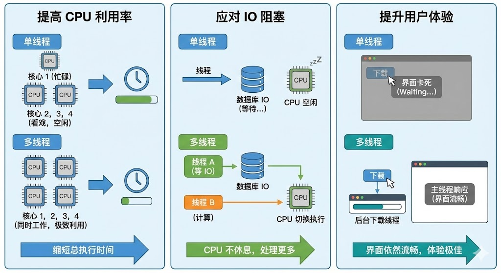

### 一、 核心目的解析

#### 提高CPU利用率

现在的 CPU 基本上都是多核的。如果你的程序是单线程的，那它只能在一个 CPU 核心上跑，其他核心都在“看戏”。

- **多线程的目的：** 就是让多个 CPU 核心同时工作，把硬件能力用到极致，从而大幅缩短任务的总执行时间。

#### 应对 IO 阻塞

程序运行中经常需要等待：读写文件、请求数据库、网络传输，这些都叫 IO 操作。

- **单线程的问题：** 一旦遇到 IO，CPU 就空闲了，整个程序卡住不动。
- **多线程的目的：** 当线程 A 在等数据库返回时，CPU 可以切换去执行线程 B 的计算任务。这样 CPU 就不休息，单位时间内处理的请求更多。

#### 提升用户体验

这在图形界面或 Web 服务中尤为重要。

- **场景：** 你点击了一个“下载”按钮。
- **单线程：** 界面直接卡死，直到下载结束才能动。
- **多线程：** 主线程负责响应你的鼠标点击，后台开启一个新线程去下载。界面依然流畅，用户体验极佳。

---

### 二、 面试标准回答

第一，为了充分利用多核 CPU 的计算能力。

现在的服务器和电脑几乎都是多核的。如果是单线程程序，它只能跑在一个核心上，其他核心资源就被浪费了。通过多线程，我们可以让多个核心并行工作，极大提高程序的执行效率，也就是我们常说的“压榨 CPU 性能”。

第二，为了提高系统的吞吐量，尤其是应对 IO 阻塞。

绝大多数应用都不是纯计算的，都会涉及读写数据库或网络请求。在单线程模式下，一旦发生 IO 等待，CPU 就会空闲。而多线程允许我们在等待 IO 的时候，把 CPU 让给其他线程去处理业务。这样 CPU 一直在干活，系统的整体处理能力就上来了。

第三，为了提升用户体验和程序的响应速度。

这一点在 GUI 编程或高并发 Web 服务中很明显。我们不能让一个耗时的任务（比如生成报表）阻塞住主线程，导致用户界面卡死或后续请求无法响应。通过异步线程处理耗时任务，主线程可以一直保持“敏捷”的状态。

总结来说：

多线程并不是万能的，它带来了上下文切换的开销，但在现代硬件背景下，它是提升系统性能和并发能力的必要手段。
