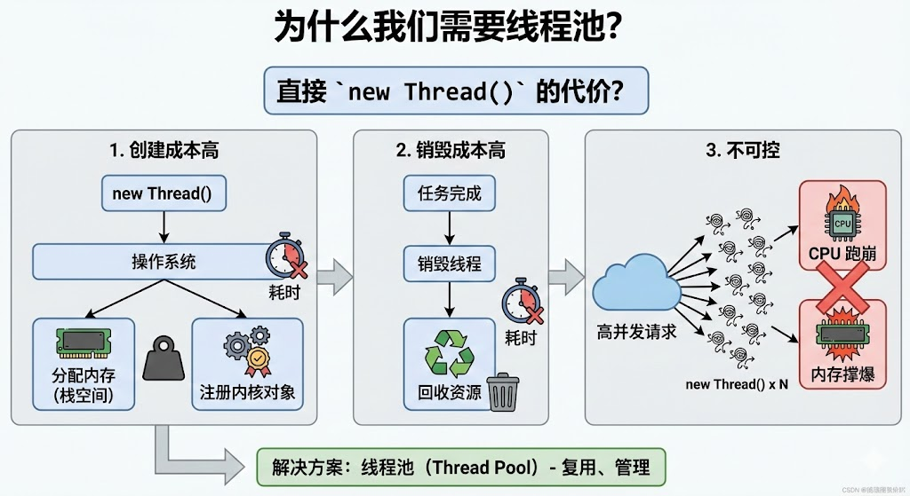
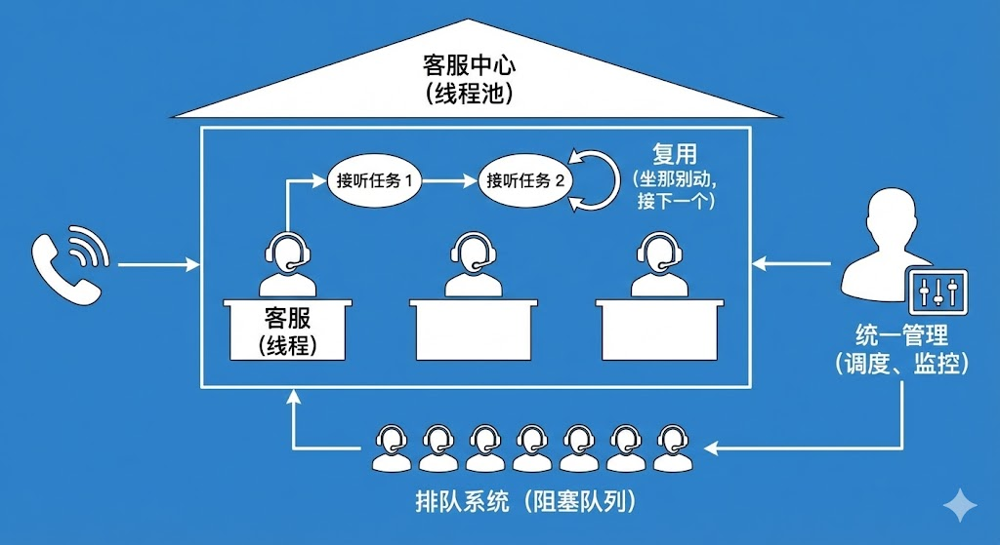

### 一、 核心概念解析

#### 为什么我们需要它？

在 Java 中，`new Thread()` 是一个很“重”的操作。

- **创建成本高：** 每次创建一个线程，操作系统都要分配内存（栈空间）、注册内核对象。
- **销毁成本高：** 任务做完销毁线程，又要回收资源。
- **不可控：** 如果来一个请求就开一个线程，并发一高，几万个线程瞬间就会把 CPU 跑崩或者内存撑爆。

#### 线程池做了什么？

线程池就像一个**“原本就有人的客服中心”**：

- **复用：** 客服（线程）坐那别动，接完一个电话（任务），不辞职，直接接下一个电话。
- **排队：** 电话太多接不过来，就让客户在系统里排队（阻塞队列），而不是再去招几千个新客服。
- **管理：** 统一调度，统一监控。

---

### 二、 面试标准回答

**Java 中的线程池，本质上是一种基于“池化思想”的线程管理机制。**

**总的来说，它的出现是为了解决传统** `**new Thread()**` **模式带来的性能开销大和资源不可控的问题。** 它的核心类是 JUC 包下的 `ThreadPoolExecutor`。

**具体来说，使用线程池主要有三个核心优势：**

第一，降低资源消耗。

我们知道，线程的创建和销毁在操作系统层面是非常消耗 CPU 和内存资源的。线程池通过复用已创建的线程，让一个线程执行完当前任务后，继续去执行队列里的下一个任务，从而避免了重复造轮子的开销。

第二，提高响应速度。

当任务到达时，如果线程池里有空闲线程，任务可以立刻执行，而不需要等待线程创建的过程。这就好比打车时，车已经在门口等着了，肯定比现叫车要快。

第三，提高线程的可管理性。

线程是稀缺资源，如果无限制地创建，不仅会消耗系统资源，还会降低系统的稳定性（比如导致 OOM）。线程池可以对线程进行统一的分配、调优和监控，通过参数（比如核心线程数、最大线程数）来限制系统的最大并发量，起到一个“防洪堤”的作用。
