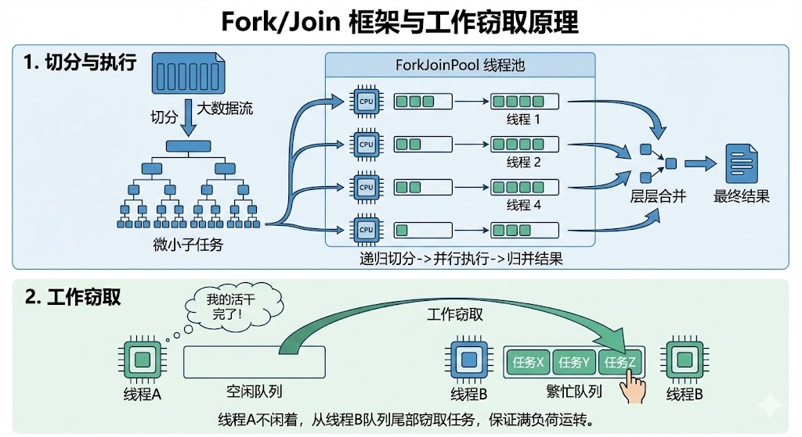
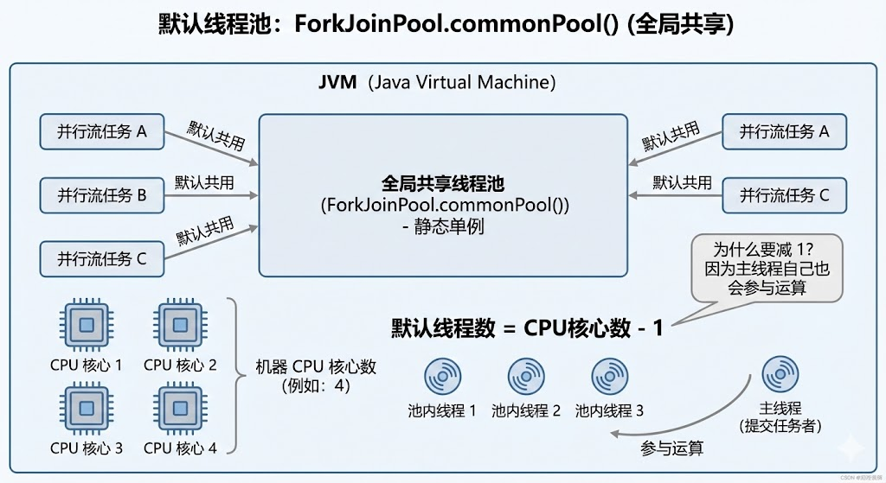

并行流其实并不是什么新发明的黑科技，它本质上就是对 Java 7 引入的 **Fork/Join 框架** 的一层封装。

**并行流利用“分而治之”的思想，将大任务切分成多个小任务并行执行，最后汇总结果。它默认使用的线程池是全局唯一的** `**ForkJoinPool.commonPool()**`**。**

具体的底层运作机制和潜在风险，可以从以下 **3 个维度** 来拆解：

1. **核心引擎：Fork/Join 框架与“工作窃取”**

- **切分（Fork）：** 并行流首先利用 `Spliterator`将整个数据流递归地切分成无数个微小的子任务，直到任务足够小。
- **执行与合并（Join）：** 这些子任务被提交到线程池中并行执行。执行完的结果会像归并排序一样，层层合并，最后返回。
- **工作窃取（Work Stealing）：** 这是它效率高的关键。
    - 每个线程都有自己的双端队列。
    - 如果线程 A 把自己的活干完了，它不会闲着，而是去线程 B 的队列尾部“偷”一个任务来干。这就保证了所有 CPU 核心都能满负荷运转，不会出现“一核有难，七核围观”的现象。
1. **默认线程池：ForkJoinPool.commonPool()**

- **全局共享：** 这是一个静态单例的线程池。整个 JVM 里的所有并行流，默认都共用这一口锅。
- **并发度：** 它的默认线程数等于机器的 **CPU 核心数 - 1**。
    - *为什么要减 1？* 因为提交任务的主线程自己也会参与运算。
1. **致命的大坑（面试必考）**
    1. 由于所有并行流共用同一个 `commonPool`，如果你的任务里包含 **I/O 操作（如查库、请求网络）** 或 **锁等待**：
        - 这些阻塞操作会卡住池子里的线程。
        - 一旦线程都被卡住，整个系统中其他完全无关的并行流业务也会全部卡死（因为没线程可用了）。
    2. **结论：** 并行流只适合 **CPU 密集型** 计算。涉及 I/O 的业务，严禁使用默认的并行流，必须自定义线程池。

---

### 面试标准回答

Java 的并行流底层是基于 **Fork/Join 框架** 实现的。

它的工作流程遵循‘分而治之’的策略：

首先利用 Spliterator 将数据流递归拆分为多个小任务，然后将这些任务提交到线程池中并行执行。为了平衡不同线程的负载，它还利用了 Work-Stealing（工作窃取） 算法，让空闲线程去帮助繁忙线程处理任务。

关于线程池：

并行流默认使用的是全局唯一的 ForkJoinPool.commonPool()。

这个线程池的默认线程数是 CPU 核心数减 1。

（关键补充）：需要特别注意的是，正因为它是全局共享的，我们在使用时必须非常谨慎。

如果任务中包含大量的 I/O 阻塞操作（如数据库查询），会导致这个公共线程池的线程耗尽，进而拖垮整个系统中所有使用并行流的业务。

因此，并行流通常只适用于 CPU 密集型 的计算任务。
