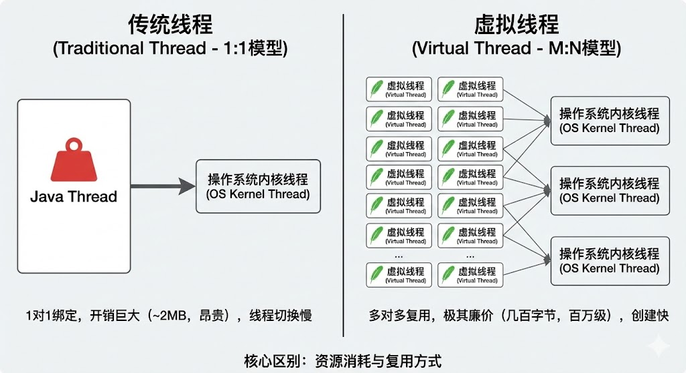
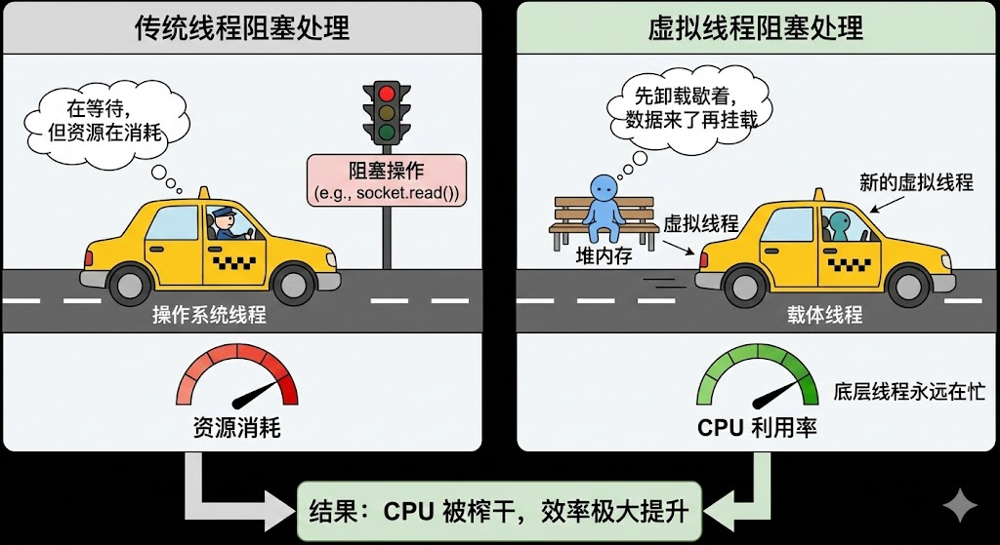

虚拟线程是 Java 21 引入的王炸特性。**它是 Java 层面实现的“轻量级线程”，不再和操作系统的内核线程 1:1 绑定，而是由 JVM 自己管理。这让“一个请求配一个线程”这种最简单的编程模式，也能拥有媲美 Netty 的高并发性能。**

具体区别和影响，可以从以下 **3 个维度** 来拆解：

1. **调度模型：从 1:1 到 M:N（核心区别）**

- **传统线程**
    - Java 的 `Thread` 和操作系统的内核线程是 **1:1** 绑定的。
    - 创建一个线程要消耗 ~2MB 内存（栈空间），且线程切换需要进入内核态，开销巨大。所以我们以前最多只能开百来个线程，不敢开几十万个。
- **虚拟线程**
    - 它是 **M:N** 模型。成千上万个虚拟线程，复用底层的几个操作系统线程。
    - 创建一个虚拟线程只消耗几百字节。你可以在一台机器上轻松创建 **100 万个** 虚拟线程，就像创建对象一样廉价。
1. **阻塞处理**

- **传统线程：** 当线程执行 `socket.read()` 等待网络数据时，操作系统线程会真的被**阻塞**。这就像出租车司机停在路边等乘客，虽然没干活，但油钱（资源）照样烧。
- **虚拟线程：** 当代码执行阻塞操作时，JVM 会把这个虚拟线程“卸载”**下来，放到堆内存里歇着。底层的 Carrier Thread 立马去干别的活。等数据来了，JVM 再把虚拟线程**“挂载”回去继续跑。
- **结果：** 底层的操作系统线程几乎永远在干活，CPU 利用率被榨干。
1. 对编程模型的改变

这是最大的革命。

    1. **以前** 为了高并发，我们被迫使用 WebFlux、Netty、CompletableFuture。代码被拆得支离破碎，全是回调，调试极其痛苦。
    2. **现在** 有了虚拟线程，你可以直接写最简单的**同步阻塞代码**。
        - 虽然代码看起来是阻塞的，但底层完全是非阻塞的。
        - **结论：** 我们不再需要复杂的响应式编程了，就能写出高并发系统。

---

### 面试标准回答

虚拟线程是 Java 在 JDK 21 正式推出的轻量级线程实现，它彻底改变了 Java 的并发模型。

**它与传统线程的主要区别在于：**

第一，映射关系不同：

传统线程是 1:1 映射到操作系统内核线程的，创建和切换开销极大（MB 级栈内存），数量受限。

而虚拟线程是 M:N 映射的，由 JVM 在用户态进行管理和调度，创建成本极低（字节级），单机支持百万级并发。

第二，阻塞机制不同：

传统线程阻塞时会挂起内核线程，导致 CPU 资源浪费。

虚拟线程在执行阻塞 I/O 操作时，会被 JVM 自动‘卸载’，底层的 Carrier Thread 可以立刻去执行其他虚拟线程，极大地提升了 CPU 利用率。
