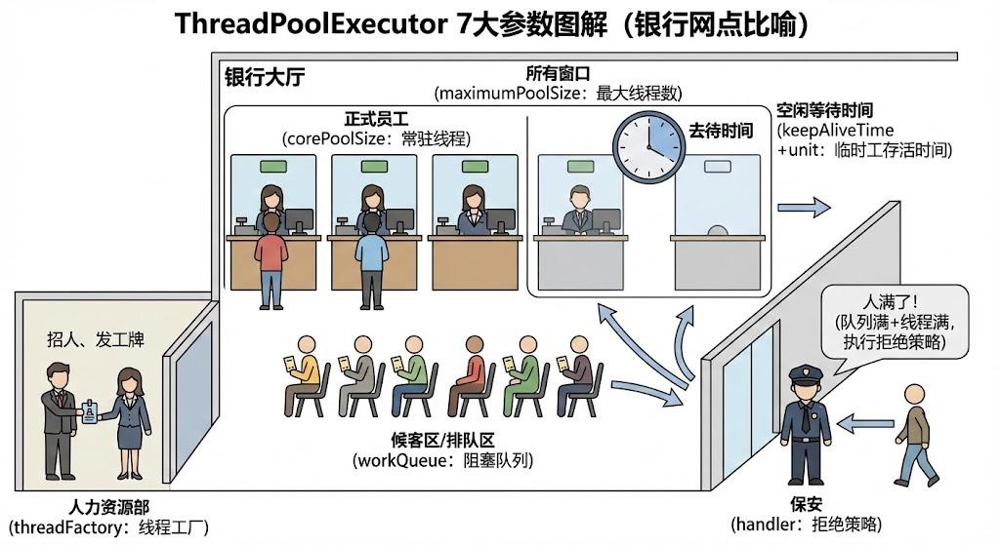

### 一、 核心参数深度解析

`ThreadPoolExecutor` 的构造函数中，一共有 **7 个参数**。为了方便记忆，我们可以把线程池想象成一个**银行网点**：

1. `**corePoolSize**`**：**
    1. **含义：** 线程池中“常驻”的线程数量。
    2. **比喻：** 银行里的**“正式员工”**。哪怕没有客户来办业务，他们也在柜台坐着，不会被辞退。
2. `**maximumPoolSize**`**：**
    1. **含义：** 线程池允许创建的最大线程数（核心线程 + 非核心线程）。
    2. **比喻：** 银行里的**“所有窗口”**（正式员工 + 忙碌时临时加开的窗口）。当业务非常火爆时，最多能开多少个窗口。
3. `**keepAliveTime**`**：**
    1. **含义：** 当线程数超过核心线程数时，多余的空闲线程在终止前等待新任务的最长时间。
    2. **比喻：****“临时工”的等待时间**。如果临时加开的窗口空闲了这么久还没人来办业务，就把这个临时窗口关了（销毁线程），节省成本。
4. `**unit**`**：**
    1. **含义：**`keepAliveTime` 的单位（秒、毫秒等）。
5. `**workQueue**`**：**
    1. **含义：** 用来存放等待执行任务的阻塞队列。
    2. **比喻：** 银行里的**“候客区/排队区”**。如果所有正式窗口都在忙，新来的客户就得去排队区拿号等待。
6. `**threadFactory**`**（线程工厂）：**
    1. **含义：** 用于创建新线程的工厂，通常用来给线程起个有意义的名字，方便排查问题。
    2. **比喻：****“人力资源部”**，负责招人、发工牌、录入系统。
7. `**handler**`**（拒绝策略）：**
    1. **含义：** 当队列满了，且线程数也达到最大值时，对新任务的处理策略。
    2. **比喻：****“保安”**。当排队区坐满了，所有窗口也开满了，这时候再来人，保安要怎么把人挡回去（抛异常、让客户自己办、或者直接赶走）。

---

### 二、 面试标准回答

**Java 线程池的核心实现类** `**ThreadPoolExecutor**` **一共有 7 个核心参数，我可以把它们分为“三类”来介绍。**

**第一类是“配置人员数量”的参数：**

- `**corePoolSize**`**：** 这是线程池维持的最小常驻线程数量，即使空闲也不会被回收。
- `**maximumPoolSize**`**：** 线程池能容纳的最大线程数量。
- `**keepAliveTime**` **和** `**unit**`**：** 这两个定义了非核心线程的“保活时间”。如果当前线程数超过了核心数，且这些线程空闲时间达到了设定值，就会被回收。

**第二类是“配置等待区”的参数：**

- `**workQueue**`**：** 用于存放因为核心线程忙碌而来不及处理的任务。常见的有 `LinkedBlockingQueue` 或 `ArrayBlockingQueue`。

**第三类是“兜底与辅助”的参数：**

- `**threadFactory**`**：** 用来创建新线程，我们通常会自定义它来给线程设置有意义的名字，方便后续查日志。
- `**handler**`**（拒绝策略）：** 当队列满了，并且线程数也达到了最大值，线程池就会启动拒绝策略来处理新提交的任务。
