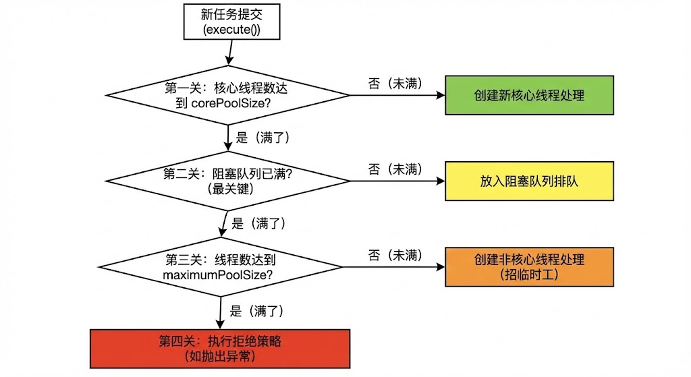

简单来说：**线程池的执行流程就是一个“优先利用核心资源 -> 其次缓冲堆积任务 -> 再次招募临时工 -> 最后不得不拒绝”的过程。**

### 一、 核心流程深度解析

我们可以把线程池的工作流程看作是一个**精密的漏斗筛选机制**。当一个新任务通过 `execute()` 方法提交时，会依次经历以下四道关卡：

1. **第一关：核心线程判断**
    1. 如果不满，直接创建新线程处理任务。
    2. 如果满了，进入下一关。
2. **第二关：任务队列判断**
    1. **这是最关键的一步。** 如果核心线程都在忙，线程池**不会**立刻扩容去创建新线程，而是优先把任务丢进阻塞队列里排队。
    2. 只有当队列塞满了，装不下了，才会进入下一关。
3. **第三关：最大线程判断**
    1. 队列满了，说明积压严重。这时线程池会尝试“招临时工”，创建新的非核心线程来处理新任务。
    2. 如果线程数达到了最大限制，进入最后一关。
4. **第四关：拒绝策略**
    1. 没人能处理，队也排不上，只能执行拒绝策略（如抛出异常或丢弃任务）。

---

### 二、 面试标准回答

**Java 线程池处理任务的流程非常清晰，主要遵循“四步走”策略：**

第一步，检测核心线程：

当一个任务提交进来，线程池首先会判断当前运行的线程数是否少于核心线程数。

- 如果少于，则直接创建一个新的核心线程来执行该任务，哪怕此时有空闲线程也会创建。
- 如果核心线程数已满，则进入下一步。

第二步，检测任务队列：

这一步非常关键。线程池会将任务尝试放入阻塞队列中排队等待。

- 如果入队成功，任务就在队列里等着核心线程忙完来取。
- **只有当队列也满了**，才会进入下一步。

第三步，检测最大线程：

此时，线程池会判断当前线程数是否少于最大线程数。

- 如果少于，线程池会创建一个**非核心线程**来“救急”，立刻处理这个新提交的任务（注意：是处理新任务，而不是去处理队列里的老任务）。
- 如果最大线程数也满了，说明系统负载已达极限，进入最后一步。

第四步，执行拒绝策略：

线程池会调用 RejectedExecutionHandler 的 rejectedExecution 方法。默认情况下是抛出 RejectedExecutionException 异常，当然也可以配置为丢弃任务或由调用者线程自己执行。
