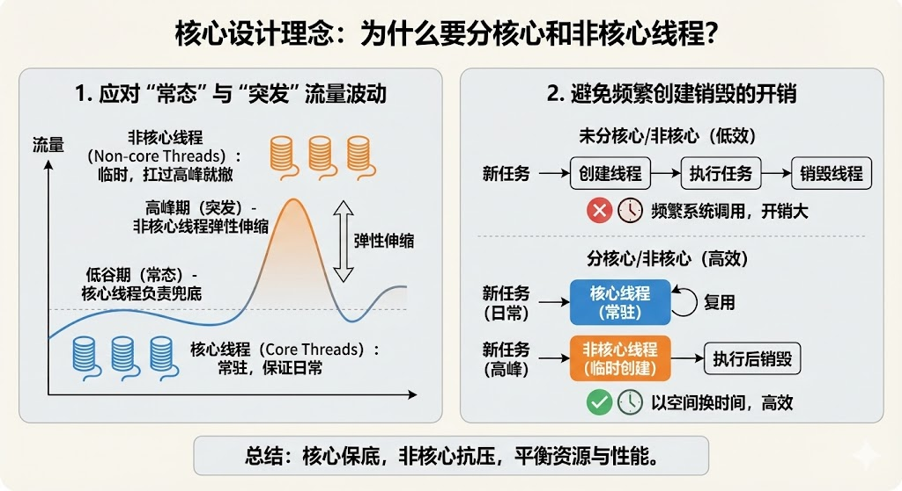

简单来说：**这种设计是为了在节省资源和抗住突发流量之间找到一个弹性的平衡点。**

### 一、 核心设计理念解析

为什么要分核心和非核心？

1. **为了应对“常态”与“突发”的区别：**
    1. 大多数系统的流量是有波动的。如果按最高峰去配置所有线程，那在低谷期，大量线程空转，占用内存，这是极大的浪费。
    2. 如果按低谷期配置，高峰期又扛不住。
    3. **核心线程**负责兜底，保证日常处理速度；**非核心线程**负责弹性伸缩，扛过高峰就撤。
2. **避免频繁创建销毁的开销：**
    1. 核心线程创建后常驻，避免了每次来任务都 `new Thread` 的系统调用开销。
    2. 非核心线程虽然也需要创建，但它只在极端情况下才出现，用完即毁，是一种“以空间换时间”的临时策略。

---

### 二、 面试标准回答

**这个设计的核心目的是为了实现线程池的“弹性伸缩”，在系统性能和资源消耗之间找到最优解。**

**具体可以从以下两点来理解：**

第一，核心线程是为了保证“响应速度”和“稳定性”。

核心线程是线程池的基石。它们就像公司的“正式员工”，无论有没有活干，都在那里待命。

- **目的：** 应对系统的**常态流量**。
- **好处：** 当任务来临时，不需要经历“创建线程-启动线程”这个耗时的过程，直接能干活，保证了低延迟。同时，它们避免了线程频繁销毁重建带来的 CPU 开销。

第二，非核心线程是为了应对“突发流量”并“节省资源”。

非核心线程就像是外包的“临时工”。只有当活儿太多，正式员工干不过来，且排队区（队列）也塞满的时候，才会招募它们。

- **目的：** 应对系统的**峰值流量**。
- **好处：** 它们具有“可回收性”。一旦高峰期过去，这些线程空闲超过了 `keepAliveTime`，就会被销毁。这样就避免了在流量低谷期，系统还维护着几百个无用的线程，白白浪费内存。

如果没有这个区分，我们要么得维持一个巨大的线程池导致资源浪费（全员常驻），要么在高峰期面临处理能力不足（全员排队）。
