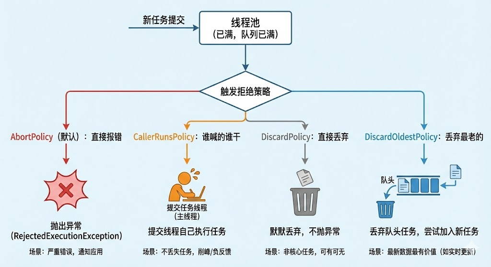

简单来说：**当线程池“忙不过来”（队列满 + 线程满）时，需要一种策略来处理新来的任务，JDK 内置了 4 种策略，分别对应“报错”、“自己干”、“直接丢”和“喜新厌旧”。**

### 一、 核心策略深度解析

在 `ThreadPoolExecutor` 中，提供了 4 个静态内部类来实现 `RejectedExecutionHandler` 接口：

1. **AbortPolicy（默认）：直接报错**
    1. **行为：** 抛出 `RejectedExecutionException` 运行时异常。
    2. **场景：** 也是最常用的。通常我们认为任务丢失是严重的错误，必须抛出异常通知上层应用进行干预。
2. **CallerRunsPolicy：谁喊的谁干**
    1. **行为：** 不用线程池的线程，而是让提交任务的那个线程（通常是主线程）自己去执行这个任务。
    2. **场景：****这个策略非常聪明。** 它有两个作用：第一，保证任务不丢失；第二，因为主线程去干活了，提交任务的速度自然就慢下来了，变相起到了“负反馈”或“削峰”的作用，给线程池喘息的时间。
3. **DiscardPolicy：直接丢弃**
    1. **行为：** 默默地丢弃这个任务，不抛异常，也不执行。
    2. **场景：** 适用于那些“可有可无”的任务，比如某些非核心的日志记录或统计数据，丢了也不心疼。
4. **DiscardOldestPolicy：丢弃最老的**
    1. **行为：** 丢弃队列里等待时间最长（队头）的那个任务，然后把新任务加进去。
    2. **场景：** 适用于此时此刻的数据才是最有价值的场景（比如传感器实时数据更新，旧数据没意义了）。

---

### 二、 面试标准回答

**当线程池的任务队列满了，且线程数也达到了最大值时，就会触发拒绝策略。JDK 默认提供了 4 种策略，我可以把它们总结为：**

第一种是 AbortPolicy：

这是线程池的默认策略。它的行为非常直接，就是抛出 RejectedExecutionException 异常。

- **适用场景：** 这种策略适合对任务完整性要求比较高的场景，抛出异常可以让开发人员及时感知到系统瓶颈并处理。

第二种是 CallerRunsPolicy：

这个策略的意思是“谁提交的任务，谁自己去执行”。比如主线程提交的任务，就由主线程自己跑。

- **适用场景：** 这是一种非常稳健的策略。它既能保证任务不丢失，又能降低任务提交的速度，给线程池一段缓冲时间。这在不允许丢数据的并发场景下很有用。

第三种是 DiscardPolicy：

它会直接丢弃新提交的任务，而且不抛出任何异常。

- **适用场景：** 适合那些不太重要、允许数据丢失的业务，比如某些非核心的日志采集。

第四种是 DiscardOldestPolicy：

它会丢弃队列里等待最久（也就是队头）的一个任务，然后尝试再次提交当前的新任务。

- **适用场景：** 适合关注“最新数据”的场景。**但要注意**，如果队列是优先级队列（PriorityBlockingQueue），这个策略会导致优先级最高的任务被丢弃，所以要慎用。
