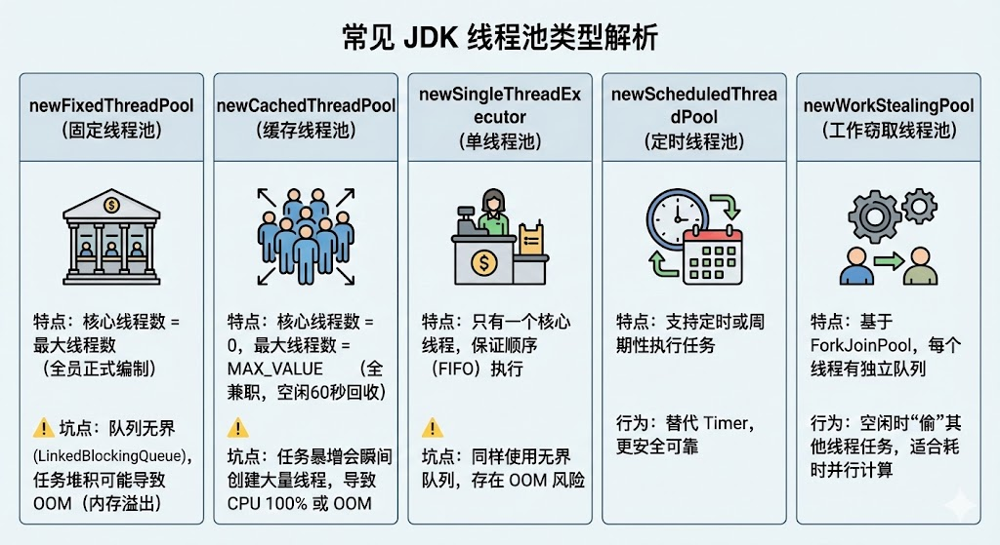

简单来说：**JDK 的** `**Executors**` **工具类提供了 4 种（JDK 8 后是 5 种）快捷创建线程池的方法，但在实际大规模生产中，我们通常都不直接用，而是手动创建。**

### 一、 常见类型深度解析

JDK 通过 `Executors` 工厂类提供了以下几种标准实现：

#### newFixedThreadPool

- **特点：** 核心线程数 = 最大线程数。
- **行为：** 就像一个没有任何临时工、全员正式编制的银行网点。线程数固定，即使空闲也不会回收。
- **坑点：** 它使用的任务队列是 `LinkedBlockingQueue`，且没有指定容量（默认为 `Integer.MAX_VALUE`）。如果任务堆积太快，队列会无限制增长，最终导致 **OOM**。

#### newCachedThreadPool

- **特点：** 核心线程数 = 0，最大线程数 = `Integer.MAX_VALUE`。
- **行为：** 就像一个完全由兼职人员组成的网点。来一个任务就招一个人，任务做完空闲 60 秒就辞退。
- **坑点：** 如果任务提交速度极快，它会瞬间创建成千上万个线程，导致 **CPU 100% 或 OOM**。

#### newSingleThreadExecutor

- **特点：** 只有一个核心线程，且保证所有任务按照指定顺序（FIFO）执行。
- **行为：** 就像只开了一个窗口。
- **坑点：** 和 `FixedThreadPool` 一样，它也用了无界队列，存在 **OOM 风险**。

#### newScheduledThreadPool

- **特点：** 支持定时或周期性执行任务。
- **行为：** 替代了老旧的 `Timer` 类，更安全可靠。

#### newWorkStealingPool

- **特点：** 基于 `ForkJoinPool` 实现，每个线程都有自己的队列。如果不忙，会去“偷”其他忙线程队列里的任务来干。适合非常耗时的并行计算。

---

### 二、 面试标准回答

**JDK 的** `**Executors**` **工具类主要提供了 4 种（JDK 8 之后是 5 种）常见的线程池：**

第一种是 FixedThreadPool：

它的核心线程数等于最大线程数。特点是线程数固定，适合负载比较重但任务量相对稳定的场景。

第二种是 CachedThreadPool：

它的特点是按需创建，没有核心线程，但最大线程数是无限的。适合执行大量、短时间的异步任务。

第三种是 SingleThreadExecutor：

它内部只有一个线程。适合需要保证任务按顺序执行的场景。

第四种是 ScheduledThreadPool：

它是用来替代 Timer 的，用于执行定时或周期性任务。

第五种是 JDK 8 引入的 WorkStealingPool：

它是基于 ForkJoinPool 实现的，适合处理很耗时的并行任务。
