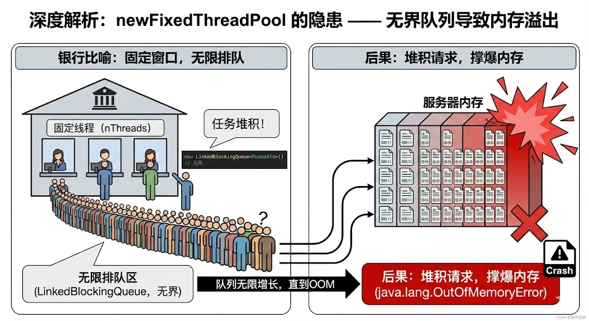
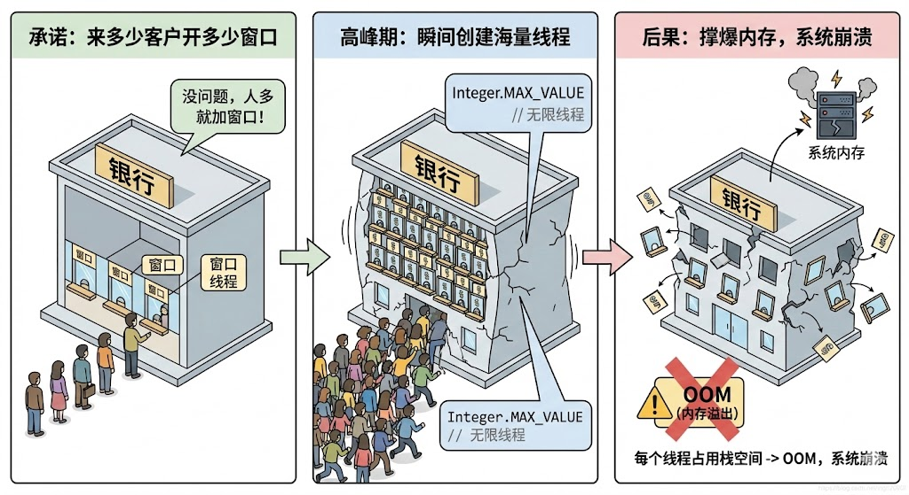

简单一句话总结：**JDK 自带的线程池为了“方便”，默认参数设置得太“宽容”（无界），这在生产环境中会导致内存溢出（OOM），直接搞垮服务器。**

---

### 一、 深度解析：到底哪里“不安全”？



阿里开发手册的这条规约，本质上是为了规避 **资源耗尽风险**。JDK 的 `Executors` 类提供的快捷创建方式，主要有两大隐患：

#### 堆积请求，撑爆内存

- **涉及对象：**`newFixedThreadPool` 和 `newSingleThreadExecutor`
- 这就好比一个银行，虽然只有固定几个窗口（线程），但它允许无限多的人在外面排队。
- 它们内部使用了 LinkedBlockingQueue，且没有指定容量。在 Java 中，如果不指定容量，默认就是 Integer.MAX_VALUE。

```
return new ThreadPoolExecutor(nThreads, nThreads,
                                  0L, TimeUnit.MILLISECONDS,
                                  new LinkedBlockingQueue<Runnable>()); // 注意这里：无界队列
}
```

- **后果：** 如果任务处理不过来，队列会无限增长，直到把服务器内存填满，导致 **java.lang.OutOfMemoryError**。

#### 创建海量线程，撑爆内存



- **涉及对象：**`newCachedThreadPool`
- 这就好比一个银行，承诺来多少客户就开多少窗口，根本不考虑大楼能不能装得下。
- 它的最大线程数参数被设置为 Integer.MAX_VALUE。

```
// 源码示意public static ExecutorService newCachedThreadPool() {
    return new ThreadPoolExecutor(0, Integer.MAX_VALUE, // 注意这里：无限线程60L, TimeUnit.SECONDS,
                                  new SynchronousQueue<Runnable>());
}
```

- **后果：** 在并发高峰期，如果任务提交速度很快，它会瞬间创建成千上万个线程。每个线程都要占用内存（栈空间），直接导致系统崩溃或 OOM。

---

### 二、 面试标准回答

**这个规定的核心目的是为了规避内存溢出（OOM）的风险，强制开发者手动进行“资源管控”。**

**JDK 提供的** `**Executors**` **工具类虽然方便，但它的默认策略在生产环境中是非常危险的，主要体现在两个方面：**

第一，是队列无界带来的风险。

像 FixedThreadPool 和 SingleThreadExecutor，它们底层使用的是 LinkedBlockingQueue，且没有限制容量。

- 如果消费端处理慢，或者数据库卡顿，任务会无限制地积压在队列里。
- 最终导致堆内存被占满，引发 **OOM**，整个服务宕机。

第二，是线程数无界带来的风险。

像 CachedThreadPool，它的最大线程数被设置成了 Integer.MAX_VALUE。

- 这意味着只要有请求来，它就创建线程。
- 在高并发场景下，瞬间创建几千上万个线程，不仅会把 CPU 资源耗尽在上下文切换上，更会直接因为内存不足而导致 **OOM**。

所以，阿里手册强制要求我们手动使用 ThreadPoolExecutor 的构造函数来创建线程池。
