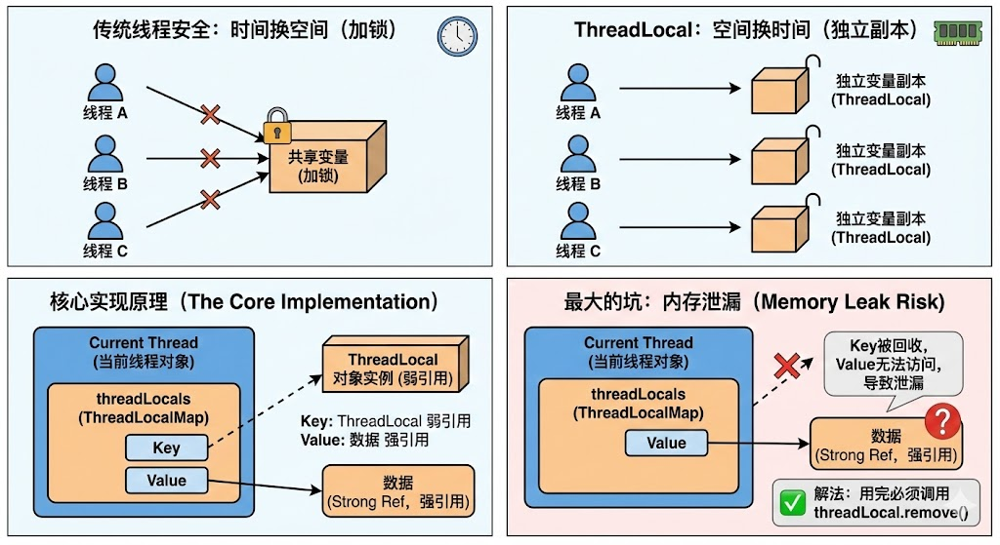

简单来说：**ThreadLocal 是给每个线程分配一个独立的“私有副本”，让大家各玩各的，互不干扰，从而避免了锁竞争。**

---

### 一、 核心原理深度解析

#### 什么是 ThreadLocal？

通常我们解决线程安全问题（比如多线程操作同一个变量），是靠 synchronized 加锁，这叫“时间换空间”。

而 ThreadLocal 是“空间换时间”：它给每个线程都发一份独立的变量副本。A 线程改了 A 的，B 线程改了 B 的，大家老死不相往来，自然就没有线程安全问题了。

#### 它是怎么实现的？

这是一个最大的误区。很多初学者以为 ThreadLocal 内部维护了一个 Map，Key 是线程，Value 是数据。**错！**

**真实情况是：**

- **每个 Thread 对象内部**，都有一个成员变量叫 `threadLocals`，它的类型是 `ThreadLocalMap`。
- **ThreadLocalMap** 本质上就是一个简易版的 HashMap。
- **存储方式：**
    - 当你调用 `threadLocal.set("data")` 时，其实是往**当前线程**的 `threadLocals` 里存入了一条数据。
    - **Key：** 是当前的 `ThreadLocal` 对象实例（而且是弱引用）。
    - **Value：** 是你要存的数据（强引用）。

#### 最大的坑：内存泄漏

由于 Map 中的 Key（ThreadLocal）是弱引用，而 Value 是强引用。

- **场景：** 如果 ThreadLocal 对象被回收了（Key 没了），但线程还活着（比如线程池里的核心线程），那么 Map 里的 Value 就会一直存在，却永远访问不到它。这就导致了内存泄漏。
- **解法：** 务必遵循“谁创建，谁销毁”的原则，用完后必须手动调用 `threadLocal.remove()`。

---

### 二、 面试标准回答

**ThreadLocal 可以理解为 Java 提供的一种“线程隔离”机制。**

首先，关于它的作用：

它为每个线程提供了一份独立的变量副本。也就是说，不同线程访问同一个 ThreadLocal 对象时，读写到的都是自己线程内部的私有数据，互不干扰。这在 Web 开发中很常见，比如我们可以用它在同一个线程内传递 UserID、Transaction或者 Session 信息，避免在方法参数里传来传去。

其次，关于它的底层实现，这里有一个常见误区：

数据其实不是存放在 ThreadLocal 这个实例里面的，而是存放在线程对象里面的。

- 在 `Thread` 类的源码中，有一个成员变量叫 `threadLocals`，类型是 `ThreadLocalMap`。
- 当我们调用 `threadLocal.set(value)` 时，本质上是获取当前线程的 Map，然后以 `ThreadLocal`**自己作为 Key**，以 value 作为值，存进去的。
- 当调用 `get()` 时，也是去当前线程的 Map 里，根据 Key 把值拿出来。

最后，使用它需要注意“内存泄漏”的问题：

因为 ThreadLocalMap 的 Key 是弱引用，但 Value 是强引用。如果线程是复用的（比如在线程池中），且 ThreadLocal 对象被回收了，Key 会变成 null，但 Value 还在内存中。如果不清理，这个 Value 就永远无法被访问也无法被回收。所以标准用法是 使用完 ThreadLocal 后，必须手动调用 remove() 方法来清理数据。
