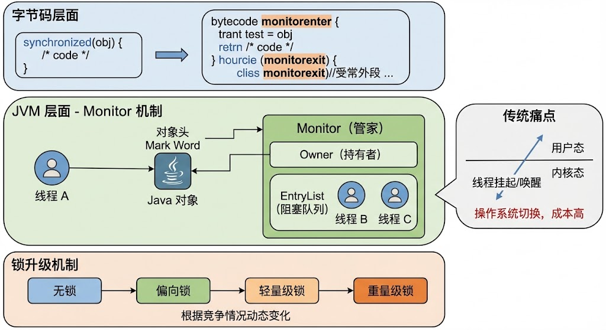

简单概括：`**synchronized**` **的底层是基于对象的 Monitor机制实现的。但在 JDK 1.6 之后，为了减少获得锁和释放锁带来的性能消耗，引入了“偏向锁”和“轻量级锁”进行优化，锁的状态会随着竞争情况逐渐升级。**

---

### 一、 核心原理深度解析

#### 字节码层面

如果你去反编译一段 synchronized 代码块，你会发现它被翻译成了两个核心指令：

- `**monitorenter**`：插入在同步代码块开始的位置，尝试获取对象的锁。
- `**monitorexit**`：插入在方法结束处和异常处，用于释放锁。
- *注：如果是 synchronized 方法，则是通过方法标志* `*ACC_SYNCHRONIZED*` *来实现的，但核心原理依然是 Monitor。*

#### JVM 层面

每个 Java 对象在内存中（对象头 Mark Word 部分）都关联了一个 **Object Monitor** 对象。

- Monitor 就像一个“管家”。当线程持有一个对象锁时，Monitor 中的 `Owner` 字段就会指向这个线程。
- 其他抢不到锁的线程，会被扔进 `EntryList` 队列中阻塞等待。
- **痛点：** 在 JDK 1.6 之前，Monitor 底层依赖操作系统的 **互斥量**。这意味着每次挂起和唤醒线程，都要从“用户态”切换到“内核态”，这个操作系统级别的切换成本非常高，所以以前我们叫它“重量级锁”。

#### 锁升级机制

为了解决上述性能问题，JVM 引入了**锁升级**流程。锁不再是一上来就是重量级的，而是根据竞争情况动态变化的：

- **无锁 -> 偏向锁 -> 轻量级锁 -> 重量级锁**

---

### 二、 面试标准回答

**synchronized 的底层实现可以从两个维度来理解：一个是字节码层面，一个是 JVM 的锁升级机制。**

首先，从字节码层面来看：

如果我们反编译 class 文件，会发现 synchronized 代码块的前后分别插入了 monitorenter 和 monitorexit 指令。

- 执行 `monitorenter` 时，线程会尝试获取对象关联的 **Monitor（监视器锁）**。
- 如果 Monitor 的计数器是 0，说明可以进入，计数器加 1，当前线程成为 Owner。
- 如果已经拥有锁，再次进入，计数器再加 1（也就是**可重入性**）。
- 执行 `monitorexit` 时，计数器减 1，减到 0 时释放锁。

其次，从底层和优化层面来看：

在 JDK 1.6 之前，synchronized 是完全依赖操作系统的 互斥锁 实现的。这就导致每次加锁解锁都需要在“用户态”和“内核态”之间切换，性能开销非常大，所以以前它叫“重量级锁”。

**但是，JDK 1.6 引入了“锁升级”机制，大大提升了性能。** 锁的状态会记录在对象的对象头中，根据竞争程度分为三种状态：

1. 偏向锁：
    1. 当只有一个线程访问同步块时，JVM 根本不需要通过操作系统加锁，只需要在对象头里记录一下这个线程 ID。下次这个线程再来，直接放行。这是最快的。
2. 轻量级锁：
    1. 如果有第二个线程开始竞争，偏向锁就会失效，升级为轻量级锁。这时候线程不会立刻阻塞，而是通过 CAS（自旋） 的方式尝试获取锁。如果执行时间短，自旋一下就拿到了，避免了线程切换。
3. 重量级锁：
    1. 如果自旋很久还没拿到，或者竞争非常激烈，锁就会最终升级为重量级锁。这时候才会真正去调用操作系统的 MutEx，把线程挂起阻塞。
