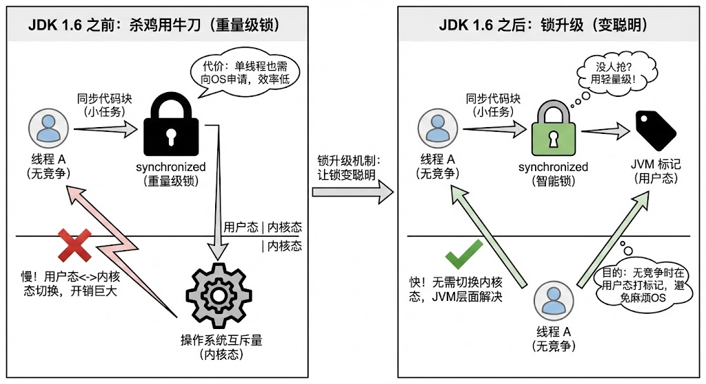
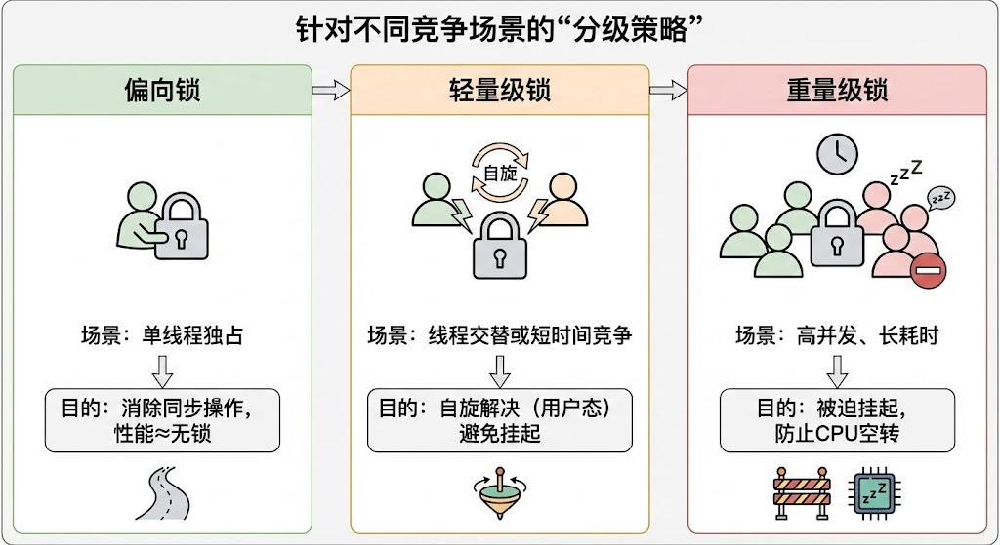

简单一句话总结：**锁升级的根本目的，是为了在锁竞争不激烈的情况下，避免使用操作系统级别的重量级锁，从而减少线程上下文切换带来的巨大性能消耗。**

---

### 一、 核心目的深度解析

要理解目的，得先知道没有升级机制前的代价。

#### 解决“杀鸡用牛刀”的问题

在 JDK 1.6 之前，`synchronized` 是重量级锁。哪怕只有一个线程在运行（根本没人和它抢），只要遇到 `synchronized`，JVM 就会去向操作系统申请互斥量。

- **代价：** 这会导致程序从 **用户态** 切换到 **内核态**。这个切换过程非常慢，甚至比执行业务代码本身的时间都要长。
- **目的：** 锁升级就是为了让锁“变聪明”。如果发现根本没人抢，就别去麻烦操作系统，在 JVM 层面（用户态）随便打个标记就把锁拿了。

#### 针对不同竞争场景的“分级策略”

JVM 开发团队通过数据发现：**绝大多数情况下，锁不仅不存在多线程竞争，而且总是由同一个线程多次获得。**

- **偏向锁的目的：** 针对“单线程独占”场景。消除连 CAS 都不需要的同步操作，性能几乎等同于无锁。
- **轻量级锁的目的：** 针对“线程交替执行”或“短时间竞争”场景。通过自旋在用户态解决问题，避免线程挂起。
- **重量级锁的目的：** 针对“高并发、长耗时”场景。当自旋也不管用时，为了防止空转消耗 CPU，才被迫挂起线程。

---

### 二、 面试标准回答

**JDK 1.6 引入锁升级机制，核心目的就是为了提升性能，减少“用户态”到“内核态”的上下文切换开销。**

**具体来说，它是为了适应三种不同的锁竞争场景，做到“按需分配”：**

第一，是为了优化“无竞争”的场景。

统计表明，很多时候锁是被同一个线程重复获取的。

- **目的：** 引入偏向锁，就是为了让这个线程在后续获取锁时，连 CAS 操作都不用做，只需要判断一下对象头里的 ID 是不是自己就行。这几乎消除了同步操作的所有开销。

第二，是为了优化“轻微竞争”的场景。

当有第二个线程来竞争，或者锁被交替访问时，直接挂起线程太重了。

- **目的：** 引入轻量级锁，利用 **CAS 自旋**，让线程在“门外”多转几圈等待锁释放。只要持有锁的线程很快释放，等待的线程就不用被挂起。这样做完全在**用户态**完成，避免了操作系统级别的切换。

第三，才是兜底的“强竞争”场景。

如果竞争非常激烈，或者持有锁的线程执行时间很长，自旋会白白消耗 CPU 资源。

- **目的：** 这时候升级为重量级锁，将等待线程阻塞（挂起），虽然切换成本高，但能避免 CPU 资源被无意义地浪费。
