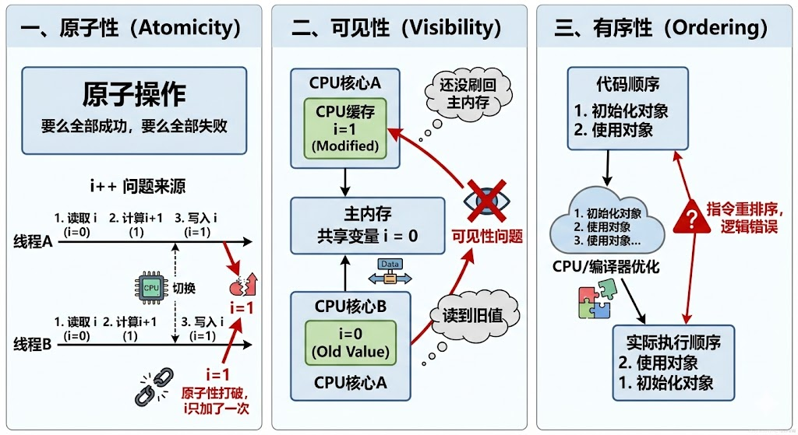

简单来说：**Java 并发编程的所有代码技巧，无非就是为了解决这三个问题：原子性、可见性、有序性。**

---

### 一、 核心原理解析

#### 原子性

- **概念：** 一个操作或者一组操作，要么全部执行成功，要么全部不执行，中间不能被打断。
- **问题来源：****线程切换**。
    - 比如最简单的 `i++`，在底层其实是三步走：1.读取 i；2.计算 i+1；3.写入 i。
    - 如果线程 A 读完 i，还没来得及加，CPU 切到了线程 B，B 也读了 i，结果两个人都加了 1，最后 i 只增加了一次。这就是原子性被打破了。

#### 可见性

- **概念：** 当一个线程修改了共享变量的值，其他线程能够立刻看到修改后的值。
- **问题来源：****CPU 缓存**。
    - 为了快，每个 CPU 核心都有自己的缓存。线程 A 把变量改了，其实是改在自己的缓存里，还没刷回主内存。此时线程 B 去读，读到的还是主内存里的旧值。

#### 有序性

- **概念：** 程序执行的顺序按照代码的先后顺序执行。
- **问题来源：****指令重排序**。
    - 编译器和 CPU 为了优化性能，经常会把指令顺序打乱（只要保证单线程结果不对就行）。
    - 但在多线程下，这种乱序会导致严重的逻辑错误（比如著名的单例模式双重检查锁问题，如果不加 volatile，对象可能还没初始化完就被拿去用了）。

---

### 二、 面试标准回答

**Java 并发编程主要围绕着三大核心特性展开，它们分别是原子性、可见性和有序性。这三个特性也对应了 JMM（Java 内存模型）想要解决的核心问题。**

第一是原子性：

它指的是一个操作是不可分割的，要么全做，要么全不做。

- **典型案例：** 就像经典的 `count++` 操作，它包含读取、修改、写入三个步骤。如果在多线程环境下，这三个步骤被 CPU 调度打断，就会导致数据丢失。
- **解决方案：** 在 Java 中，我们可以通过 `synchronized` 关键字或者 JUC 包下的 `Lock` 接口来保证原子性；对于简单的数值操作，也可以用 `AtomicInteger` (CAS 机制) 这种轻量级方案。

第二是可见性：

它指的是当一个线程修改了共享变量，其他线程能立刻感知到。

- **典型案例：** 由于每个线程都有自己的“工作内存”（对应 CPU 缓存），线程修改数据后可能只是改了缓存，还没同步回主内存。导致其他线程读到的还是旧数据。
- **解决方案：** 最常用的就是 `volatile` 关键字，它强制将修改的值立即刷回主内存，并让其他线程的缓存失效。当然，`synchronized` 和 `Lock` 在释放锁之前也会把变量同步回主内存，也能保证可见性。

第三是有序性：

它指的是程序按照代码书写的先后顺序执行。

- **典型案例：** 编译器和 CPU 为了优化性能，会进行“指令重排序”。这在单线程下没问题，但在多线程下（比如单例模式的双重检查锁）可能会导致线程拿到了一个“半初始化”的对象。
- **解决方案：** Java 提供了 `volatile` 关键字，通过插入“内存屏障”来禁止特定类型的指令重排序。此外，`synchronized` 也能间接保证有序性（因为加锁后变成了串行执行）。
