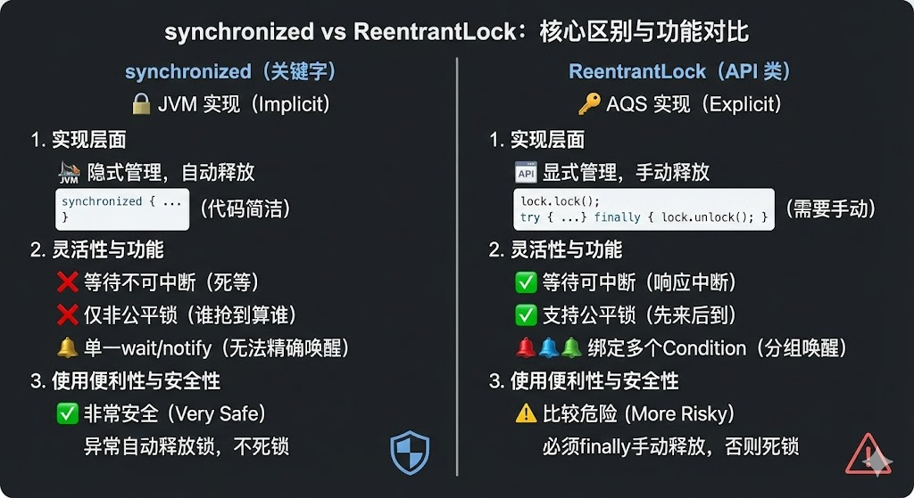

简单一句话总结：`**synchronized**` **是 JVM 层面的“自动挡”原生锁，简单省事但功能固定；**`**ReentrantLock**` **是 API 层面的“手动挡”工具锁，操作繁琐但功能强大灵活。**

---

### 一、 核心区别深度解析

#### 实现层面

- **synchronized**：它是 Java 语言的**关键字**，基于 JVM 实现。它的锁获取和释放是**隐式**的，由 JVM 自动管理，代码看起来非常简洁。
- **ReentrantLock**：它是 JDK 提供的 **API 类**，基于 AQS实现。它的锁获取和释放是**显式**的，你需要手动调用 `lock()` 和 `unlock()`。

#### 灵活性与功能

`ReentrantLock` 相比 `synchronized` 多了三项高级功能，这也是为什么我们需要它的原因：

- **等待可中断：**`synchronized` 一旦去抢锁，要么抢到，要么死等。而 `ReentrantLock` 提供了 `lockInterruptibly()`，允许在等待锁的时候响应中断，防止死锁。
- **支持公平锁：**`synchronized` 只能是非公平锁（谁抢到算谁的）。`ReentrantLock` 构造函数可以传 `true` 开启公平锁（先来后到，严格排队），虽然性能会下降，但在某些特定场景很有用。
- **绑定多个条件：**`synchronized` 配合 `wait/notify` 只能唤醒一个或全部等待线程，无法精确唤醒。而 `ReentrantLock` 可以绑定多个 `Condition` 对象，实现“分组唤醒”（比如只唤醒读线程，或只唤醒写线程），这在实现生产-消费者模型时非常强大。

#### 使用便利性与安全性

- **synchronized**：非常安全。出了异常 JVM 会自动释放锁，不会导致死锁。
- **ReentrantLock**：比较危险。必须在 `try-finally` 代码块的 `finally` 中手动释放锁。如果你忘了写 `unlock()`，或者在 `unlock()` 之前抛出了异常，锁就永远死在那了。

---

### 二、 面试标准回答

**这两者都是 Java 中可重入的阻塞锁，但在实现和功能上有 4 个核心区别：**

**第一，层级不同：**

- `synchronized` 是 Java 的**关键字**，是 JVM 层面的底层实现，通过 Monitor 对象完成。
- `ReentrantLock` 是 JDK 的 **API 类**，是基于 AQS实现的软件层面的锁。

**第二，使用方式不同：**

- `synchronized` 是**隐式锁**，自动加锁、自动解锁。即使发生异常，JVM 也会保证锁被释放，使用简单。
- `ReentrantLock` 是**显式锁**，必须手动调用 `lock()` 和 `unlock()`。**特别注意**：为了防止死锁，必须在 `finally` 代码块中释放锁。

第三，功能丰富度不同：

ReentrantLock 相比 synchronized 增加了三个高级功能：

1. **支持公平锁：**`synchronized` 只能是非公平的；`ReentrantLock` 可以通过构造参数设置为公平锁。
2. **支持等待可中断：** 使用 `lockInterruptibly()` 可以让正在等待锁的线程响应中断，放弃等待，避免死锁。
3. **支持多条件变量：**`synchronized` 只有一个等待队列（waitSet）；而 `ReentrantLock` 可以通过 `newCondition()` 创建多个条件队列，实现更精准的线程唤醒（比如只唤醒消费者）。

第四，性能上的区别：

在 JDK 1.6 之前，synchronized 性能很差。但 JDK 1.6 引入了偏向锁、轻量级锁等优化后，两者在性能上已经相差无几了。
